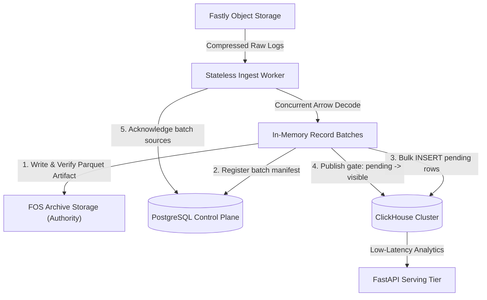

# System Architecture Reference
*Under the Hood of Fastly Object Storage Log Analysis*

This document provides a detailed technical overview of how the dashboard and ingest system are architected, how data flows through the application, and the internal design patterns used to maintain high performance, atomic crash safety, and strong security.

Two acronyms recur throughout: **FOS** = Fastly Object Storage (the S3-compatible bucket where raw logs and canonical archive batches land), and **NGWAF** = Fastly's Next-Gen WAF.

Architectural decisions are recorded under [`docs/adr/`](adr/) — see the [ADR index](adr/README.md) for the full list.

---

## 1. Unified Storage & Serving Layout

Fastly Log Analytics uses a single unified architecture across every deployment topology — from a 1-worker laptop Docker Compose setup (~2–4 GiB RAM with `HIGH_SCALE_WORKER_THREADS=1`, `HIGH_SCALE_MAX_BATCH_BYTES=6291456`, `HIGH_SCALE_MAX_BATCH_OBJECTS=10`) up to multi-node Kubernetes clusters sustaining 1,000,000 RPS bursts:

| Layer | Location / Connection | Purpose |
|---|---|---|
| **Raw Logs** | `s3://{bucket}/{prefix}/raw/request/**/*.{zst,gz}` and `.../raw/rum/**/*.{zst,gz}` | Immutable zstd-compressed (and gzipped) request and RUM JSON logs streamed directly from Fastly logging endpoints. v3 services use these roots exclusively; v2 services must be torn down and reprovisioned. |
| **Canonical Archive Storage** | `s3://{bucket}/{prefix}/archive/{domain}/...` | Merged, checksum-verified Parquet archive batches written by the stateless ingest worker (`python -m backend.high_scale.worker`). Serves as the durable off-box source of truth for replay and recovery. |
| **ClickHouse Analytical Store** | `CLICKHOUSE_URL` (default `http://clickhouse:8123` / `http://127.0.0.1:8123`, database `fla`) | Primary analytical serving store (`request_facts`, `rum_vitals`, `rum_errors`, projections, and least-privilege `fla_cv_*` SQL console views). Queries read only published (`visible`) batches. |
| **Admin State** | `s3://{bucket}/{prefix}/meta/admin_state.json` | Replicated metadata: `log_format_history`, `audit_logs`, `views`, `custom_fields` (not alerts — alerts are per-instance). Scoring matrix and history live beside it under `meta/`. |
| **Metadata & Control Plane** | PostgreSQL 16 (`METADATA_DSN`, mandatory — see [ADR-22](adr/22-postgres-only-metadata.md)) | Stores operational state (`alerts`, `views`, `audit_logs`, `cron_runs`, `sources`, `ingested_files`, `asn_names`, `slow_queries`, `usage_log`, `usage_log_hourly_summary`, `remote_invites`, `remote_sessions`, `remote_share_audit_logs`, `share_settings`, `share_tos_versions`, `ngwaf_bots`, `rdns`, `quarantine_evidence`) and ingest control-plane tables (`high_scale_source_ledger`, `high_scale_source_cursors`, `high_scale_partition_cursors`, `high_scale_archive_manifests`, `high_scale_publication_batches`). Schema lives in [`backend/core/metadata/pg_schema.py`](../backend/core/metadata/pg_schema.py) and [`backend/high_scale/postgres_control/`](../backend/high_scale/postgres_control/). |
| **Service Configs** | `configs/{logging_service_id}.json` | Per-service credentials, settings, and `log_fields` configuration (gitignored). |

### Module layout & shared helpers

The full backend package map and cross-cutting shared helpers (`cron_run`, `draft_version`, `mutate_config` / `cid_salt`, `escape_sql_literal`, `retry_call`, `BoundedTTLCache`, `date_utils`, `make_error` / `sse_response` / `WireSafeModel`) are cataloged in [AGENTS.md](../AGENTS.md#package-map) and [AGENTS.md §Shared Helpers](../AGENTS.md#shared-helpers).

### Analytical Serving Plane
All dashboard, domain analytics, session scoring, RUM, insights, alerts, and SQL console queries execute against ClickHouse via [`backend/high_scale/`](../backend/high_scale/) and [`backend/core/clickhouse/`](../backend/core/clickhouse/). Pure-Python response shaping, response caching (`BoundedTTLCache`), filter normalization, bot classification, and insight definitions live in [`backend/repositories/`](../backend/repositories/). Analysts using the SQL Console (`/query`) execute read-only ClickHouse queries strictly scoped to least-privilege `fla_cv_*` views (see [docs/runbooks/high-scale-analyst-console.md](runbooks/high-scale-analyst-console.md)).

### Health probe
`GET /api/health` is cheap liveness. `GET /api/health?deep=1` probes ClickHouse (`get_clickhouse_client().health()`), PostgreSQL 16 metadata/control-plane connectivity, FOS reachability, and per-service ingest freshness (`max(ingested_at) FROM ingested_files`, control-plane ledger state, and the latest terminal `log_discovery` cron run). It returns 503 when ClickHouse or PostgreSQL is unreachable or when any service is `degraded`: last ingest older than `stale_minutes` (default 30, widened per service to its own historical p95 gap between non-empty ingests so a low-traffic service's quiet periods don't false-positive), last discovery errored, or a discovery row stuck in `status='running'` past `_STUCK_SYNC_RUNNING_MINS`. Deep health requires authentication when `ADMIN_GATEWAY_REQUIRED=1`.

---

## 2. Stateless Ingest Pipeline & Atomic Publication Guarantees

Ingestion across all environments is driven by the stateless worker (`python -m backend.high_scale.worker`) coordinated by PostgreSQL 16 and serving through ClickHouse (see [ADR-16](adr/16-ingest-ledger.md), [ADR-21](adr/21-high-scale-serving-architecture.md), and the [capacity & recovery runbook](runbooks/high-scale-capacity-and-recovery.md)):

1. **FOS Archive as Canonical Authority:** FOS archive Parquet (`s3://{bucket}/{prefix}/archive/`) is the durable source of truth. All ClickHouse tables and projections can be reconstructed 100% from the archive manifests without retaining or re-fetching raw `.gz` / `.zst` logs.
2. **Batched Page Pipeline:** Ingestion processes bounded batches of objects (`HIGH_SCALE_MAX_BATCH_OBJECTS`, default 10 on lightweight workers, configurable up to 50–100; bounded by `HIGH_SCALE_MAX_BATCH_BYTES`, default 6 MiB) concurrently in Arrow memory, writing a single merged Parquet archive to FOS per batch. This amortizes the per-object PUT and checksum-verification overhead across the entire batch while keeping worker RSS under 2 GiB.
3. **Fenced Cursors:** Per-service, per-domain discovery cursors live in PostgreSQL (`high_scale_source_cursors`, `high_scale_partition_cursors`) under an owner epoch, so worker replicas cannot advance a cursor they no longer own.
4. **Order of Operations & Publication Gate:** Execution strictly enforces: Archive Write → Checksum Verify → Manifest Commit → Bulk ClickHouse INSERT (`pending`) → Count Check & Visibility Gate (`visible`) → PostgreSQL Batch Acknowledge. Readers query only `visible` rows; row-count mismatches or uncommitted writes are never exposed.
5. **Decoupled Batch Deletion:** Source deletions are queued and processed asynchronously using a verified manifest cache (`batch_{manifest_id}`), guaranteeing retention cleanup without stalling the ingest tick.
6. **RUM Dual-Domain Shared Object Handling:** Because `raw/rum/` objects can contain both Web Vitals (`rum_vitals`) and JS Errors (`rum_errors`), the claiming worker decodes both domains from the payload, publishes any sibling-domain rows under `build_batch_id_from_manifest_id(f"{manifest_id}:{sibling}")`, and verifies both before acknowledging the source ([AGENTS.md Trap #48](../AGENTS.md#48-a-shared-rawrum-object-belongs-to-one-domain-but-carries-both)).

RUM receipt identity is preserved as the string `req_id` in normalized events, canonical archives, and both `rum_vitals_facts` and `rum_error_facts`. It retains an explicit `req_id`, otherwise the logged `fastly_req_id` (already extracted from beacon query `req`), with query `req` as a fallback. One beacon can expand into several child rows with the same receipt identity; `req_id` is not a unique row key and does not replace `client_id` or the nullable UUID `request_event_id`. Legacy rows without it remain empty, including archive replay. The existing ClickHouse schema installer adds the column idempotently to both fact tables without backfilling identity; run schema installation before deploying the updated writer.

---

## 3. VCL Log Format & Custom Fields

Generated by `generate_log_format()` in [`backend/core/vcl_generator.py`](../backend/core/vcl_generator.py) from the registry in [`backend/core/catalog.py`](../backend/core/catalog.py) (`LOG_FIELD_CATALOG`, groups; presets in `presets.py`). Output is a single-line JSON VCL string. For the full catalog of field groups (`A`–`M` plus always-on Core HTTP), see [docs/features.md](features.md#log-field-configuration). A `METRICS` pseudo-group holds chart-metric-only synthetic fields ([AGENTS.md Trap #40](../AGENTS.md#40-metrics-group-catalog-fields-have-no-real-column)).

- `format_hash` — SHA-256 of the generated format; detects drift between deployed VCL and local config.
- `FASTLY_LOG_FORMAT_SAFE_MAX` (default 12,000 chars, env-overridable; Fastly's own limit is ~16 KiB) is enforced before deployment.
- `default_off` fields (e.g. `cookie_session`, group H) are excluded from `resolve_enabled_fields` even when their group is enabled; they need explicit per-field opt-in.
- `generate_capture_vcl()` in [`backend/provision/fastly_api.py`](../backend/provision/fastly_api.py) injects per-hook code (`recv`, `miss`, `pass`, `fetch`, `error`, `deliver`) populating log variables. The captured `ip` prefers a non-empty operator-set `req.http.Fastly-Client-IP` and falls back to `client.ip`; a priority `-100` recv snippet scrubs a client-forged `Fastly-Client-IP` at the true edge. Edge-hop detection is `fastly.ff.visits_this_service == 0`, a per-hop value a client cannot forge.
- `log_format_history` records format changes with before/after group lists, added/removed fields, and actor.
- **Custom fields:** Admins define VCL fields appended to the log format (`configs/{service_id}.json` → `log_fields.custom_fields[]`, schema v2; API `/api/services/{service_id}/custom-fields` in [`backend/routers/services/custom_fields.py`](../backend/routers/services/custom_fields.py)). Each custom expression is validated using the [`falco`](https://github.com/ysugimoto/falco) VCL linter when installed, falling back to regex checks otherwise.

---

## 4. Live Dashboard Sharing Architecture

The **Share Dashboard** feature allows administrators to invite read-only analysts to collaborate on log views over an HTTPS `public_endpoint` (direct hostname or direct IP) without copying log files or exposing storage credentials.

For the full admin and analyst specifications, endpoints, OAuth/OIDC login flow, `RemoteAccessMiddleware` isolation, and idle-timeout activity model, see:
- [docs/pages/admin/share.md](pages/admin/share.md) — Admin sharing control plane, invite/session management, OAuth/OIDC provider configuration, and security isolation layers.
- [docs/pages/share-login.md](pages/share-login.md) — Analyst authentication, claim links, and Terms of Service flow.
- [SECURITY.md](../SECURITY.md) — Role-based access control and PII masking policies.
