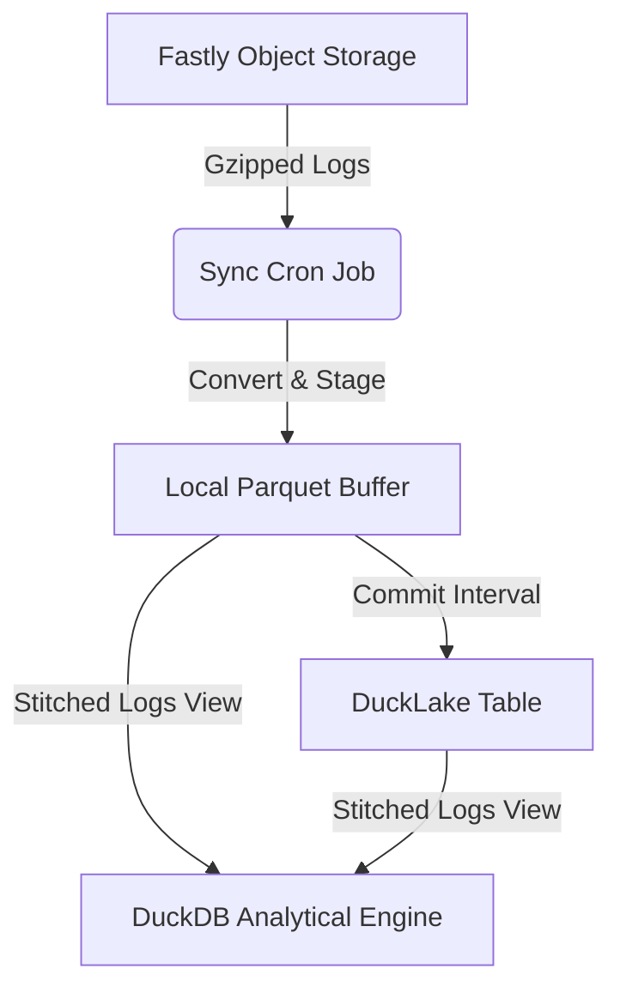
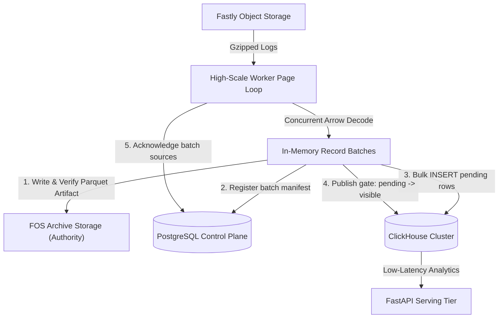

# System Architecture Reference
*Under the Hood of Fastly Object Storage Log Analysis*

This document provides a detailed technical overview of how the dashboard and ingest system are architected, how data flows through the application, and the internal design patterns used to maintain high performance, atomic crash safety, and strong security.

Two acronyms recur throughout: **FOS** = Fastly Object Storage (the S3-compatible bucket where raw logs land), and **NGWAF** = Fastly's Next-Gen WAF.

Architectural decisions are recorded under [`docs/adr/`](adr/) — see the [ADR index](adr/README.md) for the full list.

---

## 1. Directory & Storage Layout

The system uses a layered storage architecture to optimize for real-time query speed, long-term durable query planning, and transactional consistency of administrative state:

| Layer | Location / Connection | Purpose |
|---|---|---|
| **Raw Logs** | `s3://{bucket}/{prefix}/raw/request/**/*.gz` and `.../raw/rum/**/*.gz` | Immutable gzipped request and RUM JSON logs streamed directly from Fastly logging endpoints. v3 services use these roots exclusively; v2 services must be torn down and reprovisioned. |
| **Local Buffer** | `cache/{bucket}/` | Transient Parquet files stored locally during active ingestion before commit. |
| **DuckLake Table** | Catalog: Postgres DSN (`DUCKLAKE_CATALOG`, required in all modes — see [ADR-22](adr/22-postgres-only-metadata.md)); data: local disk under `/app/data/services/{service_id}/ducklake/` | Long-term transactional storage powered by DuckDB's DuckLake extension. All queried Parquet is local on NVMe/SSD for zero-latency scans. FOS is the raw-log ingress and the durable cloud copy: in Standard mode, [`backend/core/storage/backup.py`](../backend/core/storage/backup.py) pushes catalog-live Parquet to `{prefix}/ducklake/<path>` after every commit, and `python -m backend.provision.cli restore-data --service-id <id>` rebuilds local data from it ([AGENTS.md Trap #50](../AGENTS.md#50-the-standard-mode-cloud-copy-is-the-only-off-box-copy-of-committed-data)). |
| **Admin State** | `s3://{bucket}/{prefix}/meta/admin_state.json` | Replicated metadata: `log_format_history`, `audit_logs`, `views`, `custom_fields` (not alerts — alerts are per-instance). Scoring matrix and history live beside it under `meta/`. |
| **DuckDB Engine** | `data/services/{service_id}.duckdb` | Per-service analytical query engine (session-scoped `logs` view and temporary tables). |
| **Metadata & State Store** | PostgreSQL 16 (`METADATA_DSN`, mandatory across all deployment modes — see [ADR-22](adr/22-postgres-only-metadata.md)) | Stores `alerts`, `views`, `audit_logs`, `cron_runs`, `sources`, `ingested_files`, `asn_names`, `slow_queries`, `usage_log`, `usage_log_hourly_summary`, `remote_invites`, `remote_sessions`, `remote_share_audit_logs`, `share_settings`, `share_tos_versions`, `ngwaf_bots`, `rdns`, and other operational state (schema in [`backend/core/metadata/pg_schema.py`](../backend/core/metadata/pg_schema.py)). |
| **Service Configs** | `configs/{logging_service_id}.json` | Credentials, settings, and `log_fields` configuration (gitignored). |

### Module layout & shared helpers

The full backend package map and cross-cutting shared helpers (`cron_run`, `draft_version`, `mutate_config` / `cid_salt`, `escape_sql_literal`, `retry_call`, `BoundedTTLCache`, `date_utils`, `make_error` / `sse_response` / `WireSafeModel`) are cataloged in [AGENTS.md](../AGENTS.md#package-map) and [AGENTS.md §Shared Helpers](../AGENTS.md#shared-helpers).

### The Unified Logs View
To provide real-time query speed without waiting for a commit, the DuckDB `logs` view dynamically stitches the committed DuckLake table and the local transient Parquet buffers together. Callers run analytical queries against the `logs` view without needing to worry about the underlying storage state. With `DEPLOYMENT_MODE=high_scale`, serving uses ClickHouse (or ephemeral in-memory DuckDB over durable state) and never opens native service files or local buffers. `DEPLOYMENT_MODE=standard` (default) keeps synchronous ingest and file-backed serving. Both modes require `METADATA_DSN` and `DUCKLAKE_CATALOG`.

### Local-only Parquet compaction
Implemented in [`backend/core/storage/compaction.py`](../backend/core/storage/compaction.py) to keep dashboard scans fast without FOS write cost:
1. `local_compact` scans local cache dirs every 2 minutes (`LOCAL_COMPACT_INTERVAL_MIN`) and merges small hourly files into size-capped Parquet (default ≤ 256 MB) to preserve DuckDB parallelism.
2. A compact-on-sync thread merges immediately after a raw sync that produced multiple files.
3. Partitions older than 1 day (`LOCAL_COMPACT_DAILY_TIER_DAYS`) bin-pack into `daily_YYYY-MM-DD_<uuid>.parquet`; daily files older than 30 days bin-pack into `weekly/weekly_YYYY-WXX_<uuid>.parquet`. All files are capped at `_MAX_PARTITION_BYTES`.

Use local compaction for hot-tier dashboard performance; use `optimize` ([`docs/cron/jobs/optimize.md`](cron/jobs/optimize.md)) when compaction must also be reflected in FOS. Code that walks the local cache and deletes files not in a catalog must skip `compacted_*.parquet`, `daily/`, and `weekly/`.

### Health probe
`GET /api/health` is cheap liveness. `GET /api/health?deep=1` also verifies per-service ingest freshness (`max(ingested_at) FROM ingested_files` and the latest terminal `log_discovery` cron run) and returns 503 when any service is `degraded`: last ingest older than `stale_minutes` (default 30, widened per service to its own historical p95 gap between non-empty ingests so a low-traffic service's quiet periods don't false-positive), last discovery errored, a discovery row stuck in `status='running'` past `_STUCK_SYNC_RUNNING_MINS`, or the latest `commit` errored. Celery mode additionally derives freshness from `ingest_ledger` ([ADR-16](adr/16-ingest-ledger.md)). Postgres-only, never FOS or Fastly; safe for a load balancer. Deep health requires authentication when `ADMIN_GATEWAY_REQUIRED=1`.

---

## 2. Ingest Pipeline & Atomic Guarantees

There are two supported deployment modes selected by `DEPLOYMENT_MODE`: `standard` (synchronous DuckDB + DuckLake ingest) and `high_scale` (ClickHouse and dedicated micro-batching workers).

### Default mode: per-service APScheduler

The original model: one in-process `BackgroundScheduler` job per service performs sync, commit, compaction, optimization, and expiration on a fixed interval. This is the whole system for single-pod deployments and remains the default.

**Atomic Manifest & Crash Recovery** (write-ahead registry pattern, unchanged from earlier releases):

1.  **In-Flight Recording:** Before writing any staged Parquet files, a PostgreSQL table `ingest_in_flight` records the source filename, unique hash, and row counts.
2.  **Deterministic Buffering:** Staged Parquet files are named deterministically based on a SHA-256 hash of their sorted content (`batch_{sha256[:16]}.parquet`). If an ingest restarts or crashes mid-way, duplicate writes naturally overwrite the same file instead of creating redundant rows.
3.  **Commit Promotion:** Once the Parquet buffer is written successfully, the database transfers the records into `ingested_files` and clears the `ingest_in_flight` table.
4.  **Idempotent Auto-Recovery:** Upon any startup or tick cycle, the ingest system inspects left-over entries in the in-flight table. If the corresponding buffer exists, it is promoted; otherwise, it is dropped and queued for clean re-download on the next LIST tick.

### High-Scale Data Plane (`DEPLOYMENT_MODE=high_scale`)

For horizontally-scaled ingestion in Kubernetes clusters, `DEPLOYMENT_MODE=high_scale` uses ClickHouse (`backend/high_scale/`) and dedicated micro-batching workers (`backend/high_scale/worker.py`). In High-Scale mode RUM beacon discovery runs as `rum_discovery_{id}` with `ledger_rum_sweep_{id}` as its crash net (see [docs/cron/](cron/README.md) and [ADR-16](adr/16-ingest-ledger.md)).

### High-Scale Request Logs Architecture (ADR-21)

For high-volume services, the high-scale data plane (`backend/high_scale/`) ingests with dedicated workers and serves from ClickHouse, with strict durability and isolation guarantees (see the [high-scale runbooks](runbooks/high-scale-capacity-and-recovery.md)):

1. **FOS Archive as Canonical Authority:** FOS archive Parquet is the sole source of durable truth. All ClickHouse tables, projections, and aggregate rollups can be reconstructed 100% from the archive manifests without retaining or re-fetching raw `.gz` logs.
2. **Batched Page Pipeline:** Ingestion processes pages of objects (`HIGH_SCALE_PAGE_SIZE`, default 100) concurrently in Arrow memory, writing a single merged Parquet archive to FOS per page. This amortizes the per-object PUT and checksum-verification overhead across the whole page.
3. **Fenced Cursors:** Per-service, per-domain discovery cursors live in Postgres (`high_scale_source_cursors`, `high_scale_partition_cursors`) under an owner epoch, so worker replicas cannot advance a cursor they no longer own.
4. **Order of Operations & Publication Gate:** Execution strictly enforces: Archive Write → Checksum Verify → Manifest Commit → Bulk ClickHouse INSERT (`pending`) → Count Check & Visibility Gate (`visible`) → Postgres Batch Acknowledge. Readers query only `visible` rows; row-count mismatches or uncommitted writes are never exposed.
5. **Decoupled Batch Deletion:** Source deletions are queued and processed asynchronously using a verified manifest cache (`batch_{manifest_id}`), guaranteeing retention cleanup without stalling the ingest tick.

---

## 3. VCL Log Format & Custom Fields

Generated by `generate_log_format()` in [`backend/core/vcl_generator.py`](../backend/core/vcl_generator.py) from the registry in [`backend/core/catalog.py`](../backend/core/catalog.py) (`LOG_FIELD_CATALOG`, groups; presets in `presets.py`). Output is a single-line JSON VCL string. For the full catalog of field groups (`A`–`M` plus always-on Core HTTP), see [docs/features.md](features.md#vcl-log-format--field-groups). A `METRICS` pseudo-group holds chart-metric-only synthetic fields ([AGENTS.md Trap #40](../AGENTS.md#40-metrics-group-catalog-fields-have-no-real-column--exclude-them-from-every-per-field-rollup-writer)).

- `format_hash` — SHA-256 of the generated format; detects drift between deployed VCL and local config.
- `FASTLY_LOG_FORMAT_SAFE_MAX` (default 12,000 chars, env-overridable; Fastly's own limit is ~16 KiB) is enforced before deployment.
- `default_off` fields (e.g. `cookie_session`, group H) are excluded from `resolve_enabled_fields` even when their group is enabled; they need explicit per-field opt-in.
- `generate_capture_vcl()` in [`backend/provision/fastly_api.py`](../backend/provision/fastly_api.py) injects per-hook code (`recv`, `miss`, `pass`, `fetch`, `error`, `deliver`) populating log variables. The captured `ip` prefers a non-empty operator-set `req.http.Fastly-Client-IP` and falls back to `client.ip`; a priority `-100` recv snippet scrubs a client-forged `Fastly-Client-IP` at the true edge. Edge-hop detection is `fastly.ff.visits_this_service == 0`, a per-hop value a client cannot forge.
- `log_format_history` records format changes with before/after group lists, added/removed fields, and actor.
- **Custom fields:** Admins define VCL fields appended to the log format (`configs/{service_id}.json` → `log_fields.custom_fields[]`, schema v2; API `/api/services/{service_id}/custom-fields` in [`backend/routers/services/custom_fields.py`](../backend/routers/services/custom_fields.py)). Each custom expression is validated using the [`falco`](https://github.com/ysugimoto/falco) VCL linter when installed, falling back to regex checks otherwise.

---

## 4. Live Dashboard Sharing Architecture

The **Share Dashboard** feature allows administrators to invite read-only analysts to collaborate on log views over an HTTPS `public_endpoint` (direct hostname or direct IP) without copying log files or exposing storage credentials.

For the full admin and analyst specifications, endpoints, OAuth/OIDC login flow, `RemoteAccessMiddleware` isolation, and idle-timeout activity model, see:
- [docs/pages/admin/share.md](pages/admin/share.md) — Admin sharing control plane, invite/session management, OAuth/OIDC provider configuration, and security isolation layers.
- [docs/pages/share-login.md](pages/share-login.md) — Analyst authentication, claim links, and Terms of Service flow.
- [SECURITY.md](../SECURITY.md) — Role-based access control and PII masking policies.
