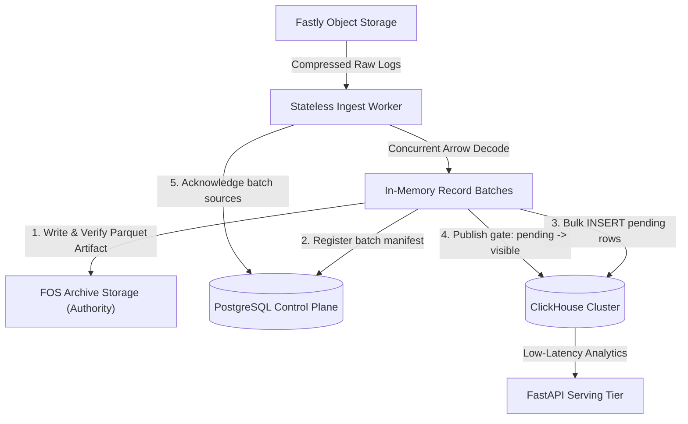
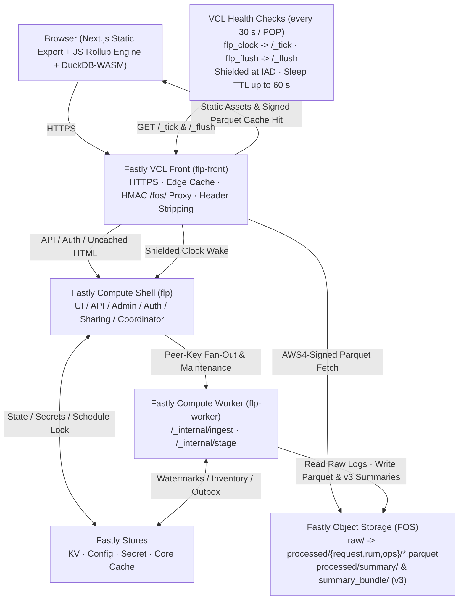

# System Architecture Reference
*Under the Hood of Fastly Log Analytics (High-Scale & Cloud Editions)*

This document provides a technical overview of both **Fastly Log Analytics** deployment editions — **High-Scale (Kubernetes / Docker)** and **Cloud (Serverless)** — including how data flows through each edition, storage authority, query execution, scheduling, security isolation, and resource naming.

Two acronyms recur throughout: **FOS** = Fastly Object Storage (the S3-compatible bucket where raw logs and Parquet datasets land), and **NGWAF** = Fastly's Next-Gen WAF.

Architectural decisions are recorded under [`docs/adr/`](adr/) — see the [ADR index](adr/README.md) for the full list.

---

## Editions at a Glance

| Dimension | Cloud (Serverless) Edition (`compute/cloud/`) | High-Scale Edition (Kubernetes / Docker) |
|---|---|---|
| **Compute / Serving Plane** | Fastly VCL Front (`flp-front`) + stateless Rust/Wasm Fastly Compute Shell (`flp`) & Worker (`flp-worker`) | Caddy / Ingress + Next.js Frontend + FastAPI Backend + horizontally scaled Python ingest workers |
| **Storage Authority** | Fastly Object Storage (FOS): immutable Parquet windows (`processed/request/`, `processed/rum/`, `processed/ops/`) + v3 rollup summaries & hour/day bundles; Fastly KV / Config / Secret Stores for state & secrets | Fastly Object Storage (FOS): checksum-verified canonical Archive Parquet (`archive/`); **ClickHouse** for analytical serving; **PostgreSQL 16** for operational metadata & ingest control plane |
| **Query Engine** | Browser **JS rollup engine** (`frontend/lib/cloud-engine/`) over v3 summaries for unfiltered views + in-browser **DuckDB-WASM** over edge-cached Parquet for filtered queries & `/query` SQL | Server-side **ClickHouse** MergeTree tables, minute projections (`performance_minute_dimensions`, etc.), and least-privilege `fla_cv_*` SQL console views |
| **Ingest Pipeline** | Coordinator on `flp` dispatches shard workers on `flp-worker` (`/_internal/ingest`) to convert raw `.zst`/`.gz` logs into Parquet windows + v3 summaries; `/_internal/stage` folds hour/day bundles, compacts, and sweeps retention | Stateless Python workers (`python -m backend.high_scale.worker`) with PostgreSQL fenced cursors: Arrow decode → FOS Archive Parquet → ClickHouse `pending` → `visible` atomic publication gate |
| **Scheduler / Heartbeat** | Autonomous VCL health checks (`flp_clock` → `/_tick`, `flp_flush` → `/_flush`) probing every **30 s** per POP (half shortest log period, clamped 1–30 s), shield-cached with Compute sleep TTL (up to 60 s idle); ingest cadence follows service `log_period` (≥ 60 s) with immediate self-continuation on backlog | In-process **APScheduler** jobs (`log_discovery`, `expire`, `metadata_cleanup`, `ledger_sweep`, `gap_heal`, etc.) alongside continuous worker polling loops |
| **Auth & Sharing** | WebAuthn passkeys (admin), per-analyst passcode/OIDC invites, signed HMAC CDN cookies (`__Host-flp_cdn`) for edge-verified Parquet & admin-shell caching | Admin gateway / local auth, live direct-mode HTTPS `public_endpoint` sharing with passcode or OAuth/OIDC invites, `RemoteAccessMiddleware` isolation, IP allowlists & PII masking |
| **Target Scale** | Zero-origin serverless analytics (1 monitored service per install; bounded by 32 backend calls / execution) | Single-host laptop Docker Compose (~2–4 GiB RAM, ~2,175 RPS/worker) up to multi-pod Kubernetes clusters sustaining 1,000,000 RPS bursts |

---

## 1. High-Scale Edition Architecture (Kubernetes / Docker)

The High-Scale edition uses a unified ClickHouse + PostgreSQL 16 + FOS Archive architecture across every container topology — from a 1-worker laptop Docker Compose setup (~2–4 GiB RAM with `HIGH_SCALE_WORKER_THREADS=1`, `HIGH_SCALE_MAX_BATCH_BYTES=6291456`, `HIGH_SCALE_MAX_BATCH_OBJECTS=10`) up to multi-node Kubernetes clusters sustaining 1,000,000 RPS bursts:

| Layer | Location / Connection | Purpose |
|---|---|---|
| **Raw Logs** | `s3://{bucket}/{prefix}/raw/request/**/*.{zst,gz}` and `.../raw/rum/**/*.{zst,gz}` | Immutable zstd-compressed (and gzipped) request and RUM JSON logs streamed directly from Fastly logging endpoints. v3 services use these roots exclusively; v2 services must be torn down and reprovisioned. |
| **Canonical Archive Storage** | `s3://{bucket}/{prefix}/archive/{domain}/...` | Merged, checksum-verified Parquet archive batches written by the stateless ingest worker (`python -m backend.high_scale.worker`). Serves as the durable off-box source of truth for replay and recovery. |
| **ClickHouse Analytical Store** | `CLICKHOUSE_URL` (default `http://clickhouse:8123` / `http://127.0.0.1:8123`, database `fla`) | Primary analytical serving store (`request_facts`, `rum_vitals`, `rum_errors`, minute projections including `performance_minute_dimensions` with mergeable latency sketches, and least-privilege `fla_cv_*` SQL console views). Queries read only published (`visible`) batches. |
| **Admin State** | `s3://{bucket}/{prefix}/meta/admin_state.json` | Replicated metadata: `log_format_history`, `audit_logs`, `views`, `custom_fields` (not alerts — alerts are per-instance). Scoring matrix and history live beside it under `meta/`. |
| **Metadata & Control Plane** | PostgreSQL 16 (`METADATA_DSN`, mandatory — see [ADR-22](adr/22-postgres-only-metadata.md)) | Stores operational state (`alerts`, `views`, `audit_logs`, `cron_runs`, `sources`, `ingested_files`, `asn_names`, `slow_queries`, `usage_log`, `usage_log_hourly_summary`, `remote_invites`, `remote_sessions`, `remote_share_audit_logs`, `share_settings`, `share_tos_versions`, `ngwaf_bots`, `rdns`, `quarantine_evidence`) and ingest control-plane tables (`high_scale_source_ledger`, `high_scale_source_cursors`, `high_scale_partition_cursors`, `high_scale_archive_manifests`, `high_scale_publication_batches`). Schema lives in [`backend/core/metadata/pg_schema.py`](../backend/core/metadata/pg_schema.py) and [`backend/high_scale/postgres_control/`](../backend/high_scale/postgres_control/). |
| **Service Configs** | `configs/{logging_service_id}.json` | Per-service credentials, settings, and `log_fields` configuration (gitignored). |

### Module layout & shared helpers

The full backend package map and cross-cutting shared helpers (`cron_run`, `draft_version`, `mutate_config` / `cid_salt`, `escape_sql_literal`, `retry_call`, `BoundedTTLCache`, `date_utils`, `make_error` / `sse_response` / `WireSafeModel`) are cataloged in [AGENTS.md](../AGENTS.md#package-map) and [AGENTS.md §Shared Helpers](../AGENTS.md#shared-helpers).

### Analytical Serving Plane & Local Storage Billing
All dashboard, domain analytics, session scoring, RUM, insights, alerts, and SQL console queries execute against ClickHouse via [`backend/high_scale/`](../backend/high_scale/) and [`backend/core/clickhouse/`](../backend/core/clickhouse/). Pure-Python response shaping, response caching (`BoundedTTLCache`), filter normalization, bot classification, and insight definitions live in [`backend/repositories/`](../backend/repositories/). Analysts using the SQL Console (`/query`) execute read-only ClickHouse queries strictly scoped to least-privilege `fla_cv_*` views (see [docs/runbooks/high-scale-analyst-console.md](runbooks/high-scale-analyst-console.md)).

- **Mergeable latency sketches (`performance_minute_dimensions`):** Unfiltered `/performance` URL and ASN percentile rankings read `performance_minute_dimensions`, which stores compact mergeable weighted latency sketches (`latency_sk_v Array(Float64)`, `latency_sk_w Array(UInt32)` in [`backend/high_scale/sql/performance_schema.sql`](../backend/high_scale/sql/performance_schema.sql)) evaluated with `quantilesExactWeightedArray(0.5, 0.95, 0.99)` (falling back to legacy request-weighted averages only when sketch arrays are empty).
- **Authoritative service-local storage billing:** `/api/usage/current-storage` integrates `StorageBillingInterval` records over the selected `[start, end)` range from PostgreSQL (`high_scale_source_objects`, `high_scale_archive_manifests`, and local cloud-copy deletion records) — covering live owned objects plus deleted objects still inside Fastly Object Storage's 30-day minimum billing window — producing `total_billed_gb_hours` independently of account-wide Fastly Platform metrics (see [docs/pages/usage-and-cost.md](pages/usage-and-cost.md)).

### Health probe
`GET /api/health` is cheap liveness. `GET /api/health?deep=1` probes ClickHouse (`get_clickhouse_client().health()`), PostgreSQL 16 metadata/control-plane connectivity, FOS reachability, and per-service ingest freshness (`max(ingested_at) FROM ingested_files`, control-plane ledger state, and the latest terminal `log_discovery` cron run). It returns 503 when ClickHouse or PostgreSQL is unreachable or when any service is `degraded`: last ingest older than `stale_minutes` (default 30, widened per service to its own historical p95 gap between non-empty ingests so a low-traffic service's quiet periods don't false-positive), last discovery errored, or a discovery row stuck in `status='running'` past `_STUCK_SYNC_RUNNING_MINS`. Deep health requires authentication when `ADMIN_GATEWAY_REQUIRED=1`.

### Stateless Ingest Pipeline & Atomic Publication Guarantees

Ingestion across all High-Scale environments is driven by the stateless worker (`python -m backend.high_scale.worker`) coordinated by PostgreSQL 16 and serving through ClickHouse (see [ADR-16](adr/16-ingest-ledger.md), [ADR-21](adr/21-high-scale-serving-architecture.md), and the [capacity & recovery runbook](runbooks/high-scale-capacity-and-recovery.md)):

1. **FOS Archive as Canonical Authority:** FOS archive Parquet (`s3://{bucket}/{prefix}/archive/`) is the durable source of truth. All ClickHouse tables and projections can be reconstructed 100% from the archive manifests without retaining or re-fetching raw `.gz` / `.zst` logs.
2. **Batched Page Pipeline:** Ingestion processes bounded batches of objects (`HIGH_SCALE_MAX_BATCH_OBJECTS`, default 10 on lightweight workers, configurable up to 50–100; bounded by `HIGH_SCALE_MAX_BATCH_BYTES`, default 6 MiB) concurrently in Arrow memory, writing a single merged Parquet archive to FOS per batch. This amortizes the per-object PUT and checksum-verification overhead across the entire batch while keeping worker RSS under 2 GiB.
3. **Fenced Cursors:** Per-service, per-domain discovery cursors live in PostgreSQL (`high_scale_source_cursors`, `high_scale_partition_cursors`) under an owner epoch, so worker replicas cannot advance a cursor they no longer own.
4. **Order of Operations & Publication Gate:** Execution strictly enforces: Archive Write → Checksum Verify → Manifest Commit → Bulk ClickHouse INSERT (`pending`) → Count Check & Visibility Gate (`visible`) → PostgreSQL Batch Acknowledge. Readers query only `visible` rows; row-count mismatches or uncommitted writes are never exposed.
5. **Decoupled Batch Deletion:** Source deletions are queued and processed asynchronously using a verified manifest cache (`batch_{manifest_id}`), guaranteeing retention cleanup without stalling the ingest tick.
6. **RUM Dual-Domain Shared Object Handling:** Because `raw/rum/` objects can contain both Web Vitals (`rum_vitals`) and JS Errors (`rum_errors`), the claiming worker decodes both domains from the payload, publishes any sibling-domain rows under `build_batch_id_from_manifest_id(f"{manifest_id}:{sibling}")`, and verifies both before acknowledging the source ([AGENTS.md Trap #48](../AGENTS.md#48-a-shared-rawrum-object-belongs-to-one-domain-but-carries-both)).

RUM receipt identity is preserved as the string `req_id` in normalized events, canonical archives, and both `rum_vitals_facts` and `rum_error_facts`. It retains an explicit `req_id`, otherwise the logged `fastly_req_id` (already extracted from beacon query `req`), with query `req` as a fallback. One beacon can expand into several child rows with the same receipt identity; `req_id` is not a unique row key and does not replace `client_id` or the nullable UUID `request_event_id`. Legacy rows without it remain empty, including archive replay. The existing ClickHouse schema installer adds the column idempotently to both fact tables without backfilling identity; run schema installation before deploying the updated writer.

---

## 2. Cloud (Serverless) Edition Architecture (`compute/cloud/`)

The Cloud Edition runs 100% on Fastly infrastructure with zero origin servers, no ClickHouse, and no PostgreSQL. A Fastly VCL front service terminates HTTPS and caches static assets and Parquet objects, two stateless Rust/Wasm Fastly Compute services (`flp` shell + `flp-worker`) handle control-plane APIs and background ingestion, Fastly Object Storage + Fastly Stores hold all data and state, and the user's browser executes analytics via a JS rollup engine and **DuckDB-WASM**.

### Fastly VCL Front (`compute/cloud/vcl/front/main.vcl`)
The front VCL delivery service is the sole public HTTPS entrypoint:
- **TLS, HTTP/3 & Rate Limiting:** Enforces HTTPS on all public paths, advertises HTTP/3 (`h3.alt_svc()`), emits `103 Early Hints` on top-level document navigations, and enforces edge rate limits (`auth_fail_rc`/`auth_fail_pb` penalty box and `auth_challenge_rc`) on auth, API, and Parquet paths.
- **Edge Caching:**
  - Immutable frontend bundles (`/_next/static/*`, versioned `/duckdb/<ver>/duckdb-*`): cached 1 year (`immutable`, `Surrogate-Key: flp-static`).
  - Geo & map assets (`/geo/asn-names.tsv`, `/geo/*`, `/duckdb/*`, `/maplibre-gl-*`): cached 24 h (`86400s`, `must-revalidate`, `Surrogate-Key: flp-static`).
  - Public HTML/RSC route shells: cached 60 s (`flp-html`), keyed by build SHA (`flp_build_hash`). Admin shells (`/admin`, `/logs`, `/provision`, `/log-fields`, `/services`) are cached 60 s only when an edge-verified admin HMAC cookie (`__Host-flp_cdn` / `flp_cdn`) validates (`x-flp-shell: admin`, `Vary: Cookie`).
  - **Signed Parquet delivery (`/api/file`, `/fos/...`):** Browser requests carrying a valid HMAC CDN cookie are authorized at the edge, rewritten to `/fos/{sid}/{key}`, AWS4-signed in `vcl_miss`/`vcl_pass` (`flp_fos_sign`), and cached for 24 h with 20 MiB segmented caching so repeat browser reads incur zero FOS Class B operations.
- **Inbound & Outbound Security Header Stripping:** At the true edge (`fastly.ff.visits_this_service == 0`), `vcl_recv` strips client-forged internal headers (`x-flp-front-key`, `x-flp-front-rl`, `x-flp-clock-secret`, `x-flp-worker-key`, `x-flp-tick`, `x-flp-tick-pass`, `x-flp-auth-fail`, `x-flp-api-file`, `x-flp-fos-service`, `x-flp-fos-bucket`, `x-flp-fos-region`, `x-flp-shell`, and non-clock `x-flp-continue`). `vcl_deliver` strips `Surrogate-Key`, all `x-flp-*` internal response headers (`x-flp-fos-bucket`, `x-flp-fos-region`, `x-flp-fos-service`, `x-flp-tick-ttl`, `x-flp-auth-fail`, `x-flp-worker-key`, `x-flp-clock-secret`, `x-flp-shell`, `x-flp-front-key`, `x-flp-front-rl`), `x-compress-hint`, and upstream S3 headers (`x-amz-id-2`, `x-amz-request-id`, `server`).

### Rust Fastly Compute Shell (`flp`) & Worker (`flp-worker`)
Cloud splits request serving and heavy background execution across two Rust/Wasm Compute services under [`compute/cloud/`](../compute/cloud/):
- **Shell (`flp`):** Stateless request router serving the frozen Next.js static export, `/api/*` control-plane/admin/usage/provisioning routes, WebAuthn passkey & analyst invite/OIDC authentication, signed CDN cookies, and the `/_tick` + `/_flush` coordinator. Each execution operates within Fastly's 32-backend-call budget, 64 Core Cache operation budget (`CACHE_OP_BUDGET`), and 40 s wall-time guard (under a 55 s Core Cache lease).
- **Worker (`flp-worker`):** Internal-only Compute service authenticated via mutual peer key (`x-flp-worker-key`; rejects `/_tick` with 403):
  - `/_internal/ingest`: Shard-parallel raw `.zst`/`.gz` download, JSON-to-Arrow/Parquet window conversion, and v3 rollup summary emission (with peer relay fan-out for high shard counts).
  - `/_internal/stage`: Round-robin maintenance stages (`retention_sweep`, `log_compact`, `delete_history`, `storage_reconcile` writing `ops:storage_inventory` snapshots, `summary_bundle` folding closed hours/days and rolling open-hour snapshots, `delete_data`) plus standalone `request_compact` / `rum_compact` passes.

### Health-Check Heartbeat & Clock Cadence
Compute only runs when a request arrives, so the front VCL service supplies its own heartbeat via two health checks attached to dummy backends (`flp_clock` → `GET /_tick` and `flp_flush` → `GET /_flush`; see [docs/cloud/crons/clock.md](cloud/crons/clock.md) and [docs/cloud/crons/README.md](cloud/crons/README.md)):
- **30 s per-POP heartbeat on Cloud:** Initial bootstrap (`compute/cloud/infra/provision.py`) creates both health checks at 1,000 ms, and the first reconcile (and every reconcile or log-settings save thereafter) sets `check_interval` on both checks to `clock_interval_ms` (`compute/cloud/src/admin/reconcile.rs`): half the shortest configured request/RUM log period, clamped to `1–30 s`. Because Cloud enforces a minimum `log_period` of 60 s, **every saved Cloud install probes every 30 s per POP** (~305K front requests/day across ~53 POPs, rather than ~9.1M/day at 1 s).
- **IAD Shield Caching & Sleep TTL:** Both clock routes shield at `iad-va-us`. Compute responds `200` immediately before running work (`Shell::clock_ack`) and sets `x-flp-tick-ttl` via `schedule::next_ttl_s`:
  - While idle with nothing due, Compute returns a **sleep TTL up to 60 s** (`REFRESH_S`), so the shield absorbs probes without invoking Compute every second.
  - While a lease is held or work is due, Compute returns the `1 s` minimum TTL floor.
- **Ingest Cadence Follows `log_period`:** Ingest does **not** run every second. The Core Cache dispatcher (`flp-sched-v1`) triggers request ingest once per configured `log_period` (≥ 60 s, `INGEST_GRACE_S = 0`) as soon as a period closes, and RUM ingest after `max(rum_log_period, 60) + 120 s`. Maintenance runs every 120 s (30 s while `summary_bundle` is catching up), and compaction runs every 30 s (10 s while behind).
- **Immediate Continuation on Backlog:** If a turn hits its call/wall budget with work remaining (`more_pending`), `Shell::continue_clock` calls `/_tick` (or `/_flush`) directly through the front with `x-flp-continue` and the CDN key (bypassing the shield cache, up to `MAX_CLOCK_CONTINUATIONS = 20`) so backlogs drain continuously without waiting for the next health-check probe.

### FOS Storage, Fastly Stores & Browser Query Engine
- **Fastly Object Storage (FOS):**
  - Raw logs (`raw/request/`, `raw/rum/`) are converted into immutable Parquet windows under `processed/{request,rum,ops}/`.
  - Alongside each request window, the worker writes a **v3 rollup summary** (`processed/summary/`), which `summary_bundle` folds into hour bundles (`hour_bundle=`), day bundles (`day_bundle=`), and rolling open-hour snapshots (`open_bundle=`) under `processed/summary_bundle/` ([`compute/cloud/src/ingest/summary.rs`](../compute/cloud/src/ingest/summary.rs), [`bundle.rs`](../compute/cloud/src/ingest/bundle.rs)).
  - v3 summaries carry additive, mergeable groups: `time_series`, `overview`, `all_fields` (+ `field_totals` and `all_fields_ip` HLL sketches), `sessions`, `dims`, `series5`, `series1`, `bins`, `assets`, `transport`, `origin`, `urls` (per-URL/ASN elapsed histograms + exact `urls/ttl_bucket` counts), `quality`, `filtered_rollups`, `sample` (uniform 300-row scatter sample), `header_ip`, `bot_ua`, `tls_fp`, `value`, and `proxy`.
- **Fastly Stores:**
  - **KV Store:** Durable control plane (`cron:state`, service configs, `ingest:watermark`, `ingest:compact_state`, `ops:storage_inventory` snapshots for service-local `StorageBillingInterval` cost accounting, `ops:ingest_files`, `logq_*` telemetry outbox, auth/share sessions & invites).
  - **Config Store:** Non-secret install wiring (`front_service_id`, store IDs, internal Compute/Worker hostnames).
  - **Secret Store:** Fastly API tokens, FOS access/secret keys, CDN/front/worker peer keys, and session signing secrets.
  - **Core Cache:** Ephemeral shield-local schedule lock (`flp-sched-v1`, `flp-flush-sched-v1`) and short-lived status caches.
- **Browser Engine (`frontend/lib/cloud-engine/`):**
  - Unfiltered analytics pages merge compact v3 rollup summaries and hour/day bundles in JavaScript (`performance-rollup.ts`, etc.) with zero raw Parquet reads.
  - Filtered queries, drill-downs, and the `/query` SQL console execute in-browser **DuckDB-WASM** directly against edge-cached Parquet windows (256-file / 64 MiB compressed scan limit; 256 MB DuckDB query memory budget; half-open `[start, end)` time windows).

---

## 3. Security & Opaque Resource Naming (SEC-22)

To prevent external enumeration or correlation of customer Fastly service IDs and install names via DNS or S3 bucket namespaces, both editions enforce **SEC-22 opaque resource naming** for newly provisioned system-generated resources:

- **96-bit CSPRNG Opaque Labels (`fla-<24hex>`):** Newly provisioned **FOS buckets**, **CDN proxy `.global.ssl.fastly.net` subdomain prefixes**, **session scorer `.edgecompute.app` domains**, **Terraform defaults**, and **Cloud internal Compute (`flp`) & Worker (`flp-worker`) `.edgecompute.app` domains** default to independent 96-bit CSPRNG labels (`fla-<24 lowercase hex chars>`, generated via [`backend/provision/opaque_names.py`](../backend/provision/opaque_names.py) on High-Scale and `compute/cloud/infra/provision.py` / `compute/cloud/src/admin/{fos,scoring}.rs` on Cloud).
- **Persist-Before-Create & Collision Retry:** Generated names are persisted to local config / inventory / KV *before* issuing the remote Fastly or FOS creation call, and retried up to 5 times with a fresh CSPRNG label on HTTP `409` (or S3 `BucketAlreadyExists`/`403`) collisions.
- **Backward Compatibility & Explicit Operator Domains:** Existing legacy installs keep their previously persisted bucket and domain names unchanged across reconciles and deploys. Explicit operator- or user-supplied public front domains, share domains, and custom bucket names are always preserved as specified.
- **Public Proxy Header Stripping:** Both the High-Scale SSR proxy (`frontend/lib/apiSsrProxy.ts`) and the Cloud VCL front (`compute/cloud/vcl/front/main.vcl`) strip internal routing, surrogate-key, and upstream storage headers before responses leave the edge.

---

## 4. VCL Log Format & Custom Fields

Generated by `generate_log_format()` in [`backend/core/vcl_generator.py`](../backend/core/vcl_generator.py) from the registry in [`backend/core/catalog.py`](../backend/core/catalog.py) (`LOG_FIELD_CATALOG`, groups; presets in `presets.py`). Output is a single-line JSON VCL string. For the full catalog of field groups (`A`–`M` plus always-on Core HTTP), see [docs/features.md](features.md#log-field-configuration). A `METRICS` pseudo-group holds chart-metric-only synthetic fields ([AGENTS.md Trap #40](../AGENTS.md#40-metrics-group-catalog-fields-have-no-real-column)).

- `format_hash` — SHA-256 of the generated format; detects drift between deployed VCL and local config.
- `FASTLY_LOG_FORMAT_SAFE_MAX` (default 12,000 chars, env-overridable; Fastly's own limit is ~16 KiB) is enforced before deployment.
- `default_off` fields (e.g. `cookie_session`, group H) are excluded from `resolve_enabled_fields` even when their group is enabled; they need explicit per-field opt-in.
- `generate_capture_vcl()` in [`backend/provision/fastly_api.py`](../backend/provision/fastly_api.py) injects per-hook code (`recv`, `miss`, `pass`, `fetch`, `error`, `deliver`) populating log variables. The captured `ip` prefers a non-empty operator-set `req.http.Fastly-Client-IP` and falls back to `client.ip`; a priority `-100` recv snippet scrubs a client-forged `Fastly-Client-IP` at the true edge. Edge-hop detection is `fastly.ff.visits_this_service == 0`, a per-hop value a client cannot forge.
- `log_format_history` records format changes with before/after group lists, added/removed fields, and actor.
- **Custom fields:** Admins define VCL fields appended to the log format (`configs/{service_id}.json` → `log_fields.custom_fields[]`, schema v2; API `/api/services/{service_id}/custom-fields` in [`backend/routers/services/custom_fields.py`](../backend/routers/services/custom_fields.py)). Each custom expression is validated using the [`falco`](https://github.com/ysugimoto/falco) VCL linter when installed, falling back to regex checks otherwise.

---

## 5. Live Dashboard Sharing Architecture

The **Share Dashboard** feature allows administrators to invite read-only analysts to collaborate on log views over an HTTPS `public_endpoint` (direct hostname or direct IP on High-Scale, or the Cloud front HTTPS domain on Cloud) without copying log files or exposing storage credentials.

For the full admin and analyst specifications, endpoints, OAuth/OIDC login flow, `RemoteAccessMiddleware` isolation, and idle-timeout activity model, see:
- [docs/pages/admin/share.md](pages/admin/share.md) — Admin sharing control plane, invite/session management, OAuth/OIDC provider configuration, and security isolation layers.
- [docs/pages/share-login.md](pages/share-login.md) — Analyst authentication, claim links, and Terms of Service flow.
- [SECURITY.md](../SECURITY.md) — Role-based access control and PII masking policies.
