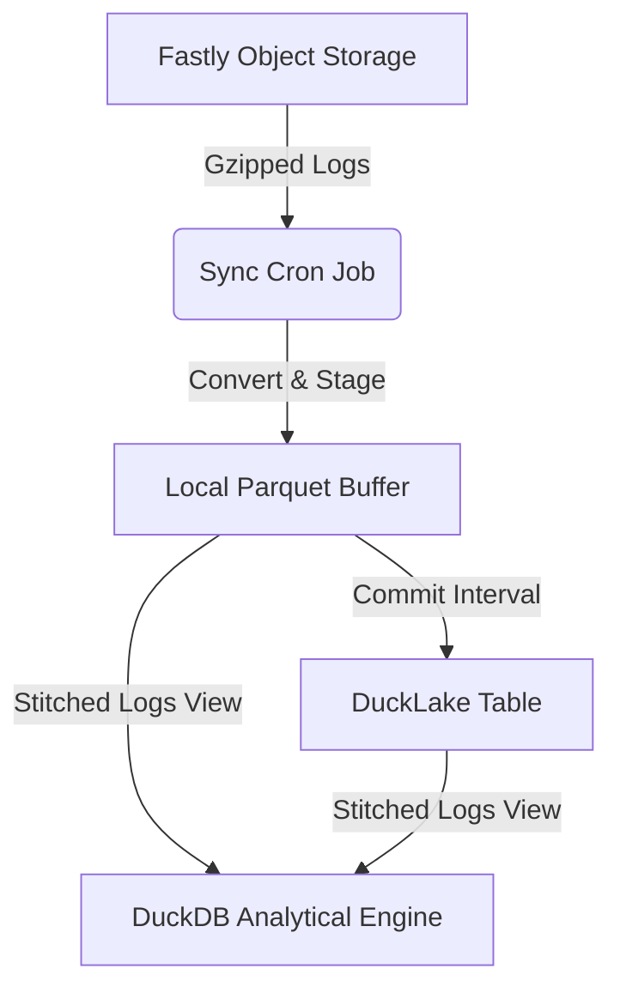
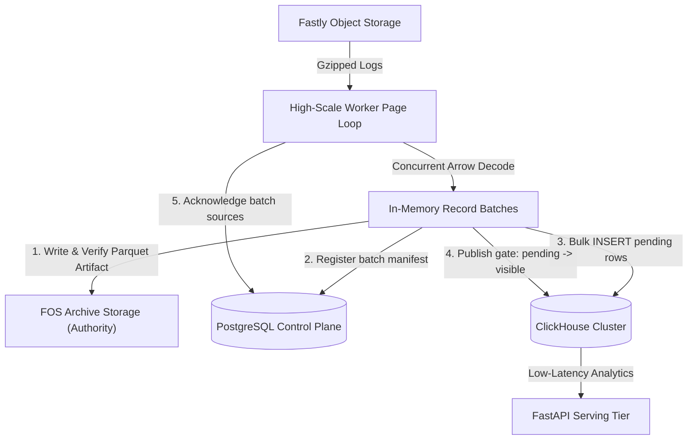

# System Architecture Reference
*Under the Hood of Fastly Object Storage Log Analysis*

This document provides a detailed technical overview of how the dashboard and ingest system are architected, how data flows through the application, and the internal design patterns used to maintain high performance, atomic crash safety, and strong security.

Two acronyms recur throughout: **FOS** = Fastly Object Storage (the S3-compatible bucket where raw logs land), and **NGWAF** = Fastly's Next-Gen WAF.

Architectural decisions are recorded under [`docs/adr/`](adr/) — see the [ADR index](adr/README.md) for the full list.

---

## 1. Directory & Storage Layout

The system uses a layered storage architecture to optimize for real-time query speed, long-term durable query planning, and transactional consistency of administrative state:

| Layer | Location / Connection | Purpose |
|---|---|---|
| **Raw Logs** | `s3://{bucket}/{prefix}/raw/request/**/*.gz` and `.../raw/rum/**/*.gz` | Immutable gzipped request and RUM JSON logs streamed directly from Fastly logging endpoints. v3 services use these roots exclusively; v2 services must be torn down and reprovisioned. |
| **Local Buffer** | `cache/{bucket}/` | Transient Parquet files stored locally during active ingestion before commit. |
| **DuckLake Table** | Catalog: Postgres DSN (`DUCKLAKE_CATALOG`, required in all modes — see [ADR-22](adr/22-postgres-only-metadata.md)); data: local disk under `/app/data/services/{service_id}/ducklake/` | Long-term, transactional storage powered by DuckDB's DuckLake extension. All queried parquet data is stored locally on NVMe/SSD disk for instant analytical queries with 0 network latency. FOS / S3 serves as the edge ingress destination for raw `.gz` logs as well as the durable cloud backup/sync store for periodic commits (every `commit_interval_mins`), archive Parquet, and synchronized admin state. |
| **Admin State** | `s3://{bucket}/{prefix}/meta/admin_state.json` | Replicated metadata: views, custom fields, audit logs, and log format history. |
| **DuckDB Engine** | `data/services/{service_id}.duckdb` | Per-service analytical query engine (compiles temporary tables and unified `logs` view). |
| **Metadata & State Store** | PostgreSQL 16 (`METADATA_DSN`, mandatory across all deployment modes — see [ADR-22](adr/22-postgres-only-metadata.md)) | Stores alerts, views, crons, ingested-file manifests, usage logs, live share invites/sessions, and the NGWAF bot cache. Eliminates all file lock contention. |

### Module layout

Storage subsystems live as cohesive packages rather than monoliths:

- **DuckLake engine** — [`backend/core/storage/`](../backend/core/storage/): split into `catalog.py` (DuckLake catalog attach, secret management, table DDL/migrations, `ducklake_table_name`), `view.py` (`logs` view stitching, schema evolution, `execute_with_stale_view_retry`), `buffer.py` (local Parquet buffer staging and promotion), `compaction.py` (local hourly/daily/weekly compaction and DuckLake `optimize_table` / `run_cloud_maintenance`), and `backup.py` (durable FOS cloud push/restore), with `_core.py` and `__init__.py` re-exporting the full surface via `install_shim_module` (`backend/utils/module_shim.py`).
- **Celery/ledger ingest** — [`backend/core/ingest/`](../backend/core/ingest/) (`discovery.py`, `parser.py`, `writer.py`, `batch_worker.py`, `__init__.py`): `discover_prefix`/`convert_batch_objects`/`convert_object`/`sweep_ledger_once`/`finalize_committed_raw` (with RUM beacon ingestion in [`backend/core/rum_ingest.py`](../backend/core/rum_ingest.py) and Faro SDK bundle/version discovery in [`backend/core/faro_versions.py`](../backend/core/faro_versions.py)), the state-machine functions behind the `ingest_ledger` table. See [ADR-16](adr/16-ingest-ledger.md).
- **Per-service metadata** — [`backend/core/metadata/`](../backend/core/metadata/): focused submodules (`pg_pool`, `pg_schema`, `admin_state`, `alerts_db`, `state_sync` re-exported via `base.py`; `cron_runs`, `fos_usage`, `slow_queries_db` re-exported via `usage_log.py`; `ingest_log` and `quarantine_evidence`; and `ingest_ledger`), all synced via `install_shim_module`.
- **Other packages** — `backend/routers/` (one module per domain; packages `admin/`, `services/`, `session_scoring/`, `share_admin/`, `rum/`), `backend/repositories/` (SQL per domain plus `rollup_executor/`, `insights/`, `security/`, `sessions/`), `backend/core/rollups/` (hourly/daily rollup writers and bundles), `backend/cron/` (`scheduler/` and `jobs/`), `backend/provision/` (orchestrators, CLI, `declarative/` reconciler, `session_scoring/`), `backend/high_scale/` (ClickHouse data plane: `archive/`, `postgres_control/`, `ingest_controller/`, `insights/`, `worker.py`, domain readers), and `backend/utils/` (`telemetry/`, `tunnel/`, `bot_sources/`, `remote_access.py`, `router_utils.py`). [CONTRIBUTOR_GUIDE.md](../CONTRIBUTOR_GUIDE.md#architecture) carries the full package map.

Each package's `__init__.py` re-exports the full public surface for backward compatibility; the import-shim mechanics are documented in [CONTRIBUTOR_GUIDE.md](../CONTRIBUTOR_GUIDE.md) and [MONKEYPATCHES.md](../MONKEYPATCHES.md).

### Shared backend helpers
Cross-cutting patterns have one owner each; new code uses them instead of re-deriving the pattern (see [Contributor Reference, Shared Helpers](../CONTRIBUTOR_GUIDE.md#shared-helpers)).

| Concern | Owner | What it guarantees |
|---|---|---|
| Cron run lifecycle | [`backend/cron/scheduler/`](../backend/cron/scheduler/) (`lifecycle.py` re-exported via `scheduler/__init__.py`) `cron_run`, `record_skip_row`; `CronLeaseHeldError` in [`cron_runs.py`](../backend/core/metadata/cron_runs.py) | Lease, progress, terminal `cron_runs` row and finalize backstops for every job. A held lease is a clean skip, never an error. |
| Fastly draft versions | [`backend/provision/cli.py`](../backend/provision/cli.py) (`draft_version`) | Clone, mutate, validate, activate, with rollback to the base version on failure. |
| Service config writes | `backend/config.py` `mutate_config` / `config_lock` / `snapshot_config` | Cross-process locked read-modify-write, atomic save, write-once cid salt. |
| SQL literals and identifiers | `core/sql_validator` (`escape_sql_literal`, `require_safe_ident`), `core/metric_expressions` | One quote-escaping routine, one bare-identifier validator, shared null-default and metric SQL fragments. |
| Retry | [`backend/core/retry.py`](../backend/core/retry.py) `retry_call` | Bounded exponential backoff with an explicit retryable predicate; mechanics only (see [ADR-09](adr/09-error-handling.md)). |
| Caches | `utils/bounded_cache` (`BoundedTTLCache`, `CacheRegistry`) | Thread-safe LRU+TTL caches (`cachetools.TTLCache` + `threading.RLock`), drained between tests through the registry. |
| Dates | `utils/date_utils` | UTC-aware parsing of ISO strings and `YYYY-MM-DD[-HH]` partition keys; raw parsing is ratcheted by `make dateparse-guard`. |
| HTTP layer | `utils/error_utils` (`make_error`, `raise_internal`), `utils/sse` (`sse_response`), `utils/router_utils`, `utils/telemetry` (`log_once_per`, redaction), `models/common` (`WireSafeModel`, `PassthroughModel`, `JsonRows`) | Unified error envelope with redaction, 400 `service_id_required`, SSE framing, throttled logging, typed responses with an unchanged wire shape. |

Ratchet gates keep these honest: `make retry-guard`, `coalesce-guard`, `dateparse-guard` and `urllib-guard` allow only a per-file baseline of pre-existing sites, and the baselines only go down.

### The Unified Logs View
To provide real-time query speed without waiting for a commit, the DuckDB `logs` view dynamically stitches the committed DuckLake table and the local transient Parquet buffers together. Callers run analytical queries against the `logs` view without needing to worry about the underlying storage state.

### Service Config Locking & the cid Salt
Service configs are plain JSON files under the configs volume. Every read-modify-write goes through `backend.config.mutate_config` (fresh read, mutate in place, atomic save; routers use `backend.utils.router_utils.mutate_service_config`, which maps a missing config to the standard 404), which holds a per-service `flock` sidecar lock so uvicorn workers, Celery workers and pods sharing the volume serialize. Lock acquisition is non-blocking with bounded backoff (5 s, then `ConfigLockTimeout`), re-entrant per thread (a `mutate` callback may call `save_config`/`mutate_config` for the same service; the outer save lands last), and If the lock cannot be taken at all (read-only filesystem, no `fcntl`) writes proceed unlocked, an error is logged once per process, and `/api/admin/health` reports `config_lock_degraded: true`.

The pseudonymous-client-id (`cid`) salt is **write-once**. `save_config` re-adopts the persisted salt on every write, so a stale writer or a hand-edited payload cannot re-key every cid. If the config file exists but cannot be read, the save is aborted (`CidSaltReadError`) rather than minting a new salt. Rotation is therefore intentionally impossible through `save_config`; only `mutate_config(..., allow_cid_salt_change=True)` can replace it, and no route or helper in this tree uses that flag. Changing the salt would change every cid hash from that point on (historical rows keep the old hashes).

Multi-step changes that must be undone as a unit (the declarative IaC reconcile) capture `snapshot_config(service_id)` (raw persisted text) and restore from it through `mutate_config`, so the persisted cid salt is re-adopted on rollback. Nothing writes a service config with a raw `write_text`.

---

## 2. Ingest Pipeline & Atomic Guarantees

There are two supported deployment modes selected by `DEPLOYMENT_MODE`: `standard` (synchronous DuckDB + DuckLake ingest) and `high_scale` (ClickHouse and dedicated micro-batching workers).

### Default mode: per-service APScheduler

The original model: one in-process `BackgroundScheduler` job per service performs sync, commit, compaction, optimization, and expiration on a fixed interval. This is the whole system for single-pod deployments and remains the default.



**Atomic Manifest & Crash Recovery** (write-ahead registry pattern, unchanged from earlier releases):

1.  **In-Flight Recording:** Before writing any staged Parquet files, a PostgreSQL table `ingest_in_flight` records the source filename, unique hash, and row counts.
2.  **Deterministic Buffering:** Staged Parquet files are named deterministically based on a SHA-256 hash of their sorted content (`batch_{sha256[:16]}.parquet`). If an ingest restarts or crashes mid-way, duplicate writes naturally overwrite the same file instead of creating redundant rows.
3.  **Commit Promotion:** Once the Parquet buffer is written successfully, the database transfers the records into `ingested_files` and clears the `ingest_in_flight` table.
4.  **Idempotent Auto-Recovery:** Upon any startup or tick cycle, the ingest system inspects left-over entries in the in-flight table. If the corresponding buffer exists, it is promoted; otherwise, it is dropped and queued for clean re-download on the next LIST tick.

### High-Scale Data Plane (`DEPLOYMENT_MODE=high_scale`)

For horizontally-scaled ingestion in Kubernetes clusters, `DEPLOYMENT_MODE=high_scale` uses ClickHouse (`backend/high_scale/`) and dedicated micro-batching workers (`backend/worker_main.py`). In High-Scale mode RUM beacon discovery runs as `rum_discovery_{id}` with `ledger_rum_sweep_{id}` as its crash net (see [docs/cron/](cron/README.md) and [ADR-16](adr/16-ingest-ledger.md)).

### High-Scale Request Logs Architecture (ADR-21)

For high-volume services, the high-scale data plane (`backend/high_scale/`) ingests with dedicated workers and serves from ClickHouse, with strict durability and isolation guarantees (see the [high-scale runbooks](runbooks/high-scale-capacity-and-recovery.md)):



1. **FOS Archive as Canonical Authority:** FOS archive Parquet is the sole source of durable truth. All ClickHouse tables, projections, and aggregate rollups can be reconstructed 100% from the archive manifests without retaining or re-fetching raw `.gz` logs.
2. **Batched Page Pipeline:** Ingestion processes pages of objects (`HIGH_SCALE_PAGE_SIZE`, default 100) concurrently in Arrow memory, writing a single merged Parquet archive to FOS per page. This amortizes the per-object PUT and checksum-verification overhead across the whole page.
3. **Fenced Cursors:** Per-service, per-domain discovery cursors live in Postgres (`high_scale_source_cursors`, `high_scale_partition_cursors`) under an owner epoch, so worker replicas cannot advance a cursor they no longer own.
4. **Order of Operations & Publication Gate:** Execution strictly enforces: Archive Write → Checksum Verify → Manifest Commit → Bulk ClickHouse INSERT (`pending`) → Count Check & Visibility Gate (`visible`) → Postgres Batch Acknowledge. Readers query only `visible` rows; row-count mismatches or uncommitted writes are never exposed.
5. **Decoupled Batch Deletion:** Source deletions are queued and processed asynchronously using a verified manifest cache (`batch_{manifest_id}`), guaranteeing retention cleanup without stalling the ingest tick.

---


## 3. VCL Log Format & Modular Field Groups

The log formatting engine generates a highly optimized single-line JSON structure compiled to valid VCL. To balance diagnostic detail with Fastly's `FASTLY_LOG_FORMAT_SAFE_MAX` size restriction (default 12,000 characters), variables are split into thirteen optional groups (A through M) on top of always-on core HTTP fields:

*   **Group A:** Request Identity (Client IP, User Agent, TLS Details)
*   **Group B:** Cache Deep-Dive (Hits, Misses, Cache State, TTL)
*   **Group C:** Infrastructure (Server ID, POP Location)
*   **Group D/E:** Geolocation (Country, Region, Lat/Long, ASN)
*   **Group F/G:** Network Quality (TCP RTT, Bandwidth, Jitter)
*   **Group H/I:** Security (JA3 TLS Fingerprinting, Proxy / Tor Detection)
*   **Group J:** WAF/NGWAF Integration (Signals, Risk Scores)
*   **Group K:** HTTP/3 QUIC Metrics
*   **Group L:** Origin Performance Metrics (TTFB, Backend response times)
*   **Group M:** Image Optimizer Metrics (input/output sizes and formats)

Admins can also define custom log fields using arbitrary VCL expressions. Each custom expression is validated using the [`falco`](https://github.com/ysugimoto/falco) VCL linter if installed, fallback-matching regular expressions otherwise.

---

## 4. Live Dashboard Sharing Architecture

The **Share Dashboard** feature allows administrators to invite read-only analysts to collaborate on log views. Rather than copying log files, the system exposes a secure, read-only session that feeds from the administrator's running analytical engine.

Two direct-mode connectivity topologies are supported:

```text
1) Direct Hostname:      [Analyst] -> (https://logs.domain.com) --------> [Admin Instance]
2) Direct IP Address:    [Analyst] -> (https://IP:Port) ----------------> [Admin Instance]
```

Both modes share a single backend code path: the admin supplies a `public_endpoint=<https URL>` (`ShareStartPayload`). The UI mode selector is presentational; the backend only enforces that `public_endpoint` starts with `https://` (the analyst session cookies need `secure=true`).

### Module layout

The tunnel manager, share-DB, and share/RUM/entrypoint routers and analytical evaluators are split into cohesive packages:

- [`backend/utils/tunnel/`](../backend/utils/tunnel/) — `TunnelManager` singleton (direct-mode lifecycle, sever-all panic), `AnalystSession`, the sliding-window login rate limiter, `tunnel_state.json` persistence and the session fingerprint, all in the package `__init__.py`.
- [`backend/core/share_db/__init__.py`](../backend/core/share_db/__init__.py) — share database access (invites, sessions, audit, ToS, settings) with argon2id passcode hashing and a legacy scrypt verify branch with rehash-on-login.
- [`backend/routers/share_admin/`](../backend/routers/share_admin/) — live-share admin endpoints split into `invites.py`, `sessions_and_tos.py` and `tunnel_routes.py`.
- [`backend/routers/rum/`](../backend/routers/rum/) — RUM endpoints split into `beacon_ingest.py`, `provisioning.py` and `analytics.py`.

### Security Isolation Layers
*   **Middleware Enforcement:** The `RemoteAccessMiddleware` intercepts any request coming from shared endpoints, strictly blocking administrative endpoints (such as configurations, deletion paths, and credentials) while rate-limiting asset scraping. The Caddyfile + compose + middleware trust topology is asserted in pytest so a regression that re-opens the bypass class trips CI.
*   **Argon2id Passcodes:** Analyst invites are protected by cryptographically secure, random passcodes hashed at rest with argon2id . Hashes minted with lower-cost argon2id parameters are transparently rehashed on the analyst's next login.
*   **Brute-Force Prevention:** Failed access attempts are tracked. 5 failures within 60 seconds triggers a temporary IP-level lockout.
*   **Immediate Severance:** Admins can instantly revoke specific invites or execute a **Sever All Access** panic, instantly evicting active sessions.
