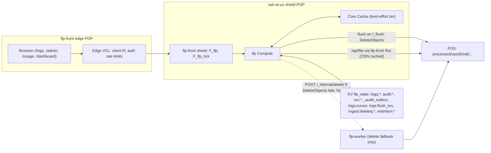

# Operational Logging, Telemetry, Retention & Usage — Design Spec

**Date:** 2026-10-30 (revised after two code reviews the same day)
**Status:** Ready for implementation planning. All decisions confirmed (§12).
**Target:** `app/` — Fastly Compute `flp` (`wasm32-wasip1`, `fastly = "=0.13.2"`), `flp-front` VCL, Next.js static export `app/web/`.
**Master plan:** `docs/superpowers/plans/2026-10-28-fastly-log-analytics-shell-and-dashboard.md`. Where this spec states no difference, follow it (and v3 through it). Stated differences are listed in §11.

---

## 1. Goals

One developer interface — `write_log(kind: WritableLogKind, row)` in Rust and `readLogs(kind, range)` in TypeScript — for seven operational streams, at near-zero marginal cost.

`LogKind` is the readable/schema enum and includes `AdminAudit`. `write_log` accepts only `WritableLogKind`, which has no `AdminAudit` variant, so audit rows can't be written directly (§2.2, §3.5).

| `LogKind` | What it records | Durability tier (§2.2) |
|---|---|---|
| `cron_runs` | Every non-idle cron unit: `request_ingest`, `rum_ingest`, `log_flush`, `log_compact`, `retention_sweep`, `raw_delete`, `storage_reconcile`, `job_step`. Rows, lines, bad lines, files, bytes, duration, vCPU, backend calls, outcome. | Durable (KV outbox) |
| `cron_ticks` | Every `/_tick` wake-up: trigger, bucket, outcome, sub-tasks, duration, vCPU, POP. Idle ticks roll up to one row per hour in Parquet. | Best-effort (Core Cache) |
| `ingest_files` | Per raw object: key, size, rows, lines, bad lines, outputs, status, raw deletion. Replaces the 16-per-tick `ingested:<raw_key>` KV writes; raw deletion moves to a delete queue (§5.2). | Durable (KV outbox) |
| `fos_usage` | FOS and CDN operations aggregated per request: op, class, dataset, caller, status, count, bytes, CDN HIT/MISS, estimated USD. | Best-effort (Core Cache) |
| `admin_audit` | Control-plane, settings and auth audit. Archived from the existing durable outboxes; never buffered only in cache. | Durable (existing KV outboxes) |
| `api_telemetry` | Compute `/api/*` and `/auth/*` requests, outbound Fastly API calls, and browser-local query summaries. | Best-effort (Core Cache) |
| `platform_errors` | Structured errors from Compute, FOS, Fastly API, KV, Core Cache, ingest corruption and auth. | Best-effort (Core Cache) |

Non-goals: logging VCL-only events (the `618`/`619` rate-limit responses never reach Compute, and `flp-front` has no logging endpoint by master-plan Q1); server-side rollups of request data (master-plan D1 is unchanged); any non-Fastly infrastructure.

---

## 2. Architecture

### 2.1 All `flp` executions run at the `iad-va-us` shield

Core Cache is per POP; objects are shared by the nodes of one POP, never across POPs. A single flush can only drain what was written in the POP it runs in, so every writer must run in the same POP.

- `app/infra/provision.py` `build_front_plan`: `backend("flp", hosts["compute"], shield=True)`, matching `flp_tick`. `flp-front` is provisioned only by `provision.py`; no Rust change is needed for the shield itself.
- **Cost of this choice:** every `/api/*` call, including `/api/file` Parquet downloads, gains a round trip to Virginia for users far from IAD. It also concentrates `/fos` CDN hits in one POP, which raises the hit ratio. The app's users are few admins/analysts, so this is accepted.
- **Shield failover guard:** if IAD is unhealthy, Fastly may run `flp` at the edge POP. `write_log` checks `fastly::shielding::Shield::new("iad-va-us")?.running_on()`. Off-shield, best-effort rows are dropped and counted in a response header `x-flp-log-dropped`. Durable tiers are unaffected because KV is global. `running_on()` can also be true at a nearby POP when Fastly relocates shield traffic (`fastly-0.13.2/src/shielding.rs:185-204`), so the design does not require a literal IAD POP. Every `api_telemetry` and `cron_ticks` row carries the actual `pop` (`fastly::compute_runtime::pop()`), and a persistent unexpected POP raises a `platform_errors` warning.
- **Worker:** `flp-worker` already runs the same binary (`app/src/main.rs:32-41`) and is already linked to the shared Secret, Config and KV stores (`app/infra/provision.py:844-852`, tested at `app/infra/test_provision.py:784-792`). No provisioning change is needed; a regression assertion keeps those links. The worker has its own cache namespace and must never call `write_log`. It returns rows in its JSON response under `logs`, and the coordinator records them.

### 2.2 Durability tiers

Core Cache objects can be evicted before their TTL. Anything that is evidence, such as audit records or the Goal 3 "every request appears exactly once" proof, must not depend on it.

| Tier | Kinds | Write path | Loss model |
|---|---|---|---|
| **Durable — existing outboxes** | `admin_audit` | Unchanged. Auth audit is committed atomically with `auth:state` and materialized as `audit:<seq>` keys (`app/src/state.rs:24-30`, `app/src/state/projection.rs:378-384`). Service audit is committed atomically with `svc:<sid>` in `_audit_outbox` (`app/src/admin/mod.rs:764-816`). | None |
| **Durable — KV outbox** | `ingest_files`, `cron_runs` | At most one KV insert per request: `logq:{sid}:{ts_ms:013}-{event_id}`, holding NDJSON with a `kind` field per line and the `event_id` assigned at enqueue. Idle ticks write nothing. | None. Draining uses strong KV LIST (`ListMode::Strong`, the default; `fastly-0.13.2/src/kv_store.rs:496-524`, `:699-717`). Only a write racing pagination can be missed, and the next flush drains it. |
| **Best-effort — Core Cache** | `cron_ticks`, `fos_usage`, `api_telemetry`, `platform_errors` | Per-request buffer, appended once at the end of the request (§2.3). | Cache eviction, shield failover, purge, replace timeout |

`write_log` picks the tier from the kind, so call sites never choose it.

**KV is not free in the tick.** `admin_get` and `admin_cas` call `self.budget.charge()` (`app/src/sdk.rs:284-286`, `:300-320`), so every KV get, CAS, insert, list page and delete counts against the 32-call backend budget, as do the new KV list and delete primitives. This is intentional. KV also allows one write per key per second; `admin_cas` sleeps through `kv_write_delay_ms` (`app/src/sdk.rs:306-316`), so the design avoids hot keys: outbox keys are unique per request and the cursor is written at most once per tick.

**Outbox growth before provisioning:** durable rows are never dropped. The `/logs` status bar shows `logq:` depth and oldest age, and a `platform_errors` warning is emitted while depth exceeds 10,000 keys.

### 2.3 Best-effort tier: sharded minute buckets, bounded scan

- **Key:** `flp:log:v1:{kind}:{sid}:{epoch_min}:{shard}`, where `shard = fnv1a(request_id) % LOG_SHARDS`, `LOG_SHARDS = 4`. Before provisioning, `sid = "global"`.
- **Write:** `fastly::cache::core::replace(key).replace_strategy(ReplaceStrategy::Wait).begin()`. Read the existing body, append this request's NDJSON, then `execute(Duration::from_secs(86_400))` with surrogate keys `["flp-logs-all", "flp-log-{kind}", "flp-log-{kind}-{sid}-h{epoch_hour}"]`. The replace swaps the object in place and serializes concurrent writers, so updates are never purged (§2.8). `user_metadata` = `{count, bytes, dropped}`. `epoch_min` comes from the time of the end-of-request append, not the event time, so a closed minute never receives late appends.
- **Replace failure:** `ReplaceStrategy::Wait` waiters can time out (`fastly-0.13.2/src/cache/core/replace.rs:31-39`). A timeout or replace failure is a best-effort drop: it is counted in `x-flp-log-dropped`, added to the `dropped` metadata of any of the request's other buckets that append successfully, and the next flush emits `platform_errors` with `code = "core_cache_replace_failed"`.
- **Bounds:** at most 256 rows per request per kind and 1 MiB per bucket object. Overflow increments `dropped` in metadata, and the next flush emits one `platform_errors` row with `code = "log_buffer_full"`. Individual rows are limited to 4 KiB, and `sample_json`/`details_json` are truncated to 2 KiB after redaction (§3.7).
- **No hot index key.** One index object per kind would serialise every writer and lose all unflushed minutes on eviction. Instead the keys are deterministic and a **scan watermark** in the cursor (§2.5) records what has been inspected:
  - Each tick inspects only newly closed minutes `(scan_min, now_min − 2]`, at most `MAX_SCAN_MIN = 30` minutes per tick: at most 4 best-effort kinds × 4 shards × 30 = 480 lookups, typically 2 minutes = 32 lookups. The 2-minute guard covers appends still in flight.
  - Non-empty buckets and their row counts (from `user_metadata`) are added to the cursor's `pending` summary, and `scan_min` is checkpointed with one KV CAS, which counts against the budget.
  - Minutes older than `now − 24 h` have expired (TTL); they are skipped, and the next flush emits a `platform_errors` row (`code = "log_scan_expired"`) with the count. A long outage is scanned in whole minutes within the execution's Core Cache operation budget (64; see Core Cache limits below) and resumes from the cursor on the next flush probe until it catches up.
- **Core Cache limits:** cache lookups, replaces and purges do not charge the backend budget, but each execution is bounded by Compute's 50 ms CPU / 2 min wall limits (https://docs.fastly.com/products/compute-resource-limits), and Cache API usage is metered (https://docs.fastly.com/products/cache-apis). Fastly also enforces an undocumented per-execution Core Cache transaction limit (https://www.fastly.com/documentation/reference/compute/errors/#cache-transactions-limit); past it every backend send in the execution fails. Live, a ~480-lookup flush scan hit it. Every execution therefore counts lookups, replaces and purges against `CACHE_OP_BUDGET` (64) and refuses past it. `cron_runs.cache_lookups` records all Core Cache operations of the stage, plus vCPU; Task 0 measures cost live.
- **Live exemption:** `GET /api/logs/:kind/live` does not write `api_telemetry` on `200` (an open tab would otherwise log itself forever). Neither does `POST /api/telemetry/query`, because its own row is the payload.

### 2.4 Parquet layout

`{fos_prefix}processed/ops/{kind}/year=YYYY/month=MM/day=DD/hour=HH/window={start}-{end}-{txn}-n{rows}.parquet`

- The `ops/` segment keeps operational files out of request discovery: `processed/request/` is the request root (`app/src/ingest/mod.rs:75`). It also lets authorization use an explicit root (§6).
- Each row's `timestamp` determines its hour partition. `{start}` is the flush-start epoch minute recorded in the flush manifest (§2.5), `{end}` is the newest row minute in the file, and `{txn}` is a short prefix of the manifest's `txn_id`. A retried flush reuses the manifest, so it writes byte-identical keys and the PUTs are idempotent, as ingest already is.
- Snappy compression, written by the existing writer in `app/src/ingest/convert.rs`. Its builders coerce mismatched types (`convert.rs:123-129`, `:144-175`), so telemetry adds a **strict conversion mode** helper in which a type mismatch becomes null; `Builder` is not exposed directly.
- Compacted files (§4) are written to `.../day=DD/compact={a}-{b}-c{nsrc}-n{rows}.parquet`.

### 2.5 Flush (`log_flush`, on its own `/_flush` probe)

*Implementation note (F4):* the flush runs in its own execution, woken by a second cached front-service health check (`/_flush`, one per 2-minute bucket at the IAD shield), never inside `/_tick` and never with FOS maintenance. Maintenance runs one stage per tick on `flp-worker` (`/_internal/stage`). The stage-priority and ingest-cap text below describes the earlier in-tick design. See `docs/crons/log-flush.md` and `docs/crons/stage-worker.md`.

1. **Cursor:** KV `logs:cursor:{sid}` = `{scan_min, cache_min, purged_hour, pending: {rows, oldest_min, nonempty: [[kind, min, shard, count], ...]}, audit_seq, svc_outbox_archived}`. `scan_min` is the scan watermark (§2.3); `cache_min` is the minute through which every bucket is archived; `purged_hour` is the last purged hour (§2.8).
2. **Due when (dynamic, by volume):** a flush runs when `pending` or the outbox is non-empty and either the unflushed row count is ≥ `flush_max_rows` (default 500) or the oldest unflushed row is ≥ `flush_max_age_s` old (default 3600). In both cases at least `flush_min_interval_s` (default 300) must have passed since the last flush. The due check uses the `pending` summary, so it needs no extra lookups. A busy install flushes about every 5 minutes; a quiet one at most hourly. Rows written by the flush itself (its PUT usage and its `log_flush` run) land in the next flush; a file can't contain the result of its own PUT.
3. **Manual flush:** `POST /api/admin/logs/flush` takes no parameters. It flushes every kind with pending rows, ignoring the 5-minute floor, through the same transaction path; there is one global cursor.
4. **Lease:** KV `logs:flush_lease` with Add semantics and a 120 s expiry, carrying the `txn_id`. A manual flush takes the same lease; if it is held, the endpoint returns `409 busy`. The flush stops work by 100 s of wall time and resumes on the next tick from the manifest.
5. **Transaction manifest:** before the first PUT, persist an immutable `logs:flush_txn:{sid}` = `{txn_id, cursor_generation, buckets: [...], outbox_keys: [...], audit_range, outputs: [keys], created_at}`. `txn_id` is a full collision-resistant hash (SHA-256) of the inputs; `cursor_generation` is the cursor's KV generation when the transaction is created. Retries reuse the manifest verbatim, so they write the same keys and bytes.
   - **Collect** only what the manifest names: the recorded `pending.nonempty` buckets (one lookup each), outbox keys from a strong KV LIST of `logq:{sid}:` (bounded pages) with a GET per key, `audit:<seq>` keys after `audit_seq`, and `svc:<sid>._audit_outbox` entries after `svc_outbox_archived`. Keys listed in a committed manifest that has not finished GC are skipped.
   - **Idle tick rollup:** unless `log_idle_ticks` is set, consecutive idle `cron_ticks` rows in an hour become one row: `trigger = "idle_rollup"`, `ticks_count = N`, summed `duration_ms`/`vcpu_ms`, and `event_id` = hash of the covered ids.
   - **Write** one Parquet object per (kind, hour), as listed in `outputs`.
6. **Commit (fenced):** CAS `logs:cursor:{sid}` using `cursor_generation`. While a manifest is uncommitted, the per-tick scan does not checkpoint and clear-cache returns `409 busy`, so the commit is the only possible cursor change. A stale executor that lost the lease fails its CAS and can never commit. If an executor finds an uncommitted manifest whose `cursor_generation` no longer matches and whose `txn_id` matches the cursor's recorded transaction, the commit already happened and only GC remains. If the generation moved but the `txn_id` does not match, another writer changed the cursor: the transaction is abandoned, its orphan output files and manifest are deleted, and the next tick re-plans from the current cursor (source rows are untouched). The commit advances `cache_min`, removes the flushed entries from `pending`, and advances `audit_seq`/`svc_outbox_archived`.
7. **After commit:** mark the transaction committed. Outbox key deletion and the CAS-trim of `svc:<sid>._audit_outbox` (keep the newest 50 so `/api/admin/audit-logs` still shows recent activity; retry on a generation conflict) are idempotent GC driven by the committed manifest. This removes the `409 audit_archive_required` failure. Archived `audit:<seq>` keys are GC'd per D10 (§5.3). Then purge each fully flushed hour from Core Cache (§2.8).
8. **Before FOS is provisioned,** nothing is flushed. Durable rows wait in KV indefinitely (§2.2). Best-effort `global` buckets expire after 24 h; the first flush after provisioning drains any that remain.

**Budget admission** (32 backend calls per execution, `app/src/shell.rs:63-64`). Stage priority within one tick: ingest, then flush, then raw delete, then compaction, then retention, then storage reconcile. Before a stage starts, it computes its full call requirement, counting KV gets/CAS/inserts/list pages/deletes as well as FOS calls, and admits only a bounded transaction that fits the remaining calls. For a flush: lease, cursor read, manifest put, outbox list pages and GETs, one PUT per (kind, hour), commit CAS and commit marker. Large backlogs are split into several persisted transactions sized to the available calls. When the flush is overdue (oldest pending ≥ 2 × `flush_max_age_s`), ingest is capped so the flush gets its calls. Every stage that doesn't finish resumes on the next tick.

### 2.6 Instrumentation chokepoints

There is one wrapper per transport, so call sites never log by hand:

- `FastlyRuntime::admin_fos` (direct S3) and `admin_cdn_get` (`/fos` via `flp-front`) add rows to the per-request `fos_usage` aggregate. `FosResponse` gains `cdn_cache: Option<String>`, read from `x-flp-fos-cache`.
- `admin_api` produces `api_telemetry` rows (`source = "fastly_api"`), and a `platform_errors` row on 4xx/5xx or a transport error.
- `Shell::handle` produces `api_telemetry` (`source = "compute_api"`) for `/api/*` and `/auth/*`, with `duration_ms`, `vcpu_ms`, `pop`, `status_code`, `actor`, and a normalized route with no query string. It then flushes the request buffer exactly once.
- **vCPU is a delta.** `fastly::compute_runtime::elapsed_vcpu_ms()` is cumulative since instance start (`fastly-0.13.2/src/compute_runtime.rs:9-27`). Capture it at request or stage start and end and record the saturating difference; never record a raw reading.
- KV failures produce `platform_errors` with `error_domain = "kv_store"`.
- Ingest records `ingest_files` and corruption errors (`corrupt_gzip`, `bad_ndjson_line` with a redacted sample).

### 2.7 `flp-front` VCL changes

1. **`x-flp-auth-fail` across the shield hop.** `unset resp.http.x-flp-auth-fail` (`app/vcl/front/main.vcl:228`) moves inside `if (fastly.ff.visits_this_service == 0)`. Without this, the shield's `vcl_deliver` strips the header and edge rate limiting silently stops working as soon as `flp` is shielded. This is a release blocker paired with the shield change.
2. **`x-flp-fos-cache` on `/fos/*`.** Set to `HIT` only when `fastly_info.state ~ "^HIT"` and `fastly_info.state !~ "SYNTH"`, which covers `HIT`, `HIT-STALE`, `HIT-CLUSTER`, `HIT-STALE-CLUSTER` and similar. `HIT-SYNTH` is a synthetic response, not a cache hit, so it and every other state (`PASS`, `ERROR`, `MISS`, …) are `MISS`. Use `fastly_info.state`, not `obj.hits`, because `/fos` uses segmented caching (`main.vcl:91-96`). `/fos` requires the server-side `cdn_key`, so only Compute reads this header. The browser learns the result from a relayed `x-flp-cdn-cache` header on `/api/file`.
3. **Surrogate keys on cached `/fos` objects.** `vcl_fetch` sets `beresp.http.Surrogate-Key` to `flp-fos flp-fos-{fos_service}` plus a dataset key derived from the path: `flp-fos-ops-{kind}` for `processed/ops/{kind}/`, `flp-fos-request` or `flp-fos-rum` for `processed/request/` or `processed/rum/`, and `flp-fos-raw` for raw keys. Used only by the purges in §2.8.
4. **`/_flush` clock (F4).** A second health check, `flp_flush` on dummy backend `flp_flush_clock`, probes `/_flush`; `vcl_recv` buckets, shields and caches it exactly like `/_tick` (`main.vcl:81-101`), so `flp` runs the flush about once per 2-minute bucket in its own execution.

### 2.8 Cache invalidation

There are three caches. Each is invalidated only where a stale copy can actually be served.

| Cache | Holds | Invalidation |
|---|---|---|
| **Compute Core Cache** (`flp` service, shield POP) | Unflushed best-effort rows; the live tier. | **Updates:** never purged; the replace swaps the object in place. **After flush:** once the cursor commit moves `cache_min` past the end of an hour, `purge_surrogate_key("flp-log-{kind}-{sid}-h{hour}")` once per (kind, hour) actually flushed, deduplicated. Purges don't charge the backend budget but are rate-limited to about 100,000 per hour per customer (https://www.fastly.com/documentation/guides/full-site-delivery/purging/getting-started-with-purging/#limitations-and-constraints); this design issues about 72 per day. The 2-minute guard means no append can land in a purged hour. On a failed purge or `TooManyRequests`, `purged_hour` is not advanced and the purge is retried on the next flush. The 24 h TTL is only a backstop, which pre-provision `global` buckets rely on. **Clear-cache:** audited; advances `scan_min` and `cache_min` to `now_min − 2`, clears `pending` for the purged kinds (or all), then purges `flp-log-{kind}` or `flp-logs-all`, dropping unflushed rows on purpose. For a single kind, the unscanned minutes are first scanned for the other kinds so their buckets stay in `pending`; if `scan_min` is more than `MAX_SCAN_MIN` behind, it returns `409 scan_behind`. Purge applies to the current service, whose Core Cache we write. |
| **`flp-front` CDN** (`/fos/*`, default TTL 3600 s) | Raw and Parquet objects, read by Compute. | **Writes:** none needed. Output keys are deterministic and a retry rewrites identical bytes. Compacted files are new keys. Direct PUTs don't populate the CDN, so the first `/fos` read of a new file is a MISS. **Routine deletes** (raw delete, retention sweep, compaction source deletes): no purge. Readers discover files through a direct FOS LIST, which no longer returns deleted keys, so nothing requests the stale copy and it expires within the TTL. **`delete-history` and service teardown:** after the deletes finish, one Fastly API `POST /service/{front_id}/purge/flp-fos-ops-{kind}` (or `flp-fos-{fos_service}` for teardown), using the API token reconcile already uses for the `rum-js` purge (`app/src/admin/reconcile.rs:232-250`). That costs one backend call, which guarantees a deleted file can't be fetched again even if its key is known. |
| **Browser CacheStorage** `flp-ops-parquet-v1:{user}:{role}` | Parquet files previously read by `/logs` and `/usage`. | Partitioned by user id and role so one browser profile never serves an admin's ops files to another user or role. Cleared on logout, on any 401/403, on role change, and after delete-history. Each `readLogs` call drops cached entries for its range that are absent from the current manifest, which covers compaction, retention and delete-history. The `v1` prefix is bumped for schema changes. |

---

## 3. Schemas

All kinds share four leading columns: `timestamp` (`TimestampMs` UTC), `event_id` (`Utf8`), `service_id` (`Utf8`, or `"global"`), and `severity` (`info|warn|error`). Supported column kinds are those in `convert.rs`: `Utf8`, `Int64`, `Float64`, `Bool`, `TimestampMs`, written in strict mode (§2.4). Times beyond `timestamp` are `TimestampMs`, not RFC3339 strings.

**Event identity:** `event_id` is server-generated and stable per logical source event, so deduplication survives retries and re-archiving. Audit rows derive it from `(source, source_seq)`; outbox rows get it at enqueue and it is persisted in the outbox line; idle rollups use a hash of the covered ids; browser beacons get a server-assigned id. Clients never supply it.

### 3.1 `cron_runs`
`cron_kind` (`request_ingest|rum_ingest|log_flush|log_compact|retention_sweep|raw_delete|storage_reconcile|job_step`), `run_id`, `tick_event_id`, `trigger` (`clock|manual`), `actor`, `bucket` Int64, `outcome` (`done|idle|busy|partial|error`), `started_at` TimestampMs, `duration_ms`, `vcpu_ms`, `listed_files`, `converted_files`, `deleted_files`, `lines_read`, `rows_written`, `bad_lines`, `bytes_read`, `bytes_written`, `parquet_files_written`, `backend_requests_used`, `cache_lookups`, `more_pending` Bool, `details_json`, `error`. `storage_reconcile` rows carry per-dataset bytes and object counts in `details_json` (§7.2).

### 3.2 `cron_ticks`
`trigger` (`clock|manual|idle_rollup`), `actor`, `bucket`, `outcome` (`active|idle|busy|error`), `ticks_count`, `triggered_crons` (JSON array), `duration_ms`, `vcpu_ms`, `backend_requests_used`, `pop`, `error`.

### 3.3 `ingest_files`
`run_id`, `dataset` (`request|rum`), `raw_key`, `raw_size`, `status` (`converted|failed|quarantined`), `state_version` Int64 (`1` = conversion, `2` = raw deleted), `rows`, `lines_read`, `bad_lines`, `output_keys_json` (`[{key, rows, bytes}]`), `raw_deleted` Bool, `raw_deleted_at` TimestampMs, `reason`. Raw deletion happens later than conversion (§5.2), so it emits a second row with the same `raw_key`, `status = "converted"`, `state_version = 2` and `raw_deleted = true`. Readers take the latest row per `raw_key` by `(state_version, timestamp, event_id)`.

### 3.4 `fos_usage` (one row per request per distinct `(op, dataset, caller, status_code, cdn_cache)`)
`op` (`PUT|LIST|GET|HEAD|DELETE|DELETE_OBJECTS`), `op_class` (`A|B|CDN_HIT`), `op_count`, `dataset` (`raw_request|raw_rum|pq_request|pq_rum|pq_ops`), `bucket`, `sample_key`, `caller` (`cron:ingest|cron:log_flush|cron:log_compact|cron:retention|cron:raw_delete|cron:storage_reconcile|api:files|api:file|api:log_extents|admin:tree|admin:reset|admin:teardown`), `status_code`, `duration_ms` (sum), `bytes_in`, `bytes_out`, `bytes_deleted` (object sizes captured from LIST at delete time), `cdn_cache` (`HIT|MISS|DIRECT`), `est_cost_usd` Float64, priced with `UsageLogging` rates (§7). `PUT`, `LIST`, `DELETE` and `DELETE_OBJECTS` are Class A; `GET` and `HEAD` are Class B; a CDN HIT is `CDN_HIT` and costs no FOS operation. A MISS through `/fos` costs one Class B.

### 3.5 `admin_audit`
`domain` (`control_plane|auth|settings|data_management`), `actor`, `action`, `target`, `job_id`, `step_name`, `outcome` (`ok|failed`), `ip`, `source` (`auth_archive|svc_outbox`), `source_seq`, `details_json` (before/after diff; never tokens, codes or secrets). Rows are mapped from the existing `AuditEntry` and `_audit` shapes by the flush only. New admin actions introduced by this work, such as flush, clear-cache, delete-history, settings changes, sweep and storage reconcile, write through the existing KV audit paths; `WritableLogKind` has no `AdminAudit` variant, so `write_log` cannot write them.

### 3.6 `api_telemetry`
`source` (`compute_api|fastly_api|browser_query`), `method`, `path` (normalized), `status_code`, `duration_ms`, `vcpu_ms`, `pop`, `actor`, `files_listed`, `files_fetched`, `files_cached`, `cdn_hits`, `rows_scanned`, `bytes_scanned`, `details_json`. Browser rows are self-reported and labelled as such in the UI.

### 3.7 `platform_errors`
`error_domain` (`compute|worker|fos_s3|fastly_api|kv_store|core_cache|ingest_corrupt|auth|telemetry`), `code`, `caller`, `status_code`, `object_key`, `message`, `sample_json` (≤ 2 KiB). Rows are built only from allowlisted structured fields, never from whole requests or responses. Before truncation, a recursive redaction removes `Authorization`, cookies, tokens, signed-URL parameters (`X-Amz-Signature`, `X-Amz-Credential` and similar) and secrets. Raw-line samples can contain customer PII and are only readable by admins (§6).

---

## 4. Compaction cron (`log_compact`) — operational kinds only

Small files make `/logs` history slow. The dynamic flush can create up to 288 window files per kind per day (one per 5 minutes), and a quiet install about 24. Once a UTC day closes, compaction merges that day's window files for one kind into bounded `compact=` chunks.

- **Scope:** `processed/ops/{kind}/` only. Request and RUM window files keep master-plan D1 (no server rewrite or merge; browser-local compaction). The implementation is generic over a prefix so D1 could later opt in, but it is not wired for request data.
- **Coverage rule (no sidecars):** `compact={a}-{b}-c{nsrc}-n{rows}.parquet` in `day=DD/` covers exactly the window files in that day folder (all its `hour=` folders) whose flush-start minute — the `{start}` in `window={start}-...` — is in `[a, b]`. Flush-start minutes come from the monotonic cursor, so a window written after compaction always starts after `b` and is never covered. Readers skip only covered window files and still read any uncovered window. A compact file is valid only if the number of listed windows in `[a, b]` equals `nsrc` (before its sources are deleted) or none remain (after), and its decoded row count equals `n{rows}`; an invalid one is ignored and its windows are read.
- **Chunks:** uncovered windows are sorted by flush-start minute and grouped into chunks of at most 24 sources, so a re-run produces the same chunks and keys. A late window (for example, an outbox row from day D flushed on day D+1) has a flush-start minute after every existing chunk's `b`, so it stays uncovered until a later chunk takes it.
- **When:** in `/_tick`, after flush and raw delete, for a (kind, day) whose day closed more than 2 h ago and that has at least two uncovered windows. Admission (§2.5) counts the full requirement with KV: one KV read of `logs:compact_delete:{kind}:{day}`, the day LIST, one GET per source, one PUT, and one KV insert of the delete batch, i.e. `nsrc + 4` calls (28 for a full chunk). If the remaining budget is smaller, the chunk waits for a tick with room; Task 0 measures idle-tick headroom.
- **How:** GET each source through `/fos` (normally a CDN MISS, since direct PUTs don't populate the CDN), merge with deduplication on `event_id`, PUT the chunk. Source keys are then queued in KV `logs:compact_delete:{kind}:{day}` and removed with `DeleteObjects` (§5.4) on later ticks.
- **Cost note:** FOS bills a minimum storage duration (`UsageLogging.min_billed_days = 30`, D12). A window file compacted away after one day still bills for 30 days. §7.1 includes this.
- `cron_runs` records each compaction (`cron_kind = "log_compact"`).

---

## 5. Retention and cleanup (master-plan Q17, plus operational kinds)

### 5.1 Settings
- **Per service (Q17, v3 names and defaults)** in `svc:<sid>`: `delete_after` (default `true`), `log_retention_days` (30), `rum_retention_days` (30); `0` means keep forever. These are edited in Logging settings (existing reconcile flow; these fields do not need a VCL reconcile). They don't exist yet, so this work adds them.
- **`OperationalLogSettings`** in KV `settings:operational_logs`: `flush_max_rows` (500; 50–5,000), `flush_max_age_s` (3600; 300–21,600), `flush_min_interval_s` (300; 120–3,600, must be ≤ `flush_max_age_s`), `log_idle_ticks` (false), `browser_query_telemetry` (true), `compaction_enabled` (true), and `retention_days_by_kind` with defaults `admin_audit` 365, `cron_runs` 30, `ingest_files` 30, `platform_errors` 30, `api_telemetry` 14, `cron_ticks` 14. `fos_usage` retention is `UsageLogging.retention_days` (existing setting, default 30); it is not duplicated here.

### 5.2 Raw deletion (`raw_delete`)
Today the `ingested:<raw_key>` ledger has a reader: the raw cleanup sweep deletes raw `.gz` objects only when their ledger status is `"ok"` (`app/src/ingest/mod.rs:440-475`). Its replacement is a delete queue:

- At ingest commit, one durable KV record `ingest:deleteq:{run_id}` lists only the raw keys that were successfully converted.
- `raw_delete` deletes exclusively from these queues, with `DeleteObjects` (§5.4). `ingest:watermark` alone is never proof that a key may be deleted.
- Each confirmed batch emits `ingest_files` rows with `state_version = 2` and `raw_deleted = true`, and its queue record is removed.
- The same change removes the ledger writes and the ledger-based sweep. Ledger writes never stop before their reader is replaced.

### 5.3 Retention sweep (`retention_sweep`) and audit GC
- Runs every 6 h (`retention:last_sweep`) or on `POST /api/admin/logs/sweep`. It is bounded per tick and never blocks ingest.
- It LISTs `year=/month=/day=` prefixes with a delimiter for `processed/request/`, `processed/rum/` and `processed/ops/{kind}/`, then deletes whole hour folders and day-level `compact=` files older than the cutoff.
- **Sweep state** is KV `retention:{dataset}`, keyed by the generation `(dataset, cutoff_day)`. Each delete batch is persisted before dispatch. The state advances only after confirmed deletes or a durable requeue of failures, so a crash mid-batch resumes the same batch. When retention days decrease, the cutoff changes, a new generation starts and discovery restarts.
- Listing-based manifests reflect deletions immediately (Q17: "deleting data must update the manifest").
- **Audit KV GC (D10):** an `audit:<seq>` key is deleted only once it is archived to Parquet (≤ `audit_seq`) and older than the `admin_audit` retention (default 365 days). The newest 50 are always kept for `/api/admin/audit-logs`.

### 5.4 Deletes: `DeleteObjects` primary, worker fan-out fallback
FOS documents `DeleteObjects` (≤ 1,000 keys per POST), `DeleteObject` and `ListObjectsV1/V2`, all Class A (https://www.fastly.com/documentation/guides/platform/object-storage/working-with-object-storage/#using-the-s3-compatible-api).

- **Primary:** raw delete, compaction-source deletes and retention use `DeleteObjects`. With each batch persisted first (one KV write + one POST), a tick can delete thousands of keys, far above any expected backlog. Task 0.2 confirms `DeleteObjects` on a disposable bucket, with explicit approval.
- **Fallback (only if Task 0.2 fails):** the coordinator sends batches of up to 28 keys to `flp-worker` `POST /_internal/delete`, added to the worker router next to `/_internal/probe` (`app/src/sdk.rs:757`) and authenticated with the existing `worker_secret` peer auth; a missing or invalid secret returns `403` (`app/src/sdk.rs:742-753`). Each worker execution has its own 32-call budget, performs single DELETEs against FOS and returns `{deleted, failed, logs}`; the coordinator records the `logs` (§2.1) and re-queues failures. Up to `retention_fanout` (default 8) worker calls per tick, about 220 deletes per tick. The fallback stays tested either way.
- Deleted object sizes, captured from the LIST that found them, are recorded in `fos_usage.bytes_deleted` for the storage ledger (§7.2). The usage page reports retention lag.

### 5.5 Manual controls (admin, audited)
`POST /api/admin/logs/flush` (no body; all kinds, §2.5) · `POST /api/admin/logs/clear-cache` `{kind|"all"}` (best-effort kinds only; §2.8) · `POST /api/admin/logs/delete-history` `{kind, older_than_days?}` (resumable job using the existing job engine; its final step purges `flp-fos-ops-{kind}` on `flp-front`, §2.8) · `POST /api/admin/logs/sweep` · `POST /api/admin/usage/reconcile-storage` (§7.2).

---

## 6. Endpoints and authorization

The operational kinds expose IPs, actors, raw-line samples and audit history, so they are **admin-only**, consistent with commit `81fa0c6` (cron-runs gated to admins).

| Endpoint | Auth | Purpose |
|---|---|---|
| `GET /api/logs/:kind/live?since=&limit=&cursor=` | Admin | Unflushed rows: the recorded `pending` buckets plus the open minutes after `scan_min`, the `logq:` outbox and unarchived audit, newest first, paginated with a cursor and capped at 2,000 rows per page. |
| `GET /api/files?dataset=request\|rum\|ops:{kind}` | Analysts for `request`/`rum`; admin for `ops:*` | Existing signed manifest, extended with a dataset parameter. `dataset` defaults to `request` (unchanged behaviour). |
| `GET /api/file?key=` | As today, **plus** keys under `processed/ops/` require admin | `valid_processed_key` (`app/src/ingest/api.rs:410-418`) accepts only `processed/request/` today and takes no role. It is extended to the explicit roots `request/`, `rum/` and `ops/`, and `Shell` (`app/src/shell.rs:325-351`) enforces admin for `ops/`. Responses relay `x-flp-cdn-cache`. |
| `POST /api/telemetry/query` | Signed-in | Browser query summary. Body ≤ 4 KiB; fields are allowlisted with enums and caps, unknown fields dropped, numbers clamped. The server assigns `event_id`, `actor`, `service_id`, `source` and `timestamp`. Same-origin POST checks as other writes; disabled by `browser_query_telemetry`. Rate limit: 60 beacons per minute per session, using a Core Cache counter keyed by session + minute (POP-local is fine under the shield); excess returns `204` and increments a dropped counter. |
| `GET /api/admin/raw-tree`, `/storage-tree`, `/ingested-files` | Admin | Existing routes. `storage-tree` also lists `processed/ops/`. `ingested-files` reads `ingest_files` (outbox, then Parquet; latest `state_version`) instead of the `ingested:` ledger. |
| `GET/PATCH /api/admin/operational-logging` | Admin | `OperationalLogSettings`. |
| `POST /api/admin/logs/{flush,clear-cache,delete-history,sweep}`, `POST /api/admin/usage/reconcile-storage` | Admin | §5.5. |
| `GET /api/cron-runs`, `/api/sync-status`, `/api/admin/audit-logs` | Unchanged | Contracts are kept. `cron:state.runs` (last 50) remains the source for the cron card. |

---

## 7. Cost model, estimates and `/usage`

### 7.1 Steady-state overhead of this system (quiet install, defaults)
Assumptions: 720 ticks/day; a quiet install flushes 24 times/day; about 3 kinds flushed per hour → 72 PUTs; 7 kinds compacted daily, one chunk each; per tick about 32 Core Cache scan lookups plus one replace for the tick's own buffer; about 72 purges/day. Rates from `UsageLogging` defaults, at list price: Class A $0.0025 per 1,000 ($0.0000025/op), Class B $0.004 per 10,000 ($0.0000004/op), storage $0.02/GB-month, egress $0.12/GB, `min_billed_days = 30`.

| Item | Per day | Class | Est. USD/day |
|---|---|---|---|
| Tick executions | 720 | Compute; not priced by `UsageLogging` | measured |
| Core Cache lookups | ≈ 23,000 scan (720 × 32) + collection (≈ one per non-empty bucket flushed) | Cache API; not priced | measured |
| Core Cache replaces | ≈ 744 (720 tick buffers + other requests) | Cache API; not priced | measured |
| Purges | ≈ 72 (limit ≈ 100,000/hour) | not priced | measured |
| KV operations | per op: ≈ 720 cursor gets + ≈ 720 cursor CAS (scan checkpoint); ≈ 24 each of lease Add, manifest put, commit CAS, commit marker; outbox inserts, list pages, GETs and deletes ≈ one each per durable request | KV; not priced | measured |
| Flush PUTs | 72 | A | $0.00018 |
| Compaction LIST + PUT | ≈ 14+ | A | $0.000035 |
| Compaction source GETs | ≤ 168, normally CDN MISS (direct PUTs don't populate the CDN) | B | $0.000067 |
| Compaction source deletes | ≈ 7 `DeleteObjects` | A | $0.000018 |
| Retention | L LIST pages + D `DeleteObjects` batches | A | (L + D) × $0.0000025 |
| **Subtotal, FOS operations only** | 93 A + 168 B + retention | | **≈ $0.00030 + (L + D) × $0.0000025** |
| Storage | Σₖ Sₖ GB/day × $0.02 × max(retentionₖ, 30) / 30 for each kind k; compacted-away window files bill the full 30 days | storage | formula |
| Egress | G GB of compaction CDN misses × $0.12 | egress | formula |

Compute, KV and Cache API usage are not priced by `UsageLogging`; `/usage` shows them as measured counts. Under load, `fos_usage` measures the real numbers, and the estimates must be replaced with measured ones (master plan: "re-measure … before publishing savings").

### 7.2 What must be updated
- **`/usage` page** (currently `comingSoon` in `app/web/components/AppLayoutChrome.tsx:199`), admin-only. Built from `fos_usage`, `api_telemetry`, `cron_runs` and `cron_ticks`:
  - Class A/B/CDN-hit counts and estimated USD by day and by caller (FOS operations only);
  - CDN hit ratio on `/fos`;
  - Compute requests and vCPU ms by route and by cron kind; KV and Core Cache operation counts;
  - bytes written/read;
  - storage by dataset from the **storage ledger (D13):** total = last reconcile snapshot + PUT bytes (`fos_usage`) − `bytes_deleted` after the snapshot, labelled "estimated". No recursive storage-tree walk;
  - retention lag;
  - logging overhead (calls attributable to `log_flush`, `log_compact` and `retention_sweep`).
  - Every number is labelled measured or estimated, and the rates come from `UsageLogging`.
- **Reconcile storage** (admin action, D13): a bounded, resumable background job run within the tick budget. It LISTs each dataset with sizes and records a snapshot as a `cron_runs` row (`cron_kind = "storage_reconcile"`, per-dataset bytes/objects in `details_json`).
- **Shared client aggregation:** under the static export, `app/web/lib/usage/summary.ts` and the hook `app/web/hooks/useUsageSummary.ts` aggregate the Compute APIs directly and are used by both `/usage` and `/calculator`.
- **`/calculator`** stays public. Admins see a "Use measured last 30 days" prefill from the shared summary; analysts and signed-out users keep a fully working calculator without it. It gains line items for KV operations and logging/compaction overhead. Its rates are per million operations, while `UsageLogging` stores per-1k (A) and per-10k (B); add one conversion helper with a test.
- **`/how-it-works`** and **`docs/cost-methodology.md`** are rewritten for the current architecture. The existing methodology describes the archived prototype's `cost/v4` API. The rewrite covers what is measured (`fos_usage`, `vcpu_ms`) versus estimated, the shield's cost and latency trade-off, compaction and minimum-billing effects, Class A LIST/DELETE, and the absence of a Fastly billing API call unless one is added later.
- **Other cost estimates:** `README.md:34-35`, `AGENTS.md:38`, `docs/README.md` (about lines 6, 11-12, 25), `docs/recommendation.md` (18, 91-170), `docs/architecture-options.md` (161, 204) and `docs/how-it-works.html` (351, 456, 697, 706). Current-facing estimates are updated; intentionally historical docs get a superseded banner linking `/usage` and `docs/cost-methodology.md`; dated research evidence is left unchanged.
- **`UsageLogging`** (`app/src/auth/settings.rs:6-29`) becomes the single source of rates. `enabled` gates `fos_usage` recording; default **on** (stated difference from v3's off, because recording costs almost nothing). `retention_days` is `fos_usage` retention. `min_billed_days` stays 30 (D12).

---

## 8. UI

### 8.1 `/logs` (Data Management)
Existing tabs stay: Cron Runs, Service History, Available Logs (`app/web/app/logs/page.tsx:28-112`). Added, admin-only: Cron Ticks, Ingested Files (switches to `ingest_files`), FOS Usage, Audit, API & Query Telemetry, Platform Errors, Storage (the existing raw/storage trees, plus `ops/`), and Retention & Cleanup (settings and the §5.5 actions with confirmation dialogs).

Each tab uses `readLogs(kind, {from, to})`: live rows plus manifest files. Reading runs in a worker, like the dashboard (`lib/dashboard/client.ts:12-14`, `engine.worker.ts:18-19`, `engine.ts:239-240`): `app/web/lib/telemetry/engine.worker.ts` and its worker client do the manifest fetch, CacheStorage, `hyparquet` decode, deduplication by `event_id` and newest-first sort; hooks only orchestrate. Files are cached in `flp-ops-parquet-v1:{user}:{role}` (separate from `flp-parquet-v1`; cleared per §2.8). The status bar shows unflushed rows, the oldest unflushed minute, `logq:` depth and oldest age, last/next tick, and dropped rows.

### 8.2 Navigation and `/admin`
- Service navigation is rendered from `SERVICE_NAVIGATION` in `app/web/components/AppLayout.tsx:82`, `:212-214` (desktop and mobile) and `AppLayoutChrome.tsx:432-434`; role filtering applies only to system navigation today. Both compute a role-filtered `visibleServiceNavigation`, and client route gating protects `/usage` and the admin `/logs` tabs.
- "Cron & Action Log" and "Usage Logging" cards on `/admin` keep their current endpoints and add deep links to `/logs?tab=…` and `/usage`.

### 8.3 Dashboard
`lib/dashboard/sources.ts` reads `x-flp-cdn-cache` on network fetches. After each completed query, `engine` sends one `POST /api/telemetry/query` (fire-and-forget, never blocking or failing the query). The "Last fetch" line adds CDN hits.

---

## 9. Testing and verification

- **Native unit tests:** in-memory Core Cache and KV list in the test `Runtime`, with KV ops charging the budget; tier routing; `WritableLogKind` rejects audit writes; shard/bucket bounds; Core Cache replace contention failure counted as a drop; strict conversion turns type mismatches into null; bounded scan, including a long outage (≤ 30 minutes per tick, expired minutes counted); lease/transaction fencing and stale-commit rejection; retry reuses the manifest and writes identical keys; cursor commit then crash before GC; budget admission splits a large backlog; idle rollup ids; audit drain keeps 50 and survives a generation conflict; audit KV GC per D10; raw delete only from `ingest:deleteq`; compaction merge, dedup, partial compaction plus a late window, invalid `n{rows}`; retention cutoff edges, expired compacted day deleted while a newer one is kept, shortened retention revisits, crash mid-batch resumes; `valid_processed_key` roots and analyst 403 on `ops:*` and `processed/ops/` keys; worker `/_internal/delete` returns 403 without the secret; beacon allowlist and rate limit; recursive redaction before truncation; vCPU delta.
- **Falco:** `app/vcl/front/tests/front.test.vcl` for the shield-hop auth-fail rule; `fos.test.vcl` for `x-flp-fos-cache` (including `HIT-SYNTH` → `MISS` and `HIT-STALE` → `HIT`) and the `/fos` surrogate keys.
- **Cache invalidation:** a flush that passes an hour boundary purges exactly that hour's keys once; a failed or rate-limited purge leaves `purged_hour` unadvanced and is retried; delete-history ends with one `flp-front` purge; `readLogs` evicts cached files missing from the manifest; logout, 401/403 and role change clear the partitioned cache.
- **pytest:** `app/infra/test_provision.py` for the `flp` shield and a regression assertion that `flp-worker` keeps its Secret/Config/KV links.
- **Vitest:** `readLogs` merge/dedup/cache in the worker; `/logs` tabs; `/usage` rendering from fixtures; `summary.ts` aggregation and storage ledger; the rate conversion helper; the beacon never throws.
- **Playwright (`app/web/e2e/`):** admin vs analyst `/usage` access and navigation visibility; `/logs?tab=…` deep links; admin measured calculator prefill; the disabled-usage-logging state; one static-export build-and-serve flow.
- **Commands:** `make test && make lint` (`app/Makefile:8-18`) do not run falco, the web typecheck/build, or the `wasm32-wasip1` check; run those separately.
- **Live (explicit approval only):** Task 0.2 `DeleteObjects` on a disposable bucket. After deploy, confirm `running_on()` is true on every `/api/*` row and record the actual `pop` (alert on a persistent unexpected POP rather than requiring IAD), and that auth-fail rate limiting still produces 429 at the edge. Measure scan lookup cost and vCPU, idle-tick call headroom, the CDN hit ratio, and the quiet-day operation counts against §7.1. Native tests and fixtures are not live evidence.

---

## 10. Migration

- The `ingested:<raw_key>` ledger has one reader that matters: the raw cleanup sweep (`app/src/ingest/mod.rs:440-475`). In one change, `ingest:deleteq:{run_id}` and the queue-driven `raw_delete` replace that sweep, and the ledger writes and ledger-based sweep are removed (§5.2). Existing `ingested:` keys are left in place; a later admin reset can remove them.
- `cron:state.runs`, `auth:state` audit and `audit:<seq>` keep their formats. `_audit_outbox` gains archival trimming (§2.5), and archived `audit:<seq>` keys gain D10 GC (§5.3).
- No backfill of history into Parquet beyond what the outboxes still hold.

---

## 11. Stated differences from the master plan

1. **New tick work.** D1 says the only cron is raw-log processing. This adds `log_flush`, `log_compact`, `storage_reconcile` and `raw_delete`/`retention_sweep` (the last two are already in Q17) as budget-bounded steps inside the same `/_tick`. There is still no separate clock.
2. **Server compaction of operational files** (§4). D1's "server never rewrites, merges or deletes window files on a schedule" still applies to request and RUM data.
3. **All `flp` traffic is shielded** (§2.1). D5's single front service is unchanged.
4. **`UsageLogging.enabled` defaults on**.
5. **Operational Parquet layout.** Operational Parquet uses `processed/ops/{kind}/...` rather than master-plan D4's `parquet/<table>/timestamp_hour=...` layout; the request/RUM layout is unchanged.

---

## 12. Decisions (confirmed by Drew, 2026-10-30)

1. **Shield `flp` at IAD.** The added latency for users outside US East is accepted.
2. **Durability tiers** as in §2.2.
3. **Dynamic flush** (§2.5): 500 rows or 1 h max age, with a 5-minute floor between flushes. All three are admin settings. A manual flush flushes all kinds with pending rows and ignores the floor (D11).
4. **Operational kinds are admin-only,** including blocking `processed/ops/` in `/api/file` for analysts.
5. **`cron:state.runs` is kept** for the cron card.
6. **`admin_audit` retention is 365 days.**
7. **`UsageLogging.enabled` defaults on.**
8. **Deletes use `DeleteObjects`** (Task 0.2 confirms it); fan-out to `flp-worker` is the tested fallback only if it fails (§5.4).
9. **Core Cache is a buffer only:** it holds unflushed rows, and each hour is purged after it is flushed (§2.8). There is no read cache.
10. **Audit KV GC:** archived `audit:<seq>` keys are deleted only once archived to Parquet and older than the `admin_audit` retention (365 days); the newest 50 are always kept for `/api/admin/audit-logs` (§5.3).
11. **Manual flush has no `kind` parameter;** it always flushes all kinds with pending rows (all due kinds), ignoring the 5-minute floor. There is one global cursor (§2.5).
12. **Billing:** `UsageLogging.min_billed_days` stays 30. LIST, DELETE and `DeleteObjects` are Class A operations, not free (§3.4, §7.1).
13. **Storage totals come from a ledger:** last reconcile snapshot + PUT bytes − deleted bytes after the snapshot, labelled "estimated". "Reconcile storage" is a bounded, resumable background job that records a `storage_reconcile` snapshot row; there is no recursive storage-tree walk (§7.2).

No questions remain open. Task 0's live checks may still change implementation details, but not these decisions.
