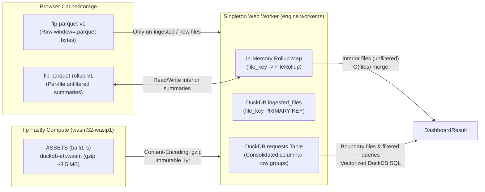

# Browser DuckDB-Wasm Analytical Engine & Per-File Rollup Cache — Design Spec

**Date:** 2026-10-31
**Status:** Ready for implementation planning. All decisions confirmed (§8).
**Target:** `app/` — Fastly Compute `flp` (`wasm32-wasip1`, `fastly = "=0.13.2"`), Next.js static export `app/web/`.
**Master plan:** `docs/superpowers/plans/2026-10-28-fastly-log-analytics-shell-and-dashboard.md`.

---

## 1. Goals & Non-Goals

### Goals
1. **Eliminate redundant per-file Parquet decoding and row scanning:** When 222 of 231 window files have already been processed, subsequent refreshes, preset range changes (`1h` ↔ `6h` ↔ `24h`), filter toggles, and full browser reloads (`Cmd+R`) must not re-decode and re-scan immutable interior files from scratch.
2. **Introduce a persistent, self-hosted `@duckdb/duckdb-wasm` (`duckdb-eh`) analytical engine:** Maintain a singleton Web Worker holding an incremental DuckDB database (`ingested_files` ledger + consolidated `requests` table) so every file is ingested into DuckDB at most once per worker lifetime and ad-hoc filtered/boundary queries run via vectorized SQL.
3. **Persist unfiltered per-file rollup summaries in `CacheStorage` (`flp-parquet-rollup-v1`):** Store compact, mergeable per-file [`Aggregator`](file:///Users/drew.michael/Projects/fastly-logs-parquet/app/web/lib/dashboard/engine.ts#L146-L266) summaries keyed by immutable `file.key` so unfiltered interior files merge in `<5 ms` even across full page reloads.
4. **Stay well within Fastly Compute resource limits:** Compress `.wasm` static assets with gzip at build time in [`app/build.rs`](file:///Users/drew.michael/Projects/fastly-logs-parquet/app/build.rs) (~8.5 MB in `flp.wasm` linear memory) and serve them with `Content-Encoding: gzip` from [`Shell::static_response`](file:///Users/drew.michael/Projects/fastly-logs-parquet/app/src/shell.rs#L1093-L1106) without external CDN dependencies.

### Non-Goals
- Server-side request rollups or server-side request compaction (master-plan D1 remains unchanged).
- Changing the [`DashboardResult`](file:///Users/drew.michael/Projects/fastly-logs-parquet/app/web/lib/dashboard/engine.ts#L50-L57) or [`FetchStats`](file:///Users/drew.michael/Projects/fastly-logs-parquet/app/web/lib/dashboard/engine.ts#L34-L42) public return shape consumed by [`Dashboard.tsx`](file:///Users/drew.michael/Projects/fastly-logs-parquet/app/web/components/dashboard/Dashboard.tsx).

---

## 2. Architecture



---

## 3. Self-Hosted Gzipped Wasm Asset Pipeline

### 3.1 Frontend Static Export (`app/web`)
- Add `@duckdb/duckdb-wasm` to `app/web/package.json`.
- Provide a build/prebuild step (`scripts/copy-duckdb-assets.mjs`, wired into `dev`, `build`, and `test`) that copies only the modern Exception Handling bundle (`duckdb-eh.wasm` and `duckdb-browser-eh.worker.js`) from `node_modules/@duckdb/duckdb-wasm/dist/` into `app/web/public/duckdb/`.
- Exclude the legacy `duckdb-mvp.wasm` and `duckdb-coi.wasm` bundles from `app/web/public/` so `app/web/out/` contains a single `.wasm` binary.

### 3.2 Compile-Time Gzip Embedding (`app/build.rs` & `app/src/site.rs`)
- Extend [`site::Asset`](file:///Users/drew.michael/Projects/fastly-logs-parquet/app/src/site.rs#L1-L5) with `pub content_encoding: Option<&'static str>`:
  ```rust
  pub struct Asset {
      pub path: &'static str,
      pub bytes: &'static [u8],
      pub content_type: &'static str,
      pub content_encoding: Option<&'static str>,
  }
  ```
- Update [`app/build.rs`](file:///Users/drew.michael/Projects/fastly-logs-parquet/app/build.rs#L14-L33):
  - Map `Some("wasm") => "application/wasm"`.
  - For `.wasm` files (or any asset `> 1 MiB`), compress the bytes with `flate2::write::GzEncoder` (`Compression::best()`) into `$OUT_DIR/compressed/<relpath>.gz` during `build.rs` execution and emit `include_bytes!` pointing to the compressed file with `content_encoding: Some("gzip")`.
  - All other assets emit `content_encoding: None`.

### 3.3 Edge Serving (`app/src/shell.rs`)
- Update [`Shell::static_response`](file:///Users/drew.michael/Projects/fastly-logs-parquet/app/src/shell.rs#L1093-L1106) to accept the request's `accept-encoding` header:
  - When `asset.content_encoding == Some("gzip")`:
    - Always include `Vary: Accept-Encoding`.
    - If `accept-encoding` contains `gzip` (case-insensitive token check), return `asset.bytes` directly with `Content-Encoding: gzip` (zero decompression allocation in Compute).
    - If `accept-encoding` does not contain `gzip`, decompress `asset.bytes` with `flate2::read::GzDecoder` and return the uncompressed bytes without `Content-Encoding`.

---

## 4. Persistent Singleton Worker & Prewarm Protocol

### 4.1 Worker Multiplexing & Cancellation (`app/web/lib/dashboard/client.ts` & `engine.worker.ts`)
- Replace the per-call `new Worker()` + `worker.terminate()` in [`runInWorker`](file:///Users/drew.michael/Projects/fastly-logs-parquet/app/web/lib/dashboard/client.ts#L5-L52) with a module-level singleton worker instance.
- Messages between main thread and worker carry a numeric `requestId`:
  - **Main → Worker:**
    - `{ type: "prewarm", baseUrl: string }`
    - `{ type: "run", requestId: number, from: string, to: string, filters: DashboardFilter[], baseUrl: string }`
    - `{ type: "abort", requestId: number }`
  - **Worker → Main:**
    - `{ type: "progress", requestId: number, done: number, total: number }`
    - `{ type: "result", requestId: number, result: DashboardResult }`
    - `{ type: "error", requestId: number, message: string }`
- When the caller's `AbortSignal` fires, `client.ts` posts `{ type: "abort", requestId }` to the worker and rejects the caller's promise with `AbortError` **without terminating the worker**, preserving the initialized DuckDB instance and in-memory caches. The worker aborts the per-request `AbortController` mapped to `requestId`.

### 4.2 Idle Prewarming (`DuckDBPrewarm` in `AppLayout.tsx`)
- Export `prewarmDashboardWorker()` and a `<DuckDBPrewarm />` client component from `app/web/lib/dashboard/client.ts` (following the exact `requestIdleCallback` + 250ms timeout pattern of [`PlotlyPrewarm`](file:///Users/drew.michael/Projects/fastly-logs-parquet/app/web/components/PlotlyChart/index.tsx#L139-L173)).
- Mount `<DuckDBPrewarm />` next to `<PlotlyPrewarm />` in [`AppLayout.tsx`](file:///Users/drew.michael/Projects/fastly-logs-parquet/app/web/components/AppLayout.tsx#L244) so the singleton worker and `duckdb-eh.wasm` initialize in the background before the user navigates to `/dashboard`.

---

## 5. Tiered Analytical Execution & Rollup Cache

### 5.1 Per-File Unfiltered Rollup Summary (`FileRollup`)
Each immutable Parquet file `file.key` has a deterministic unfiltered summary over all rows in that file:
```ts
export type FileRollup = {
  version: 1;
  rows: number;
  bytes: number;
  totalRequests: number;
  hasBytes: boolean;
  buckets: MinuteBucket[];
  cards: Record<string, { nonNull: number; counts: [Scalar, number][] }>;
};
```
- `FileSource` in [`engine.ts`](file:///Users/drew.michael/Projects/fastly-logs-parquet/app/web/lib/dashboard/engine.ts#L59-L67) gains optional `readRollup?: (key: string) => Promise<FileRollup | null>` and `writeRollup?: (key: string, rollup: FileRollup) => Promise<void>`.
- [`browserSource`](file:///Users/drew.michael/Projects/fastly-logs-parquet/app/web/lib/dashboard/sources.ts#L16-L44) implements `readRollup` and `writeRollup` using a fast in-memory `Map<string, FileRollup>` backed by `CacheStorage` (`flp-parquet-rollup-v1`), and deletes matching entries in `evict(key)`.
- [`Aggregator`](file:///Users/drew.michael/Projects/fastly-logs-parquet/app/web/lib/dashboard/engine.ts#L146-L266) gains `mergeRollup(rollup: FileRollup)` which adds `rollup.totalRequests`, ORs `rollup.hasBytes`, sums each `MinuteBucket` into `this.buckets`, and sums each field's `nonNull` and `[Scalar, number]` entries into `this.nonNull` and `this.counts`.

### 5.2 Interior vs. Boundary File Classification
Given a query window `[fromMs, toMs)` and a `ManifestFile` with `fileStartMs = Date.parse(file.start)` and `fileEndMs = Date.parse(file.end)`:
- **Interior file:** `Number.isFinite(fileStartMs) && Number.isFinite(fileEndMs) && fileStartMs >= fromMs && fileEndMs <= toMs`. Every valid timestamp in the file falls inside `[fromMs, toMs)`.
- **Boundary file:** Overlaps `[fromMs, toMs)` (`fileEndMs > fromMs && fileStartMs < toMs`), but extends before `fromMs` or past `toMs` (note: in `v2-` window files `end` is inclusive of max `ts_ms`, so `fileEndMs < toMs` guarantees `ts < toMs` for all rows; we require `fileStartMs >= fromMs && fileEndMs < toMs` for strict `[fromMs, toMs)` interior containment).

### 5.3 Execution Flow in `runDashboard`
For each overlapping file in `manifest.files`:
1. **Unfiltered Interior Fast-Path (`filters.length === 0` and strict interior `fileStartMs >= fromMs && fileEndMs < toMs`):**
   - Check `source.readRollup(file.key)` (or in-memory rollup map).
   - **Hit:** Call `aggregator.mergeRollup(rollup)`, increment `stats.cached++`, `stats.rows += rollup.rows`, `stats.bytes += rollup.bytes`, report `onProgress`, and **skip `fetchFile`, Parquet decoding, and row scanning completely**.
2. **DuckDB-Wasm Incremental Ingestion & Query Path (for cache misses, boundary files, or when `filters.length > 0`):**
   - Check if `file.key` is already recorded in DuckDB's `ingested_files` table.
   - **If not yet in `ingested_files`:**
     - Fetch Parquet bytes via `source.fetchFile(file.key, signal)`.
     - Ingest the file into DuckDB's `requests` table (`ingestFileIntoDuckDB(file.key, bytes)`), which also computes its unfiltered `FileRollup` and saves it via `source.writeRollup(file.key, rollup)`.
   - **If already in `ingested_files`:**
     - Zero network or `CacheStorage` Parquet read is needed; increment `stats.cached++`, `stats.rows += ingestedMeta.rows`, `stats.bytes += ingestedMeta.bytes`.
   - If the file is a **strict interior file** and `filters.length === 0`, merge the freshly computed `FileRollup` into `aggregator`.
   - Otherwise (boundary file or `filters.length > 0`), collect `file.key` into `sqlFileKeys`.
3. **Vectorized SQL Aggregation for `sqlFileKeys`:**
   - If `sqlFileKeys.length > 0`, execute DuckDB SQL over `requests` restricted to `file_key IN (...) AND timestamp >= fromMs AND timestamp < toMs` plus any active `DashboardFilter` predicates (§6), and merge the resulting buckets and field counts into `aggregator`.
4. **Finalize:**
   - Call `aggregator.result()` (which uses the existing O(N) top-10 selector with shared `Intl.Collator` numeric tie-breaking), record `stats.elapsedMs`, fire `sendBeacon(source, stats)`, and return `DashboardResult`.

---

## 6. DuckDB Schema & Exact Filter Semantics

### 6.1 DuckDB Tables
```sql
CREATE TABLE IF NOT EXISTS ingested_files (
  file_key VARCHAR PRIMARY KEY,
  rows BIGINT NOT NULL,
  bytes BIGINT NOT NULL
);

CREATE TABLE IF NOT EXISTS requests (
  file_key VARCHAR NOT NULL,
  timestamp DOUBLE NOT NULL,
  resp_bytes DOUBLE,
  -- All CARD_FIELDS (including status, cache, host, url, country, etc.)
  -- stored with their native Parquet scalar values or NULL when absent in a file
  ...
);
```
When ingesting a Parquet buffer for `file_key`:
- Register the `Uint8Array` buffer with DuckDB (`db.registerFileBuffer(tempName, new Uint8Array(bytes))`), inspect present columns via `DESCRIBE SELECT * FROM read_parquet(tempName)`, verify `timestamp` is present (throwing `${file.key} has no timestamp column` if missing, matching existing behavior), and insert rows where `timestamp IS NOT NULL AND NOT isnan(timestamp)` into `requests` with missing catalog columns projected as `NULL`. Always `db.dropFile(tempName)` in a `finally` block.

### 6.2 Filter Predicate Translation
Must match [`matchesFilters`](file:///Users/drew.michael/Projects/fastly-logs-parquet/app/web/lib/dashboard/filters.ts#L60-L92) 100%:
- **Include filters:** Grouped by `field`. Within a field, conditions combine with `OR`; across fields, groups combine with `AND`. `NULL` values never match an `include` filter.
  - Exact value (no `*`): `CAST("field" AS VARCHAR) = ?`
  - Wildcard value (contains `*`): regexp or `GLOB` matching `^...$` where `*` matches `.*`.
- **Exclude filters:** Every exclude filter requires that either `"field" IS NULL` OR `CAST("field" AS VARCHAR)` does **not** match the pattern (`"field" IS NULL OR NOT (...)`), preserving rows with `NULL` in that column (matching the existing `excludes drop matches but keep null values` test in [`engine.test.ts`](file:///Users/drew.michael/Projects/fastly-logs-parquet/app/web/lib/dashboard/engine.test.ts#L364-L368)).

---

## 7. Testing & Verification Plan

1. **Unit & Integration Tests (`app/web/lib/dashboard/engine.test.ts`):**
   - All existing `runDashboard`, `dashboard filters`, `manifest paging`, and `query beacon` tests must pass unchanged.
   - **Incremental Rollup Reuse Test:** Run `runDashboard` with 3 interior files (`f1`, `f2`, `f3`), then run again with `f1`, `f2`, `f3`, and a new `f4`. Assert `source.fetchFile` is called **only once for `f4`** on the second run (0 times for `f1..f3`), `stats.cached === 3`, `stats.fetched === 1`, and the aggregated totals, buckets, and cards equal a cold run over `f1..f4`.
   - **Cross-Reload Rollup Cache Test:** Simulate a fresh worker with a pre-populated `readRollup` cache (`flp-parquet-rollup-v1` hit) and assert interior files are aggregated without calling `source.fetchFile`.
   - **Boundary vs. Interior Correctness Test:** Verify that a file straddling `toMs` (containing rows both `< toMs` and `>= toMs`) filters out rows `>= toMs` via DuckDB SQL while an interior file in the same run uses its rollup summary.
   - **DuckDB Filtered Reuse Test:** Run `runDashboard` with `include` and `exclude` filters twice over the same files; assert the second filtered query reuses DuckDB's `ingested_files` table without calling `source.fetchFile` again.
2. **Rust Static Asset Gzip Tests (`app/src/site.rs` & `app/src/shell.rs`):**
   - Test that an `Asset` with `content_encoding: Some("gzip")` returns compressed bytes + `Content-Encoding: gzip` + `Vary: Accept-Encoding` when `Accept-Encoding: gzip, deflate, br` is sent, and returns decompressed bytes + `Vary: Accept-Encoding` (without `Content-Encoding`) when `Accept-Encoding` is omitted.
3. **End-to-End Browser Verification:**
   - Build static export (`STATIC_EXPORT=1 npx next build`) and run Playwright E2E specs (`dashboard-parity.spec.ts`, `loading-cls.spec.ts`, `usage-cost-parity.spec.ts`).

---

## 8. Confirmed Decisions

| # | Question | Decision |
|---|---|---|
| 1 | Engine & Wasm packaging | Self-host `@duckdb/duckdb-wasm` (`duckdb-eh.wasm`) gzip-compressed inside `flp.wasm` (~8.5 MB in Compute memory, served with `Content-Encoding: gzip`, zero external CDN dependency). |
| 2 | Cross-reload & in-session persistence | Persist per-file unfiltered rollup summaries in `CacheStorage` (`flp-parquet-rollup-v1`) AND keep the singleton DuckDB-Wasm worker alive in-memory (`ingested_files` + `requests` table). |
