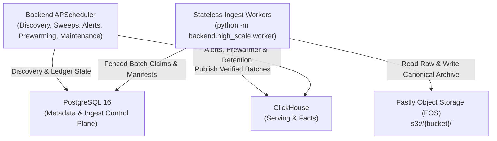

# Background Tasks & Cron Jobs

This directory contains the specification, telemetry contract, and verification checklist for every scheduled background task and cron job in **Fastly Log Analytics**.

---

## 1. Design Principles

Every scheduled background job in this system adheres to these principles:

1. **Modular Specification Structure:**
   - Every background job has a dedicated specification file under [`docs/cron/jobs/`](jobs/) documenting its purpose, cadence, execution path, role permissions, step-by-step lifecycle, query audit contract, failure modes, manual triggers, and verification checklist.
2. **100% Query, API Call & Telemetry Capture:**
   - Background jobs are subject to the same strict zero-dark-work mandate as user-facing pages.
   - Every database query (ClickHouse analytical SQL / MergeTree DDL/DML and PostgreSQL metadata & control-plane operations), cloud storage API call (FOS S3 Class A PUT/DELETE and Class B GET/LIST), Fastly API call (Edge Stats, NGWAF signals), and DNS PTR resolution must be timed, attributed, and recorded.
3. **Multi-Engine Accounting & Observability:**
   - Jobs that interact with **ClickHouse** register queries with `query_registry.register("ClickHouse", ...)` so they appear in the Live Query Monitor (`/admin/queries`); slow-query records are persisted for post-run inspection.
   - Jobs that perform FOS S3 operations record Class A / Class B counts in PostgreSQL's `usage_log` table.
   - Jobs that modify operational metadata or control-plane state use the shared PostgreSQL 16 connection pool (`backend/core/metadata/pg_pool.py`) and its query instrumentation.
4. **Strict Concurrency & Pod Safety:**
   - Jobs prevent overlapping executions for the same service using the job's `(service_id, task)` lease in PostgreSQL (`cron_runs`); a task-scoped lease does not serialize unrelated cron types.
   - Jobs that maintain pod-local caches (`insights_prewarmer`, `bot_data_refresh`) run on the web serving pod's APScheduler. Stateless ingest work runs in the dedicated worker process (`python -m backend.high_scale.worker`).
5. **Local-Only Safety Gate (`FLA_DEV_NO_CRONS=1`):**
   - Development and test environments can run safely without racing production FOS buckets or generating external write costs.
   - When `FLA_DEV_NO_CRONS=1` is set, cloud-writing jobs (`log_discovery`, `rum_discovery`, `expire`, `full_sync`, `gap_heal`, `ledger_sweep`, `ledger_rum_sweep`) are bypassed. Only local-safe read-only jobs (`insights_prewarmer`) are permitted to run; `FLA_DEV_LOCAL_CRONS=0` also disables those.
6. **Shared Run Lifecycle (`cron_run`):**
   - Every job body wraps its per-run work in `cron_run(service_id, task, ...)` ([`backend/cron/scheduler/lifecycle.py`](../../backend/cron/scheduler/lifecycle.py)), which acquires the `(service_id, task)` lease through `start_cron_run`, starts and ends progress, writes the terminal `cron_runs` row (duration, status, serialized exception), and runs the `finalize_*` backstops in a `finally`. A body must always leave a terminal status; a missing one leaves a `running` row that stalls ingestion and trips the deep health check.
   - `CronLeaseHeldError` ([`backend/core/metadata/cron_runs.py`](../../backend/core/metadata/cron_runs.py)) means another run holds the lease: `cron_run` records a clean skip (`run.skipped`), never an error.
   - `record_skip_row(source, task, summary, ...)` records a pre-flight skip that never takes the lease (nothing to evaluate) as one terminal row.
   - HTTP-triggered thread spawns own a run id and pass it in with `cron_run(run_id=...)`; that is the only other sanctioned lifecycle.
7. **Graceful Degradation & Autonomous Recovery:**
   - Background tasks must be idempotent. Re-running a job on the same data must never produce duplicate rows or corrupt control-plane state.
   - Automated crash-net sweeps (`ledger_sweep`, `ledger_rum_sweep`) recover expired worker claims and reconcile unrecorded FOS keys.

---

## 2. Unified Scheduling & Ingest Topology

Fastly Log Analytics uses a unified scheduling and ingestion architecture across single-host Docker Compose and multi-pod Kubernetes deployments:

---

## 3. Roles & Permission Governance

Background jobs respect tenant isolation and dual-role permission models:

| Role | Permitted Jobs | Permitted Actions | Architectural Rationale |
|---|---|---|---|
| **Admin** | **All Active Jobs:** Full discovery, retention expiry, full sweeps, ledger sweeps, alerting, prewarming, and housekeeping. | Manual trigger endpoints under `/api/admin/*`. | Admins own the data plane and cloud storage credentials. |
| **Analyst (Remote Live Share)** | **Zero Cron Execution:** Read-only analyst sessions connect over HTTPS to the admin's running process. | All cron execution APIs blocked with HTTP 403. | Analysts share the running host server; all background maintenance is handled by the host admin process. |

---

## 4. Background Job Inventory & Specification Catalog

Below is the catalog of scheduled background tasks. Click the link in the **Specification File** column to view the operational contract, query audit rules, and verification checklist for each job:

| Job Identifier | Default Cadence | Executor Threadpool | Engine / Target | Role Scope | Specification File |
|---|---|---|---|---|---|
| `log_discovery_{id}` | Derived (`log_period // 2`, min 5s) | streaming [10] | APScheduler + Stateless Worker | Admin | [log-discovery.md](jobs/log-discovery.md) |
| `rum_discovery_{id}` | Derived / 60 sec (min 5s) | streaming [10] | APScheduler + Stateless Worker | Admin | [rum-discovery.md](jobs/rum-discovery.md) (Faro & RUM sync contract: [rum-sync.md](jobs/rum-sync.md)) |
| `ledger_sweep_{id}` | Every 15 min (configurable) | default [10] | APScheduler + Postgres Control Plane | Admin | [ledger-sweep.md](jobs/ledger-sweep.md) |
| `ledger_rum_sweep_{id}` | Every 15 min (configurable) | default [10] | APScheduler + Postgres Control Plane | Admin | [ledger-rum-sweep.md](jobs/ledger-rum-sweep.md) |
| `full_sync_{id}` | 03:30, 09:30, 15:30, 21:30 UTC (`cron_full_sweep`) | default [10] | APScheduler + FOS / Postgres Control Plane | Admin | [full-sync.md](jobs/full-sync.md) |
| `gap_heal_{id}` | Every 30 min (configurable) | default [10] | APScheduler + Fastly Stats / ClickHouse | Admin | [gap-heal.md](jobs/gap-heal.md) |
| `expire_{id}` | Hourly (`expire_interval_mins=60`) | default [10] | APScheduler + ClickHouse / FOS Archive | Admin | [expire.md](jobs/expire.md) |
| `metadata_cleanup_{id}` | Daily 03:15 UTC (configurable) | maintenance [3] | APScheduler + PostgreSQL 16 | Admin | [metadata-cleanup.md](jobs/metadata-cleanup.md) |
| `alerts_evaluation_{id}` | Every `log_period` sec (configurable) | default [10] | APScheduler + ClickHouse | Admin | [alerts-evaluation.md](jobs/alerts-evaluation.md) |
| `insights_prewarmer_{id}` | Every 240 sec (jitter 15s) | maintenance [3] | APScheduler + ClickHouse | Admin | [insights-prewarmer.md](jobs/insights-prewarmer.md) |
| `rdns_enrichment` | Every 5 min (jitter 15s) | maintenance [3] | APScheduler + ClickHouse / PostgreSQL 16 | Global / Admin | [rdns-enrichment.md](jobs/rdns-enrichment.md) |
| `bot_data_refresh` | Daily 02:00 UTC | maintenance [3] | APScheduler | Global / Admin | [bot-data-refresh.md](jobs/bot-data-refresh.md) |
| `ngwaf_sync_{id}` | Every 5 min (`cron_ngwaf.interval_mins`), when NGWAF linked | maintenance [3] | APScheduler + PostgreSQL 16 | Admin | [ngwaf-sync.md](jobs/ngwaf-sync.md) |
| `share_audit_purge` | Daily 03:45 UTC | maintenance [3] | APScheduler + PostgreSQL 16 | Global / Admin | [share-audit-purge.md](jobs/share-audit-purge.md) |

---

## 5. Universal Telemetry, Timing & Multi-Engine Query Audit Mandate

Every background job participates in the telemetry and audit harness:

### 5.1 Storage & Operational Logging
1. **`cron_runs` Table in PostgreSQL 16 (`backend/core/metadata/cron_runs.py`):**
   - Every execution records its status (`success`, `warning`, `error`, `skipped`), duration, summary, error message, and applicable typed counters such as `files_deleted_fos`, `rows_ingested`, and `outcome_counters`.
2. **PostgreSQL `usage_log` Billing & Cost Telemetry:**
   - Any job executing FOS operations records Class A (PUT, DELETE, LIST) and Class B (GET) calls with exact operation attributes.
3. **`cron_progress` Server-Sent Events (SSE):**
   - Ingest and maintenance tasks emit live step-by-step progress events consumed by the Admin UI (`/admin`, backed by `GET /api/admin/sync-status` and `GET /api/services/{service_id}/sync-progress`).

### 5.2 Multi-Engine Query Auditing Rules
- **ClickHouse Operations:** Every query issued against ClickHouse (analytical queries, alert evaluations, insights prewarming, and partition retention maintenance) registers through `query_registry.register("ClickHouse", ...)` so operators can audit them in the Live Query Monitor (`/admin/queries`).
- **PostgreSQL Control-Plane & Ledger Operations:** State transitions (`discovered` -> `claimed` -> `published` / `committed`) use parameterized queries and record transaction durations.
- **PostgreSQL Metadata Access:** All reads and writes to operational metadata and state tables flow through the PostgreSQL connection pool (`psycopg_pool.ConnectionPool`) per ADR-22, recording pool wait times (`app.thread_wait_ms`).

---

## 6. Concurrency, Locking, Backpressure & Resource Governance

To maintain sub-second UI responsiveness while background jobs run:

1. **3-Executor Thread Pool Architecture (`backend/cron/scheduler/runner.py`):**
   - The in-process APScheduler partitions execution across three isolated `ThreadPoolExecutor` pools configured in `backend/cron/scheduler/runner.py`:
     - **`streaming` (10 worker threads):** Dedicated to latency-critical, high-frequency discovery (`log_discovery_`, `rum_discovery_`).
     - **`maintenance` (3 worker threads):** Dedicated to periodic housekeeping and analytics precomputation jobs (`insights_prewarmer_`, `metadata_cleanup`, `rdns_enrichment`, `bot_data_refresh`, `ngwaf_sync_`, `share_audit_purge`).
     - **`default` (10 worker threads):** Allocated for alerting, ledger sweeps, full sweeps, gap healing, and retention enforcement (`alerts_evaluation_`, `expire_`, `full_sync_`, `gap_heal_`, `ledger_sweep_`, `ledger_rum_sweep_`).
   - **Starvation Isolation:** Segregating heavy maintenance jobs into a bounded pool (3 threads) prevents multi-step operations from monopolizing execution slots, keeping high-frequency streaming discovery responsive.

2. **Per-Service Task Leases:**
   - Scheduled operations acquire a task-scoped `(service_id, task)` lease in PostgreSQL (`cron_runs`) so concurrent ticks of the same job never overlap.

3. **Heavy Refresh Throttling (`_claim_heavy_refresh`):**
   - Auxiliary updates after `log_discovery` (`update_top_values()` and the usage-log phase including `reconcile_fastly_stats()`) run at most once every 60 seconds per service, preventing CPU churn on busy ingest streams.

4. **Adaptive Gap Healing Throttle:**
   - If sustained log loss is detected by `gap_heal_{service_id}`, subsequent sweeps are throttled by severity band to prevent cascading full sweeps when losses are caused by upstream Fastly edge drop policies.

---

## 7. Automated Verification & Testing Runbook

When verifying background jobs during automated test suites or manual verification:

### Verification Checklist:
- [ ] **1. Scheduler Registration Audit:**
  - Inspect `scheduler.get_jobs()`.
  - Confirm every job in the catalog is registered according to role and activation gates (e.g. `alerts_evaluation` only registers when alerts exist; `ngwaf_sync` only registers when an NGWAF workspace is linked).
- [ ] **2. Manual API Triggering:**
  - Execute manual POST triggers for each job and verify HTTP 200 response:
    - `/api/admin/sync/{service_id}` (`log_discovery`)
    - `/api/admin/full-sweep/{service_id}` (`full_sync`)
    - `/api/admin/gap-heal/{service_id}` (`gap_heal`)
    - `/api/admin/ledger/sweep/{service_id}` (`ledger_sweep`)
    - `/api/admin/metadata-cleanup/{service_id}` (`metadata_cleanup`)
- [ ] **3. `cron_runs` Verification:**
  - Inspect PostgreSQL table `cron_runs` via `backend.core.metadata`.
  - Assert that execution status is `success` and `duration_s > 0`.
- [ ] **4. Telemetry & Query Audit Verification:**
  - Verify queries appear in Live Query Monitor (`/admin/queries`) under `ClickHouse` and `Postgres`.
  - Verify FOS operations are attributed in PostgreSQL's `usage_log` table.
- [ ] **5. Dev Safety Verification (`FLA_DEV_NO_CRONS=1`):**
  - Launch application with `FLA_DEV_NO_CRONS=1`.
  - Confirm cloud-writing jobs are not registered and do not fire.
  - Confirm local-safe jobs (`insights_prewarmer`) register and run normally unless `FLA_DEV_LOCAL_CRONS=0` is also set.
