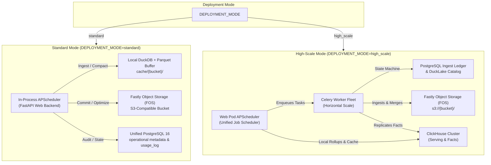

# Background Tasks & Cron Jobs — Master Architectural Directives & Specification Catalog

This directory contains the authoritative specification, telemetry contract, query audit mandate, and automated testing runbook for every scheduled background task and cron job in **Fastly Log Analytics**.

---

## 1. Master Directives & Operating Principles

Every scheduled background job in this system must adhere to these non-negotiable principles:

1. **Modular Specification Structure:**
   - Every background job has a dedicated specification file under [`docs/cron/jobs/`](jobs/) documenting its purpose, cadence, architectural execution matrix, role permissions, step-by-step lifecycle, query audit contract, failure modes, manual triggers, and AI verification checklist.
2. **100% Query, API Call & Telemetry Capture:**
   - Background jobs are subject to the same strict zero-dark-work mandate as user-facing pages.
   - Every database query (DuckDB analytical SQL, ClickHouse MergeTree DDL/DML, and PostgreSQL metadata operations), cloud storage API call (FOS S3 Class A PUT/DELETE and Class B GET/LIST), Fastly API call (Edge Stats, NGWAF signals), and DNS PTR resolution must be timed, attributed, and recorded.
3. **Multi-Engine Accounting & Observability:**
   - Jobs that interact with **ClickHouse** must register queries with `query_registry.register("ClickHouse", ...)` so they appear in the Live Query Monitor.
   - DuckDB statements are timed and attributed through the query registry and Live Query Monitor; slow-query records are persisted for post-run inspection. `telemetry_queries` is page-load telemetry, not the cron query audit surface.
   - Jobs that perform FOS S3 operations must record Class A / Class B counts in PostgreSQL's `usage_log` table.
   - Jobs that modify operational metadata must use the shared PostgreSQL connection pool and its query instrumentation.
4. **Strict Concurrency & Pod Safety:**
   - Long-running cloud write jobs (`optimize`, `expire`, `commit`) must prevent overlapping executions for the same service using the job's lease or lock; a task-scoped lease does not serialize every cron type.
   - In distributed deployments (`DEPLOYMENT_MODE=high_scale`), jobs that touch pod-local state, caches, or DuckDB memory pools (`local_compact`, `partial_hour_merge`, `rollup_heal`, `rollup_compact`, `insights_prewarmer`, `alerts_evaluation`, `metric_snapshot`, `duckdb_recycle`) **strictly run on the web serving pod's APScheduler**. They are NEVER dispatched to Celery workers, preventing multi-process lock contention on local files.
   - Cron 8 (`expire`) also stays on the serving pod's APScheduler in High-Scale mode; it is not routed to Celery workers.
5. **Local-Only Safety Gate (`FLA_DEV_NO_CRONS=1`):**
   - Development environments and AI test sessions must be capable of running safely without racing production FOS buckets or generating external write costs.
   - When `FLA_DEV_NO_CRONS=1` is set, all cloud-writing jobs (`log_discovery`, `commit`, `optimize`, `expire`, `full_sync`, `gap_heal`) are completely bypassed. Only local-safe jobs (`local_compact`, `rollup_compact`, `rollup_heal`, `partial_hour_merge`, `duckdb_recycle`, `metric_snapshot`) are permitted to run.
6. **Shared Run Lifecycle (`cron_run`):**
   - Every job body wraps its per-run work in `cron_run(service_id, task, ...)` ([`backend/cron/lifecycle.py`](../../backend/cron/lifecycle.py)), which acquires the `(service_id, task)` lease through `start_cron_run`, starts and ends progress, writes the terminal `cron_runs` row (duration, status, serialized exception) and runs the `finalize_*` backstops in a `finally`. A body must always leave a terminal status; a missing one leaves a `running` row that stalls ingestion and trips the deep health check.
   - `CronLeaseHeldError` ([`cron_log.py`](../../backend/core/metadata/cron_log.py)) means another run holds the lease: `cron_run` records a clean skip (`run.skipped`), never an error.
   - `record_skip_row(source, task, summary, ...)` records a pre-flight skip that never takes the lease (nothing to evaluate, disk too full) as one terminal row.
   - HTTP-triggered thread spawns own a run id and pass it in with `cron_run(run_id=...)`; that is the only other sanctioned lifecycle.
7. **Graceful Degradation & Autonomous Recovery:**
   - Background tasks must be idempotent. Re-running a job on the same data must never produce duplicate rows or corrupt catalog state.
   - Distributed pipelines must include automated crash-net sweeps (`ledger_sweep`, `ledger_rum_sweep`) to recover orphaned worker claims.
8. **Interactive Clarification & Inquiry Mandate (Never Guess):**
   - Before working on, modifying, or testing any background job or its scheduler registration, the AI agent must read the specific job specification (`docs/cron/jobs/{job}.md`) and supporting architecture docs, and proactively ask the operator clarifying questions regarding scheduling, backpressure, failure handling, or role constraints.
   - Any clarifications or design decisions must be updated in the job specification before executing tests or applying code changes.

---

## 2. Scheduling Topologies & Engines

The execution engine for background jobs depends on the configured `DEPLOYMENT_MODE`:

---

## 3. Roles & Permission Governance

Background jobs respect tenant isolation and dual-role permission models:

| Role | Permitted Jobs | Prohibited Jobs | Architectural Rationale |
|---|---|---|---|
| **Admin** | **All Active Jobs:** Full ingest, compaction, optimization, snapshot expiry, full sweeps, alerting, and housekeeping. | None | Admins own the data plane and cloud storage credentials. |
| **Analyst (Remote Live Share)** | **Zero Cron Execution:** Read-only analyst sessions connect over HTTPS to the admin's running process. | All cron execution APIs blocked with HTTP 403. | Analysts share the running host server; all background maintenance is handled by the host admin process. |

---

## 4. Complete Background Job Inventory & Specification Catalog

Below is the master catalog of all 24 active scheduled background tasks. Standard (`rum_sync_{id}`) and High-Scale (`rum_discovery_{id}`) RUM discovery are execution variants of the same logical job, so they appear in one row. Click the link in the **Specification File** column to view the complete operational contract, query audit rules, and testing checklist for each job:

| Job Identifier | Default Cadence | Executor Threadpool | Standard Mode Engine | High-Scale Mode Engine | Role Scope | Specification File |
|---|---|---|---|---|---|---|
| `log_discovery_{id}` | Derived (`log_period // 2`, min 5s) | streaming [10] / Celery | APScheduler | APScheduler + Celery | Admin | [log-discovery.md](jobs/log-discovery.md) (Verified) |
| `commit_{id}` | Every 5 min (configurable) | streaming [10] / Celery | APScheduler | APScheduler + Celery | Admin | [commit.md](jobs/commit.md) (Verified) |
| `local_compact_{id}` | Every 2 min (`LOCAL_COMPACT_INTERVAL_MIN`) | maintenance [3] | APScheduler | Pod APScheduler | Admin | [local-compact.md](jobs/local-compact.md) (Verified) |
| `partial_hour_merge_{id}` | Every 30 sec (`PARTIAL_HOUR_MERGE_INTERVAL_SEC`) | default [10] | APScheduler | Pod APScheduler | Admin | [partial-hour-merge.md](jobs/partial-hour-merge.md) (Verified) |
| `rollup_heal_{id}` | Hourly at :05 | maintenance [3] | APScheduler | Pod APScheduler | Admin | [rollup-heal.md](jobs/rollup-heal.md) (Verified) |
| `rollup_compact_{id}` | Daily 02:00 UTC | maintenance [3] | APScheduler | Pod APScheduler | Admin | [rollup-compact.md](jobs/rollup-compact.md) (Verified) |
| `optimize_{id}` | Daily 04:00 UTC | maintenance [3] | APScheduler | Pod APScheduler | Admin | [optimize.md](jobs/optimize.md) (Verified) |
| `expire_{id}` | Hourly (`expire_interval_mins=60`) | default [10] | APScheduler | Serving-pod APScheduler | Admin | [expire.md](jobs/expire.md) (Verified) |
| `full_sync_{id}` | Every 6h (:30 UTC) | default [10] / Celery | APScheduler | APScheduler + Celery | Admin | [full-sync.md](jobs/full-sync.md) (Verified) |
| `gap_heal_{id}` | Every 30 min (configurable) | default [10] / Celery | APScheduler | APScheduler + Celery | Admin | [gap-heal.md](jobs/gap-heal.md) (Verified) |
| `metadata_cleanup_{id}` | Daily 03:15 UTC (configurable) | maintenance [3] | APScheduler | Pod APScheduler | Admin | [metadata-cleanup.md](jobs/metadata-cleanup.md) (Verified) |
| `alerts_evaluation_{id}` | Every `log_period` sec (configurable) | default [10] | APScheduler | Pod APScheduler | Admin | [alerts-evaluation.md](jobs/alerts-evaluation.md) (Verified) |
| `insights_prewarmer_{id}` | Every 240 sec (jitter 15s) | maintenance [3] | APScheduler | Pod APScheduler | Admin | [insights-prewarmer.md](jobs/insights-prewarmer.md) (Verified) |
| `ledger_sweep_{id}` | Every 15 min (configurable) | default [10] / Celery | Disabled | APScheduler + Celery | Admin | [ledger-sweep.md](jobs/ledger-sweep.md) (Verified) |
| `rum_sync_{id}` (Standard) / `rum_discovery_{id}` (High-Scale) | Derived / 60 sec (min 5s) | streaming [10] (Standard) / Celery (High-Scale) | APScheduler | APScheduler + Celery | Admin | [Standard mode](jobs/rum-sync.md) (Verified); [High-Scale mode](jobs/rum-discovery.md) (Verified) |
| `rum_commit_{id}` | Post-sync immediate & 1m periodic | default [10] | APScheduler | Disabled | Admin | [rum-commit.md](jobs/rum-commit.md) (Verified) |
| `ledger_rum_sweep_{id}` | Every 15 min (configurable) | default [10] / Celery | Disabled | APScheduler + Celery | Admin | [ledger-rum-sweep.md](jobs/ledger-rum-sweep.md) (Verified) |
| `metric_snapshot` | Every 60 sec (jitter 5s) | maintenance [3] | APScheduler | Pod APScheduler | Global / Admin & Analyst A | [metric-snapshot.md](jobs/metric-snapshot.md) (Verified) |
| `rdns_enrichment` | Every 5 min (jitter 15s) | maintenance [3] | APScheduler | Pod APScheduler | Global / Admin | [rdns-enrichment.md](jobs/rdns-enrichment.md) (Verified) |
| `bot_data_refresh` | Daily 02:00 UTC | maintenance [3] | APScheduler | Pod APScheduler | Global / Admin | [bot-data-refresh.md](jobs/bot-data-refresh.md) (Verified) |
| `ngwaf_sync_{id}` | Every 5 min | maintenance [3] | APScheduler | Pod APScheduler | Admin | [ngwaf-sync.md](jobs/ngwaf-sync.md) (Verified) |
| `share_audit_purge` | Daily 03:45 UTC | maintenance [3] | APScheduler | Pod APScheduler | Global / Admin & Analyst A | [share-audit-purge.md](jobs/share-audit-purge.md) (Verified) |
| `duckdb_recycle` | Every 60 min (dynamic down to 2m) | maintenance [3] | APScheduler | Pod APScheduler | Process-Wide | [duckdb-recycle.md](jobs/duckdb-recycle.md) (Verified) |

---

## 5. Universal Telemetry, Timing & Multi-Engine Query Audit Mandate

Every background job must participate in the comprehensive telemetry and audit harness:

### 5.1 Storage & Operational Logging
1. **`cron_runs` Table in PostgreSQL 16 (`cron_log`):**
   - Every execution records its status (`success`, `warning`, `error`), duration, summary, error message, and applicable typed counters such as `files_deleted_fos`, `rows_ingested`, and `outcome_counters`. There is no `details_json` column.
   - Job-specific result tallies belong in the supported summary/counter fields; do not assume arbitrary JSON detail columns.
2. **PostgreSQL `usage_log` Billing & Cost Telemetry:**
   - Any job executing FOS operations must record Class A (PUT, DELETE, LIST) and Class B (GET) calls with exact operation attributes.
3. **`cron_progress` Server-Sent Events (SSE):**
   - Ingest and maintenance tasks emit live step-by-step progress events consumed by the Admin UI (`/admin/sync-status`).

### 5.2 Multi-Engine Query Auditing Rules
- **DuckDB Analytical SQL:** Every analytical query run during alerting, prewarming, or rollup generation must be wrapped with timing instrumentation and recorded in `telemetry_queries`.
- **ClickHouse Operations:** Every query issued against ClickHouse (including `BACKUP TABLE`, projection aggregations, and partition merges) must register through `query_registry.register("ClickHouse", ...)` so operators can audit them in the Live Query Monitor.
- **PostgreSQL Ledger Operations:** Distributed state transitions (`discovered` -> `claimed` -> `committed`) must use parameterized queries and record transaction durations.
- **PostgreSQL Metadata Access:** All reads and writes to operational metadata and state tables must flow through the PostgreSQL connection pool (`psycopg_pool.ConnectionPool`) per ADR-22, recording pool wait times (`app.thread_wait_ms`).

---

## 6. Concurrency, Locking, Backpressure & Resource Governance

To maintain sub-second UI responsiveness while background jobs run:

1. **3-Executor Thread Pool Architecture (`backend/cron/scheduler.py`):**
   - The in-process APScheduler partitions execution across three isolated `ThreadPoolExecutor` pools configured in `backend/cron/scheduler.py`:
     - **`streaming` (10 worker threads):** Dedicated exclusively to latency-critical, high-frequency data ingestion, and buffer flushing (`log_discovery_`, `rum_discovery_`, `rum_sync_`, `commit_`).
     - **`maintenance` (3 worker threads):** Dedicated to periodic, heavy, multi-step housekeeping and analytics precomputation jobs (`local_compact_`, `rollup_compact_`, `rollup_heal_`, `optimize_`, `insights_prewarmer_`, `metadata_cleanup`, `rdns_enrichment`, `bot_data_refresh`, `ngwaf_sync_`, `share_audit_purge`, `duckdb_recycle`, `reconcile_fastly_`, `metric_snapshot`).
     - **`default` (10 worker threads):** Allocated for general alerting, active-hour speed layer, and retention enforcement (`alerts_evaluation_`, `partial_hour_merge_`, `expire_`, `rum_commit_`, `full_sync_`, `gap_heal_`).
   - **Starvation Isolation:** Segregating heavy maintenance jobs into a tightly bounded pool (3 threads) prevents multi-minute operations (such as DuckLake cloud compaction, daily rollup merges, or statistical prewarming) from monopolizing execution slots. High-frequency streaming discovery and commit cycles are guaranteed immediate thread allocation in `streaming`, preventing log ingestion lag and buffer backlog accumulation.

2. **Per-Service Write Locks:**
   - Ingest, commit, and compaction operations acquire an exclusive per-service file or distributed lock. Only one write operation can mutate a service's Parquet buffers or DuckLake catalog at a time.

3. **Heavy Refresh Throttling (`_claim_heavy_refresh`):**
   - Auxiliary background updates (`update_top_values()` and `reconcile_fastly_stats()`) are strictly throttled to run at most once every 60 seconds per service, preventing continuous CPU churn on busy ingest streams.

4. **Queue-Depth Backpressure:**
   - Distributed task dispatchers inspect Redis queue depth before enqueuing conversion tasks, preventing task queue saturation during worker restarts.

5. **Adaptive Gap Healing Throttle:**
   - If sustained log loss is detected by `gap_heal_{service_id}`, subsequent sweeps are throttled to prevent cascading full sweeps when losses are caused by upstream Fastly edge drop policies.

6. **DuckDB Recycle: Dynamic Interval Adaptation & RSS Memory Gating:**
   - `duckdb_recycle` periodically drains and re-instantiates DuckDB connection pools to reclaim resident memory accumulated by C++ Parquet metadata caching (`enable_object_cache`):
     - **RSS Memory Gating (`_recycle_rss_threshold_bytes`):** Configured via `DUCKDB_RECYCLE_RSS_THRESHOLD_MB`. If process RSS is below this threshold, recycling is skipped (`"skipped: RSS XMB < threshold YMB"`), preserving warm Parquet footer metadata caches and avoiding cold-cache latency penalties when memory headroom is ample. It also integrates with `maybe_graceful_restart()` (`BACKEND_GRACEFUL_RESTART_RSS_MB`) to trigger a clean exit and container restart before the OS kernel issues an unrecoverable OOM-SIGKILL.
     - **Dynamic Interval Adaptation (`_maybe_adjust_recycle_schedule`):** Under elevated memory pressure (when RSS reaches or exceeds 80% of threshold, or when a previous drain was incomplete), the scheduler dynamically accelerates the recycle interval down to a rapid 2-minute cadence (`target_mins = min(2.0, baseline_mins)`). Once memory drops safely below 50% of the threshold, the schedule automatically relaxes back to the baseline setting (`DUCKDB_RECYCLE_INTERVAL_MIN`, default: 60m).

---

## 7. Automated Verification & Testing Runbook

When verifying background jobs during automated test suites or dedicated AI testing sessions:

### Verification Checklist:
- [ ] **1. Scheduler Registration Audit:**
  - Inspect `scheduler.get_jobs()`.
  - Confirm all 24 active jobs are registered according to their deployment mode, role, and activation gates (e.g. `alerts_evaluation` only registers when alerts exist).
- [ ] **2. Manual API Triggering:**
  - Execute manual POST triggers for each job and verify HTTP 200 response:
    - `/api/admin/sync/{service_id}` (`log_discovery`)
    - `/api/admin/commit/{service_id}` (`commit`)
    - `/api/admin/compact/{service_id}` (`local_compact`)
    - `/api/admin/rollups/compact/{service_id}` (`rollup_compact`)
    - `/api/admin/optimize/{service_id}` (`optimize`)
    - `/api/admin/expire-snapshots/{service_id}` (`expire`)
    - `/api/admin/full-sweep/{service_id}` (`full_sync`)
    - `/api/admin/gap-heal/{service_id}` (`gap_heal`)
    - `/api/admin/duckdb/recycle` (`duckdb_recycle`)
- [ ] **3. `cron_runs` Verification:**
  - Inspect PostgreSQL table `cron_runs` via `metadata.cron_log`.
  - Assert that execution status is `success` and `duration_s > 0`.
- [ ] **4. Telemetry & Query Audit Verification:**
  - Verify queries appear in Live Query Monitor (`/admin/queries`) under appropriate engines (`DuckDB`, `ClickHouse`, `PostgreSQL`).
  - Verify FOS operations are attributed in PostgreSQL's `usage_log` table.
- [ ] **5. Dev Safety Verification (`FLA_DEV_NO_CRONS=1`):**
  - Launch application with `FLA_DEV_NO_CRONS=1`.
  - Confirm cloud-writing jobs are not registered and do not fire.
  - Confirm local-safe jobs (`local_compact`, `partial_hour_merge`, `rollup_heal`, `rollup_compact`, `duckdb_recycle`, `metric_snapshot`) register and run normally.
