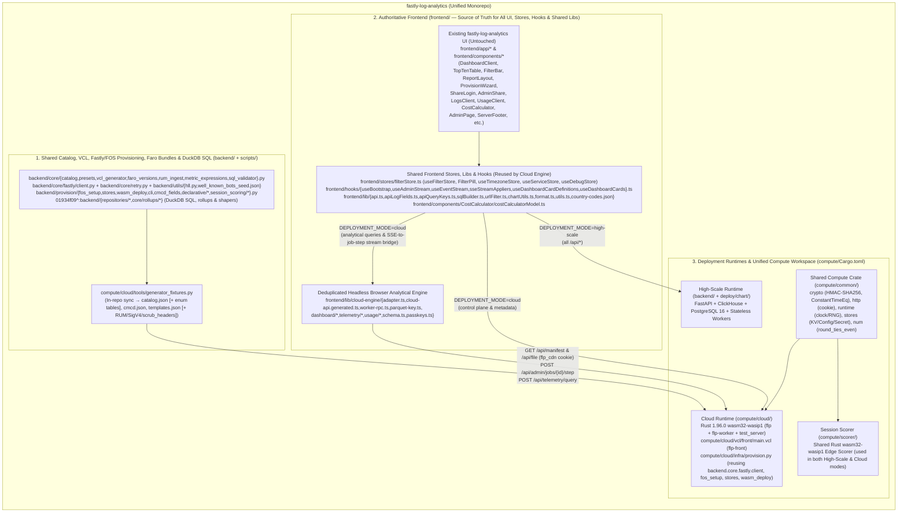

# Unify `fastly-logs-parquet` into `fastly-log-analytics` — Architecture & Migration Plan

> **For agentic workers:** REQUIRED SUB-SKILL: Use `superpowers:subagent-driven-development` (recommended) or `superpowers:executing-plans` to implement this plan task-by-task. Steps use checkbox (`- [ ]`) syntax for tracking.

## Goal Description

Merge the Fastly-only serverless runtime (`app/`) from [`fastly-logs-parquet`](file:///Users/drew.michael/Projects/fastly-logs-parquet/AGENTS.md) (`flp`) into [`fastly-log-analytics`](file:///Users/drew.michael/Projects/fastly-log-analytics/README.md) (`fla`) so a single repository supports both **Cloud (Serverless Fastly Compute + FOS)** and **High-Scale (ClickHouse + PostgreSQL 16)** deployments while using **[`fastly-log-analytics/frontend/`](file:///Users/drew.michael/Projects/fastly-log-analytics/frontend) as the strict, single source of truth for all UI work** and **reusing as much existing `fla` code as possible**.

1. **`fastly-log-analytics/frontend/` Owns 100% of the UI**:
   All pages, layouts, theme rules, charts, maps, modals, and wizards in [`fastly-log-analytics/frontend/`](file:///Users/drew.michael/Projects/fastly-log-analytics/frontend) remain the untouched, authoritative UI.
2. **All Duplicate UI, Stores, Hooks, Types, Mock E2E Specs & Helper Rewrites in `fastly-logs-parquet/app/web/` Are Discarded**:
   In addition to discarding `app/web/components/**` (+ 29 `.test.tsx` files), `app/web/app/**`, `app/web/tests/**`, and `app/web/stores/filterStore.ts`, we discard **12 duplicate `flp` library & type modules** (`cards.ts`, `countries.ts`, `format.ts`, `utils.ts`, `control-plane.ts`, `data-files.ts`, `help-content.ts`, `telemetry/columns.ts`, `telemetry/parquet.ts`, `lib/api.ts`, `types/plotly.ts`, `types/plotly-cartesian.d.ts`), **all 14 `flp` hooks in `app/web/hooks/**` (+ their `.test.tsx` files)** (`useBootstrap.ts`, `useAdminStream.ts`, `useEventStream.ts`, `useServices.ts`, `useStorageTrees.ts`, `useCronActivity.ts`, `useVersion.ts`, `useUsageActions.ts`, `useIngestEvents.ts`, `useOpsCacheGuard.ts`, `useOpsLogs.ts`, `useUsageData.ts`, `useUsageSummary.ts`, `useEstimatePrefill.ts`), **`scripts/gen-types.mjs`**, and **8 mock-DOM E2E parity specs + `serve.mjs` (533 lines) + `csp.mjs` (79 lines)** (`admin-parity.spec.ts`, `shell-parity.spec.ts`, `public-pages-parity.spec.ts`, `usage-cost-parity.spec.ts`, `operational-logging.spec.ts`, `loading-cls.spec.ts`, `goal1.spec.ts`, `goal2-parity.spec.ts`, `serve.mjs`, `csp.mjs`), reusing `fla/frontend/`'s existing stores, hooks, SQL builders, URL filter sync, chart bucket utilities, formatters, country maps, auth pages, cost calculator, and E2E suites.
3. **Only the Deduplicated Headless Browser Data Engine (`frontend/lib/cloud-engine/`) and Unified Compute Workspace (`compute/{Cargo.toml,common,cloud,scorer}`) Are Merged**:
   In Cloud Mode (`NEXT_PUBLIC_DEPLOYMENT_MODE=cloud`), [`frontend/lib/api.ts`](file:///Users/drew.michael/Projects/fastly-log-analytics/frontend/lib/api.ts) and [`frontend/hooks/useEventStream.ts`](file:///Users/drew.michael/Projects/fastly-log-analytics/frontend/hooks/useEventStream.ts) route analytical queries to the headless browser DuckDB-Wasm / Rollup Worker (`frontend/lib/cloud-engine/`) and shape responses to `fastly-log-analytics/frontend/`'s exact OpenAPI schema (`types/api.generated.ts`), while routing control-plane/metadata requests (including multi-step resumable Compute jobs bridged into SSE frames) to `compute/cloud/`, which shares a unified Cargo workspace and `compute/common` crate with `compute/scorer/`.

---

## Maximizing Code Reuse from `fastly-log-analytics` (`fla`) When Porting `flp`

> [!TIP]
> **12 Major `fla` DRY Consolidation & Code-Reuse Wins Identified Across Both Repos**
> Exhaustively auditing every file in `fla` (`HEAD` and commit `01934f09^` right before Standard DuckDB mode was removed) against every file in `flp` revealed 12 areas where `fla` **already has** production-tested code that directly replaces `flp` duplicates, unifies shared primitives, or accelerates the Cloud port:

| Area | What `flp` Had / Needed | What We Reuse & Consolidate Directly with `fla` (`fastly-log-analytics`) |
| :--- | :--- | :--- |
| **1. DuckDB SQL Queries & Response Shapers for Pages 8–15 (+ `/insights`)** | Needed DuckDB-Wasm SQL queries & OpenAPI response shapers for `/origin`, `/performance`, `/security`, `/network`, `/fastly-value`, `/assets-shield`, `/rum`, `/streaming`, `/sessions`, `/query`, and `/insights` | **Reuse `01934f09^:backend/repositories/*` + `HEAD` [`backend/core/metric_expressions.py`](file:///Users/drew.michael/Projects/fastly-log-analytics/backend/core/metric_expressions.py) & [`backend/repositories/insights/definitions/sql_coalesced.py`](file:///Users/drew.michael/Projects/fastly-log-analytics/backend/repositories/insights/definitions/sql_coalesced.py)**: `fla`'s git history at `01934f09^` contains the exact, production-verified **DuckDB SQL queries and response shapers** for every domain analytics page (`origin.py`, `performance.py`, `security/{sql,aggregates,watchdog}.py`, `network.py`, `value.py`, `assets.py`, `rum.py`, `cmcd.py`, `sessions/{queries,scoring}.py`, `query.py`), already written against `catalog.py` columns and `types/api.generated.ts`! |
| **2. DuckDB Rollup Specs, Top-N Sketch Folding & Fastpaths** | `flp` only had summary fast-paths for `/dashboard` (`summaries.ts`), scanning raw Parquet for other pages | **Reuse `01934f09^:backend/core/rollups/*`, `01934f09^:backend/repositories/rollup_executor/{scalars,time_series,top_n,exact_window}.py`, `01934f09^:backend/repositories/top_n_rollups.py`, & `01934f09^:backend/repositories/insights/rollup_fastpath.py`**: `fla` already implemented per-hour/day DuckDB rollup schemas and readers (`origin_dims.py`, `network_dims.py`, `network_transport.py`, `security_dims.py`, `security_bots.py`, `session_rollups.py`, `overview_rollups.py`, `time_series_rollups.py`, `fold_rows`, `fold_sketches`, `build_rolled_sql`, `build_ip_spread_sql`)! |
| **3. Drop 12 Duplicate `flp` Frontend Library/Type Modules & Unify Stores, URL Sync, Time Buckets & SQL Helpers** | Duplicate `stores/filterStore.ts`, `cards.ts`, `countries.ts`, `format.ts`, `utils.ts`, `control-plane.ts`, `data-files.ts`, `help-content.ts`, `telemetry/columns.ts`, `telemetry/parquet.ts`, `lib/api.ts`, `types/plotly.ts`, `types/plotly-cartesian.d.ts`, plus duplicate URL filter parsers, preset windows, bucket grids, and SQL quoting | **Delete all 12 `flp` duplicates and consolidate into `fla/frontend/`**:<br>• [`frontend/stores/filterStore.ts`](file:///Users/drew.michael/Projects/fastly-log-analytics/frontend/stores/filterStore.ts) (`useFilterStore`, `FilterPill`, `useTimezoneStore`, `useServiceStore`, `useDebugStore`) replaces `app/web/stores/filterStore.ts` (adding only `comparePreset`/`computeCompareRange` & `dashboardBounds`/`dashboardAvailability`)<br>• [`frontend/lib/urlFilter.ts`](file:///Users/drew.michael/Projects/fastly-log-analytics/frontend/lib/urlFilter.ts) (`hydrateFilterStoreFromUrl`, `quantizeAnchor`), [`useDashboardCards.ts`](file:///Users/drew.michael/Projects/fastly-log-analytics/frontend/hooks/useDashboardCards.ts) (`useFilterUrlWriteback`), [`TimePickerPopover.tsx`](file:///Users/drew.michael/Projects/fastly-log-analytics/frontend/components/FilterBar/TimePickerPopover.tsx) (`PRESET_WINDOWS`), & [`frontend/lib/chartUtils.ts`](file:///Users/drew.michael/Projects/fastly-log-analytics/frontend/lib/chartUtils.ts) (`floorToBucket`, `denseTimeGrid`) replace duplicate URL filter sync in `dashboard/filters.ts` (`L1–54`) and duplicate time-bucket grids in `dashboard/range.ts` & `usage/series.ts`<br>• [`frontend/lib/sqlBuilder.ts`](file:///Users/drew.michael/Projects/fastly-log-analytics/frontend/lib/sqlBuilder.ts) (`sqlEscape`, `quoteIdent`, `isNumericType`) replaces `sqlString` & `sqlIdent` in `dashboard/duckdb.ts`<br>• [`frontend/hooks/useDashboardCardDefinitions.ts`](file:///Users/drew.michael/Projects/fastly-log-analytics/frontend/hooks/useDashboardCardDefinitions.ts) & [`frontend/lib/apiLogFields.ts`](file:///Users/drew.michael/Projects/fastly-log-analytics/frontend/lib/apiLogFields.ts) replace `cards.ts` and `control-plane.ts`<br>• [`frontend/lib/country-codes.json`](file:///Users/drew.michael/Projects/fastly-log-analytics/frontend/lib/country-codes.json), [`frontend/lib/format.ts`](file:///Users/drew.michael/Projects/fastly-log-analytics/frontend/lib/format.ts), & [`frontend/lib/utils.ts`](file:///Users/drew.michael/Projects/fastly-log-analytics/frontend/lib/utils.ts) replace `countries.ts`, `format.ts`, and `utils.ts` (moving only 12-line `keyByOccurrence<T>` into `fla/frontend/lib/utils.ts`)<br>• [`frontend/types/api.ts`](file:///Users/drew.michael/Projects/fastly-log-analytics/frontend/types/api.ts) & [`frontend/types/plotly-cartesian.d.ts`](file:///Users/drew.michael/Projects/fastly-log-analytics/frontend/types/plotly-cartesian.d.ts) replace `types/plotly.ts` & `types/plotly-cartesian.d.ts`<br>• [`LogsFileBrowser.tsx`](file:///Users/drew.michael/Projects/fastly-log-analytics/frontend/app/logs/_sections/LogsFileBrowser.tsx), [`LogsCronColumns.tsx`](file:///Users/drew.michael/Projects/fastly-log-analytics/frontend/app/logs/_sections/LogsCronColumns.tsx), [`LogsAuditTab.tsx`](file:///Users/drew.michael/Projects/fastly-log-analytics/frontend/app/logs/_sections/LogsAuditTab.tsx), & [`UsageLogTableAndCards.tsx`](file:///Users/drew.michael/Projects/fastly-log-analytics/frontend/app/admin/usage-log/_sections/UsageLogTableAndCards.tsx) replace `data-files.ts` and `telemetry/columns.ts`<br>• [`frontend/lib/api.ts`](file:///Users/drew.michael/Projects/fastly-log-analytics/frontend/lib/api.ts) & [`DebugPanel.tsx`](file:///Users/drew.michael/Projects/fastly-log-analytics/frontend/components/DebugPanel.tsx) absorb `app/web/lib/api.ts` (`setUnauthorizedHandler`), `trace.ts` (`startDebugTrace`, `activeRequestHeaders`, `decodeDebugSpans`), and `telemetry/admin.ts`'s `MESSAGES` error-code map & `adminRequest` |
| **4. Internal `cloud-engine/` Deduplication (Web Worker RPC Harness, Parquet Key Parser, Parquet Readers, `CacheStorage` Sources, Filter Matchers, Catalog Delta & Usage Rates)** | Duplicate ~180-line Web Worker RPC client/host boilerplate (`dashboard/{client,engine.worker}.ts` & `telemetry/{client,engine.worker}.ts`), 8 duplicate S3/Parquet key regexes across `summaries.ts`/`sources.ts`/`telemetry/engine.ts`, duplicate 32-bit FNV-1a (`telemetry/engine.ts` vs `sources.ts`), duplicate compact tag coverage (`telemetry/engine.ts` vs Rust `telemetry/compact.rs`), 2 summary planners (`planCoarsestFirst` vs `planSummaries`), 3 `hyparquet` wrappers, 145 lines of duplicate `CacheStorage` fetch/evict/timing/header logic (`telemetry/sources.ts` vs `dashboard/sources.ts` & `lib/api.ts`) + 4 `openCache` wrappers + 4 network telemetry blocks + 2 byte-bounded LRU maps, duplicate `overlaps` & `/api/files` cursor pagination (`catalog-manifest.ts` vs `manifest.ts`), 3× `loadDecodedSummary`, 3× filter matcher grouping loops, 2× Map LRU eviction loops & `classifyRollupAgainstFilters` vs `classifySummaryAgainstFilters` in `engine.ts`, 2× DuckDB `DESCRIBE`/`tsExpr` in `duckdb.ts`, 4 copies of Fastly list-price rates & `DAY_MS` (`rates.ts`, `estimate.ts`, `summary.ts`, `fixtures.ts`, `estimatePrefill.ts`, `series.ts`), 4× segment vCPU billing loops in `summary.ts`, 2× 7-line cost table builders (`estimateMonthly` vs `incurredCost`), duplicate `reconcileSnapshot` / `fetchUsageInput` / `LoggedTraffic` / `filterRowsInWindow` (`admin.ts` vs `estimatePrefill.ts` vs `summary.ts`), and dead exports in `trace.ts` | **Deduplicate inside `frontend/lib/cloud-engine/`**:<br>• Extract shared `createWorkerRpcClient` & `createWorkerRpcHost` in `cloud-engine/worker-rpc.ts` (`dashboard/{client,engine.worker}.ts` & `telemetry/{client,engine.worker}.ts`)<br>• Extract `cloud-engine/parquet-key.ts` unifying all 8 S3/Parquet key regexes & `keyWindowMs` across `summaries.ts:64–145`, `sources.ts:173–186`, & `telemetry/engine.ts:39–99`, and reuse `fnv1a32` in `sources.ts:104–114`; always populate `kind`/`sources` on `summary_files` (and `compact::visible` on `dataset=ops`) in `/api/files` so browser `planSummaries` (`summaries.ts:44–217`) and `selectCoverage` (`telemetry/engine.ts:137–190`) are eliminated<br>• Parameterize `readParquetRows(buffer, { columns, rowStart, rowEnd, dateAs: 'ms' \| 'iso' })` in `dashboard/parquet.ts`, reuse in `schema.ts`, and **delete `telemetry/parquet.ts`**; share `DESCRIBE`/`tsExpr` in `duckdb.ts:686–901` and `toScalar`/`toMs` across `duckdb.ts`, `engine.ts`, `summaries.ts`, & `schema.ts`<br>• Export shared `createBrowserParquetSource`, `openCache`, `deleteCaches` (reused in `clearOpsCaches`), `buildSourceRequestHeaders`, `parseVcpuMsHeader` (`x-flp-vcpu-ms`), `classifyFileCallSource` (`"CDN Cache" \| "FOS S3" \| "Compute API"`), `recordFileResponseTelemetry` & `recordBrowserCacheHit`, `fetchJson`/`fetchFile` timing + `onApiCall` + `emitDebugSubCalls` wrappers, byte-bounded LRU map, `keyFromFileUrl` (reused in `file-store.ts:187–192`), `STORE_QUOTA_FRACTION` (reused in `store-index.ts:332`), and `mapLimit` in `dashboard/sources.ts`; remove unused `childTraceContext`, `parseTraceparent`, and `serializeDebugSpans` from `trace.ts`<br>• Reuse `filesOverlapping` and a single `/api/files` cursor-pagination helper across `catalog-manifest.ts` & `manifest.ts`; export `groupFilterMatchers(filters)` from `filters.ts:127–134` (reused in `engine.ts:773–781, 856–864`); extract `loadDecodedSummary` (replacing 3 copies in `engine.ts`) & `evictMapToLimit(map, limit)` (`engine.ts:985–988, 1822–1825`); delete `classifyRollupAgainstFilters` (`engine.ts:766–824`) by calling `classifySummaryAgainstFilters`, and derive `BOOLEAN_FIELDS`/`NUMBER_FIELDS` from `catalog`<br>• Single-source all 13 Fastly list-price rates (`LIST_RATES`) and `DAY_MS = 86_400_000` in `usage/rates.ts`, extract `billedVcpuForSegments` (`summary.ts:581–592, 843–847, 1422–1436, 1539–1550`) & `filterRowsInWindow` (`summary.ts:1161–1213` & `estimatePrefill.ts:113–116`), share one 7-line cost table builder between `estimateMonthly` & `incurredCost`, share `reconcileSnapshot` & `getLoggedTraffic(signal)` (`admin.ts:76–88, 206–207`) in `estimatePrefill.ts`, delete `fetchUsageInput` and redundant `capacity.ts:13` re-exports, extract `toCredentialDescriptors` in `passkeys.ts`, and verify `usage/ingestShape.ts` constants in `check-api-contract.ts` |
| **5. Discard ALL 14 `flp` React Hooks in `app/web/hooks/**` (+ `.test.tsx` Files) & Reuse `fla/frontend/hooks/`** | 14 hook files in `app/web/hooks/`: 8 direct duplicates (`useBootstrap.ts`, `useAdminStream.ts`, `useEventStream.ts`, `useServices.ts`, `useStorageTrees.ts`, `useCronActivity.ts`, `useVersion.ts`, `useUsageActions.ts`) plus 6 hooks written exclusively for `flp`'s discarded UI (`useIngestEvents.ts` — 0 callers anywhere, `useOpsCacheGuard.ts` — 20 lines, `useOpsLogs.ts`, `useUsageData.ts`, `useUsageSummary.ts`, `useEstimatePrefill.ts`) | **Discard 100% of `app/web/hooks/**` (all 14 hook files + `.test.tsx` files, eliminating `cloud-engine/cache-guards/` entirely) and reuse `fla/frontend/hooks/`**:<br>• [`frontend/hooks/useBootstrap.ts`](file:///Users/drew.michael/Projects/fastly-log-analytics/frontend/hooks/useBootstrap.ts) (`useBootstrapSyncEffects` calls 6-line `syncOpsCacheForSession` in `cloud-engine/telemetry/sources.ts`, replacing `useOpsCacheGuard.ts`)<br>• [`useAdminStream.ts`](file:///Users/drew.michael/Projects/fastly-log-analytics/frontend/hooks/useAdminStream.ts), [`useEventStream.ts`](file:///Users/drew.michael/Projects/fastly-log-analytics/frontend/hooks/useEventStream.ts), & [`sseStreamAppliers.ts`](file:///Users/drew.michael/Projects/fastly-log-analytics/frontend/hooks/sseStreamAppliers.ts) (`runEventStream`, `parseSSEFrames` — with headless `readIngestEvents` moved to `cloud-engine/dashboard/catalog-manifest.ts` and `useIngestEvents.{ts,test.tsx}` deleted)<br>• [`UsageClient.tsx`](file:///Users/drew.michael/Projects/fastly-log-analytics/frontend/app/usage/_sections/UsageClient.tsx), [`CostCalculator.tsx`](file:///Users/drew.michael/Projects/fastly-log-analytics/frontend/components/CostCalculator/CostCalculator.tsx), [`useLogsPageState.ts`](file:///Users/drew.michael/Projects/fastly-log-analytics/frontend/app/logs/_sections/useLogsPageState.ts), and [`UsageLogClient.tsx`](file:///Users/drew.michael/Projects/fastly-log-analytics/frontend/app/admin/usage-log/_sections/UsageLogClient.tsx) **already have** their own `useQuery` hooks calling `/api/usage/*`, `/api/cron-runs`, `/api/audit-logs`, and `/api/admin/usage-log` via `client.GET(...)` (intercepted by `adapter.ts`), making `useOpsLogs.ts`, `useUsageData.ts`, `useUsageSummary.ts`, and `useEstimatePrefill.ts` 100% redundant! |
| **6. Reuse `fla` Pages Instead of 5 Separate `flp` Routes** | 5 separate `flp` routes (`/setup`, `/sign-in`, `/invite`, `/admin/tick`, `/cache`) + `AdminUsers.tsx`, `TickHealthView.tsx`, `CacheView.tsx` | **Reuse `fla`'s existing pages**:<br>• [`frontend/app/share-login/page.tsx`](file:///Users/drew.michael/Projects/fastly-log-analytics/frontend/app/share-login/page.tsx) gains a Cloud Passkey / Setup-Code mode calling `passkeys.ts`, with `/setup`, `/sign-in`, `/invite` redirecting/aliasing to `/share-login`<br>• [`frontend/app/admin/share/page.tsx`](file:///Users/drew.michael/Projects/fastly-log-analytics/frontend/app/admin/share/page.tsx) (`InvitationsPanel`, `CreateInviteDialog`, `SessionsPanel`, `AuditLogPanel`) manages Cloud users, passkeys, and invites<br>• [`SystemHealthCard.tsx`](file:///Users/drew.michael/Projects/fastly-log-analytics/frontend/components/SystemHealthCard.tsx) (`/admin`) + [`LogsCronTab.tsx`](file:///Users/drew.michael/Projects/fastly-log-analytics/frontend/app/logs/_sections/LogsCronTab.tsx) (`/logs`) display Compute `/_tick` autonomous clock & 32-call/1000ms budget health (replacing `/admin/tick`)<br>• [`LogsFileBrowser.tsx`](file:///Users/drew.michael/Projects/fastly-log-analytics/frontend/app/logs/_sections/LogsFileBrowser.tsx) (`/logs`) displays Browser `CacheStorage`/OPFS Parquet & rollup cache stats + clear controls (replacing `/cache`) and uses `schema.ts` `sampleStats()` in `SchemaTab` |
| **7. Unify `CostCalculator`, `UsageStatCards` & `UsageChartsGrid`** | Separate `app/web/components/CostCalculator.tsx`, `app/web/components/usage/{UsageStatCards,UsageChartsGrid}.tsx`, and `app/web/lib/usage/{estimate,rates,capacity}.ts` | **Unify with [`frontend/components/CostCalculator/costCalculatorModel.ts`](file:///Users/drew.michael/Projects/fastly-log-analytics/frontend/components/CostCalculator/costCalculatorModel.ts) & [`frontend/app/usage/_sections/`](file:///Users/drew.michael/Projects/fastly-log-analytics/frontend/app/usage/_sections/UsageStatCards.tsx)**: Share `BILLING_ZONE_RATES`, `BILLING_ZONE_DESCRIPTIONS`, `RAW_LOG_COMPRESSION_RATIO = 15`, `RUM_COMPRESSED_BYTES_PER_BEACON = 128`, `PrefillResponse`, `CalcState`, plug `estimate.ts` + `capacity.ts` into `CostCalculator.tsx`, and merge `ComputeStatCards` & optional `KV Store Operations` chart into `fla`'s `UsageStatCards.tsx` and `UsageChartsGrid.tsx` |
| **8. Unified Rust Compute Workspace (`compute/Cargo.toml`), Shared `compute/common` Crate & Internal `compute/cloud/src/` Deduplication** | Two separate Cargo projects (`app/Cargo.toml` on `fastly 0.13.2` and `compute/scorer/Cargo.toml` on `fastly 0.11`) plus 52 internal duplications across `app/src/{ingest,telemetry,admin,auth,logging,state,sdk,shell,http,checks,catalog}` (`day_dir` 6×, `day_start`/`hour_floor` 6×, calendar path parser 5×, `parse_processed` 5×, `fnv1a` 3×, KV delete queue 2×, 58-line `summary_files` loop 2×, content-addressed `put_limit` 5×, catalog generation/Event/Statistics commit 4×, `Plan` construction + CAS + `dispatch` 4× & candidate coverage truncation 3× in `coordinator.rs`, uncommitted `plan_id` check 4×, `Store::can_afford` closure 8× across `reset.rs` & `retention.rs`, Arrow column downcast chains, custom field type/prefix maps, Parquet `WriterProperties` 4×, `PAR1` footer decoder 3×, direct `FosRequest` 4× & `FlushTarget` PUT/DELETE/`over_wall` 2×, `ListBucketResult` XML 2×, worker auth/validation/metrics envelope 5×, `Request::path_only`/`query_param` 10×, JSON response/cursor HMAC helpers 6×, KV retry/pagination loops + `kv_page_from_keys` 5×, `save_service` + `_audit_outbox` append 4×, `owned_endpoint_names` 3×, VCL clone/activate state machine 2×, Secret Store delete 5×, `rum_step` vs `request_ingest` tick wrapper, `audit_offset` compaction 3×, outbox NDJSON line parser 3× & `audit:<seq>` key listing 4×, CDN `/fos/` URL builder 2×, `rum` flat-field merge 4×, JSON vs compact log format 2×, edge + status cache purge 3×, and 10 cron stage `VcpuSpan` wrappers) | **Unify into a Cargo Workspace at `compute/Cargo.toml` (`members = ["cloud", "scorer", "common"]`) & deduplicate `compute/cloud/src/`**:<br>• Share `compute/rust-toolchain.toml` (`1.96.0`, `wasm32-wasip1`), `compute/.cargo/audit.toml`, `[workspace.dependencies]`, and `[profile.dev/test/release]` (`debug = "line-tables-only"` + `lto = true`)<br>• Extract `compute/common` crate sharing: `subtle::ConstantTimeEq`, HMAC-SHA256 / `sha256_hex` / generic `seal_json` & `unseal_json` (`<b64url>.<b64url_mac>` across all 6 cursor/session sites), 32-bit & 64-bit FNV-1a (`fnv1a32`, `fnv1a64`), `Cookie::parse` header extraction, WASI clock (`now_secs`, `now_ms`, `rfc3339`) & `getrandom` CSPRNG, Fastly `ConfigStore`/`KVStore`/`SecretStore` typed wrappers (including KV rate-limit delay, 2-attempt `1_100ms` retry, and `kv_list` pagination), and `round_ties_even`<br>• Consolidate inside `compute/cloud/src/`: single `day_dir`, `day_start`, `hour_floor`, `file_name`, `-n{rows}` parser, `file_hour`, `parse_ymd_midnight`, `parse_span_filename`, `scope(service)`, `Object::modified_s`, `Store::can_afford` (replacing 8 closures in `reset.rs` & `retention.rs`), `ingest::plan_id_of` & `has_uncommitted_plan` (4 sites), `Ctx::build_and_dispatch_plan` (4 sites) & `Ctx::filter_uncovered_candidates` (3 sites) in `coordinator.rs`, shared KV delete `Queue`, single `append_day_summaries` + `list_all`, shared `catalog::put_limit` (5 sites) + generation/Event/Statistics commit helpers, typed Arrow column accessors (`col_str`, `col_i64`, `col_f64`, `col_bool`, `col_bin`) & custom field type/prefix helpers, shared `encode_record_batch` & `decode_parquet_footer`, shared `Store` PUT/DELETE/MD5-ETag/XML list & `FlushTarget` PUT/DELETE/`over_wall` & `fos_credentials`, shared worker auth/validation/execution-metrics envelope, `Request::path_only` & `Request::query_param` in `http.rs`, `kv_page_from_keys` in `shell.rs` (5 runtimes), shared HTTP JSON response/body helpers, unified `save_service_with_checkpoint` + `append_service_audit` (4 sites), `Service::active_endpoint_names`, shared target/front VCL clone+activate step helpers, shared Secret Store secret deletion, unified `rum_step`/`request_ingest` tick runner, shared `audit_offset` compaction, `parse_outbox_ndjson` & `list_audit_keys` in `telemetry/mod.rs`, shared CDN `/fos/` URL builder, single `rum_from_state` & parameterized `generate_log_format`, shared `purge_edge` + `run_edge_and_status_purge`, and a single cron-stage `VcpuSpan` runner |
| **9. Single-Source Catalog Bugfixes, Enum Decode Tables, `FOS_REGIONS` / `SHIELD_MAP`, RUM VCL Snippets & Vendored Faro SDK Bundles** | `flp` monkey-patched 3 catalog fixes in `generator_fixtures.py` (with 4× duplicate endpoint body loops & 2× condition loops), hardcoded 3 enum decode tables (`CONN_SPEED_ENCODE`, `PROXY_TYPE_ENCODE`, `PROXY_DESC_ENCODE`) in `convert.rs`, hardcoded `FOS_REGIONS` / `REGIONS` / `shield_for_region` / `{region}.object.fastlystorage.app` across 5 files, hardcoded ~250 lines of RUM/SigV4 VCL & `scrub_headers` in `logging/{mod,rum}.rs`, and vendored duplicate Faro `.iife.js` bundles | **Single-source from `fla/backend/` via `generator_fixtures.py`**:<br>• Fold `ts_ms` (`%{time.start.msec}V`), Group J `waf.inspection.*` + `waf_resp` fallback, and Group M `Fastly-Io-Info` `ifmt` + NULL-safe checks directly into [`backend/core/catalog.py`](file:///Users/drew.michael/Projects/fastly-log-analytics/backend/core/catalog.py) & [`backend/provision/fastly_api.py`](file:///Users/drew.michael/Projects/fastly-log-analytics/backend/provision/fastly_api.py), and extract `capture_endpoint_bodies` (4 sites) & `eval_logging_conditions` (2 sites) in `generator_fixtures.py`<br>• Export `CONN_SPEED_ENCODE`, `PROXY_TYPE_ENCODE`, `PROXY_DESC_ENCODE`, and `fos_regions` (`SHIELD_MAP` from `backend/core/fastly/client.py:25–39`) into `catalog.json` so `convert.rs`, `admin/model.rs`, `logging/rum.rs`, `admin/{fos,mod}.rs`, `checks.rs`, and `sdk.rs` use a single `fos_endpoint(region)` / `shield_for_region(region)` helper<br>• Export `rum_recv_extraction`, `rum_recv_response`, `rum_deliver_set_cookie`, `rum_error_handler`, `rum_faro_fetch`, `rum_sigv4_sign` (replacing the 100-line hardcoded VCL SigV4 block in `rum.rs:371–470`), `rum_tracker_js`, and `scrub_headers` into `templates.json`<br>• Store vendored `faro-web-sdk-v2.{13,10}.0.iife.js` at a single canonical path read by both `rum.rs` (`include_bytes!`) and [`backend/core/faro_versions.py`](file:///Users/drew.michael/Projects/fastly-log-analytics/backend/core/faro_versions.py) (`DEFAULT_FARO_VERSION = "2.13.0"`, eliminating `registry.npmjs.org` network fetches) |
| **10. Reuse `fla` Python Fastly Client (`load_vcl`, `render_vcl_sigv4_signing_block`), Terraform Generator, FOS Setup, Generalized Store/Wasm Deploy, Declarative VCL & Readiness Probes** | Custom 1,196-line raw-`urllib` `FastlyAPI`, 3 manual `.env` parsers (`provision.py`, `deploy_test_all.py`, `record_api.py`), 5 copies of `git`/`check_clean_app_tree`/`app_tree_sha` (`provision.py`, `release.py`, `deploy_test_all.py`, `test_release.py`, `test_deploy_test_all.py`), duplicate `strip_vcl_ratelimit`, duplicate `_editable_version`/`_verify_service_identity`/`_storage_backends` in `provision.py`, duplicate active-version discovery in `checks.rs`/`reconcile.rs`/`admin/mod.rs`, custom store/package helpers in `app/infra/provision.py`, and custom `release.py` | **Reuse & generalize `fla` provisioning, VCL, Terraform & release scripts**:<br>• Reuse [`backend/core/fastly/client.py`](file:///Users/drew.michael/Projects/fastly-log-analytics/backend/core/fastly/client.py) (including `#RATELIMIT_BEGIN` stripping in `load_vcl`, `render_vcl_sigv4_signing_block`, and S3 query allowlists shared with `vcl/front/main.vcl`), [`backend/utils/terraform_gen.py`](file:///Users/drew.michael/Projects/fastly-log-analytics/backend/utils/terraform_gen.py) (extended to also emit Cloud `flp-front` + `flp`/`flp-worker` HCL), [`backend/core/retry.py`](file:///Users/drew.michael/Projects/fastly-log-analytics/backend/core/retry.py), [`backend/provision/fos_setup.py`](file:///Users/drew.michael/Projects/fastly-log-analytics/backend/provision/fos_setup.py), [`backend/provision/cli.py`](file:///Users/drew.michael/Projects/fastly-log-analytics/backend/provision/cli.py) (`draft_version` replacing `_editable_version` in `provision.py:501–512, 742–752`), [`backend/provision/declarative/fastly_ops.py`](file:///Users/drew.michael/Projects/fastly-log-analytics/backend/provision/declarative/fastly_ops.py), [`scripts/lib/environments.py`](file:///Users/drew.michael/Projects/fastly-log-analytics/scripts/lib/environments.py) (`load_dotenv`, replacing all 3 manual `.env` parsers), & [`scripts/lib/readiness.py`](file:///Users/drew.michael/Projects/fastly-log-analytics/scripts/lib/readiness.py), plus `_verify_service_identity` & `_storage_backends` in `provision.py`<br>• Deduplicate `/service/{id}/version` active-version discovery and alphanumeric `service_id` validation across `checks.rs:138–153`, `admin/reconcile.rs:19–30`, `sdk.rs:664–670`, and `admin/mod.rs` into one helper<br>• Generalize `backend/provision/session_scoring/{stores,wasm_deploy}.py` into `backend/provision/{stores,wasm_deploy}.py` (supporting `secret`, `config`, and `kv` stores + `verify_package_provenance`) for both `compute/cloud` and `compute/scorer`<br>• Generalize `app/tools/release.py` → `scripts/release_compute.py` exporting `git`, `check_clean_app_tree`, and `app_tree_sha` (reused across `provision.py`, `deploy_test_all.py`, and tests) to build both `compute/cloud` and `compute/scorer` (`make scorer-package`) from frozen `git archive` snapshots with `provenance.json` |
| **11. Cross-Language Golden Test Vectors & Shared Test Harnesses (`compute/cloud/tests/common/mod.rs`, `test-fixtures.ts`, `fos.test.vcl`)** | Separate test fixtures in Python, Rust, and TypeScript plus >1,400 lines of duplicate `struct Fake` / `Rt` (`impl Runtime` + `SetupStores` + S3 XML `list` + `<DeleteResult>` + multipart upload + `service()` + `raw_key` + `put_raw` + `zst` + `batches`) across `tests/{ingest,bundle_convergence,high_rps,ingest_fanout_faults,route_auth,retention_state,service_jobs,rum_tracker,summary}.rs`, `telemetry/{tests,flush/tests}.rs` & `src/admin/fixture.rs`, 5× `KvMemory`/session-cookie/user helpers in `tests/{auth,auth_storage,auth_read_concurrency,admin_settings}.rs`, 10× `FakeCache` stubs + 3× summary fixture loaders + `makeFilter`/`makeDashboardResult`/`selectiveBufferSource` across 35 `lib/**/*.test.ts` files, 5× `class Response` + 3× `write_synthetic_package`/`init_test_git_repo` in Python tests, and 7× cookie HMAC ceremonies in `fos.test.vcl` | **Share golden test vectors & deduplicate test harnesses across Python, Rust, VCL & TypeScript**:<br>• Share golden vectors for `rum_ingest`, `validate_rum_custom_condition` & `validate_faro_version`, `hll` (`HLL_VERSION=1, HLL_P=8`), FNV-1a 64 `fingerprint(names)`, `csp.rs` ↔ `proxy.ts` CSP directives, `sql_validator.py` adversarial SQL corpus, and `backend/models/**` Pydantic OpenAPI contracts<br>• Extract `compute/cloud/tests/common/mod.rs` + enriched `FixtureAdapter::fos` (rich S3 `list-type=2` + `POST ?delete`, `FixtureAdapter::read_record` & `ensure_dictionary_id`) + shared `telemetry::test_rt::Rt` across `tests/{ingest,bundle_convergence,high_rps,ingest_fanout_faults,route_auth,retention_state,service_jobs,rum_tracker,summary,auth,auth_storage,auth_read_concurrency,admin_settings}.rs` and `telemetry/{tests,flush/tests}.rs`<br>• Expand `cloud-engine/dashboard/test-fixtures.ts` & `cloud-engine/usage/fixtures.ts` (`loadSummaryFixtures`, `installFakeCacheStorage`, `MockWorker`, `parquetFixture`, `makeFilter`, `makeDashboardResult`, `selectiveBufferSource`, `stubBrowserSession`, `zeroUnits`, `zeroRates`, `atRps`, `line`, `mockJsonResponse`, and `walkFiles`)<br>• Replace 5 `class Response` mocks in `test_provision.py` with `httpx.MockTransport`, share `write_synthetic_package` & `init_test_git_repo` across `test_provision.py`, `test_release.py`, & `test_deploy_test_all.py`, reuse `vcl/front/tests/main.vcl` stub tables in `test_provision.py:986–1003`, and extract a shared `flp_cdn` HMAC subroutine in `vcl/front/tests/fos.test.vcl` |
| **12. Unify `browser_verify.mjs`, `deploy_test_all.py`, `scan.py`, `check_osv.py`, `frontend/e2e/` (Retiring 8 Mock Specs + `serve.mjs` + `csp.mjs`) & `Makefile`** | Separate `browser_verify.mjs` & duplicate preset/series validators in `deploy_test_all.py`, 8 mock-DOM E2E specs (`admin-parity`, `shell-parity`, `public-pages-parity`, `usage-cost-parity`, `operational-logging`, `loading-cls`, `goal1`, `goal2-parity`), 533-line Node mock server `serve.mjs`, and 79-line duplicate `csp.mjs` | **Unify verification, reporting, E2E & security scripts**:<br>• Merge `WEB_VITALS_INIT_SCRIPT` & `attachApiWaterfallRecorder` from `browser_verify.mjs` into [`scripts/lib/section_measurements.cjs`](file:///Users/drew.michael/Projects/fastly-log-analytics/scripts/lib/section_measurements.cjs) & [`scripts/verify_dashboard.js`](file:///Users/drew.michael/Projects/fastly-log-analytics/scripts/verify_dashboard.js), share `installPasskeyAuthenticator` with `e2e/helpers.ts`, and delete duplicate `summarize_numeric_series` / `validate_dashboard_presets` in `deploy_test_all.py`<br>• Retire `serve.mjs` (`L1–533`) and `csp.mjs` (`L1–79`) by adding the 12-line `/__test/csp-reports` sink to `test_server.rs` / `native-proxy.mjs` so `csp.spec.ts` & `runtime.spec.ts` run directly against the real Rust `test_server.rs` (`csp.rs`), discard the 8 mock-DOM parity specs, and consolidate `catalog-parity.spec.ts` + `dashboard-parity.spec.ts` into one cloud engine E2E spec<br>• Extract `deploy_test_all.py`'s 5-run report rotation into `scripts/lib/deploy_report.py`; move `app/tools/scan.py` → `scripts/check_secret_values.py` in `make secret-scan`; reuse [`scripts/check_osv.py`](file:///Users/drew.michael/Projects/fastly-log-analytics/scripts/check_osv.py) and `make trim-target` |

---

## Target Directory Layout in `fastly-log-analytics`



### Concrete Disposition of Every File & Directory in `fastly-logs-parquet`

| Path in `fastly-logs-parquet` | Action | Destination in `fastly-log-analytics` |
| :--- | :--- | :--- |
| [`rust-toolchain.toml`](file:///Users/drew.michael/Projects/fastly-logs-parquet/rust-toolchain.toml) (`1.96.0`, `wasm32-wasip1`), [`app/.cargo/audit.toml`](file:///Users/drew.michael/Projects/fastly-logs-parquet/app/.cargo/audit.toml), [`app/Cargo.toml`](file:///Users/drew.michael/Projects/fastly-logs-parquet/app/Cargo.toml), [`app/Cargo.lock`](file:///Users/drew.michael/Projects/fastly-logs-parquet/app/Cargo.lock), [`fastly-lt.toml`](file:///Users/drew.michael/Projects/fastly-logs-parquet/fastly-lt.toml) | **Unify in `compute/` Workspace** | `compute/{rust-toolchain.toml,.cargo/audit.toml,Cargo.toml,Cargo.lock}` (workspace with `members = ["cloud", "scorer", "common"]`), `compute/common/**` (shared HMAC/ConstantTimeEq/cookie/RNG/stores/rounding crate), `compute/cloud/{Cargo.toml,fastly.toml,build.rs,Makefile,fastly-lt.toml}` |
| [`app/src/**`](file:///Users/drew.michael/Projects/fastly-logs-parquet/app/src) (including [`test_server.rs`](file:///Users/drew.michael/Projects/fastly-logs-parquet/app/src/test_server.rs) & vendored `faro-web-sdk-*.iife.js`) | **Move + Deduplicate with `compute/common` & `templates.json`** | `compute/cloud/src/**` (reusing `compute/common`, reading enum decode tables from `catalog.json` in `convert.rs`, reading RUM/SigV4/scrub_headers VCL from `templates.json` in `logging/{mod,rum}.rs`, and sharing canonical Faro `.iife.js` bundles with `backend/core/faro_versions.py`) |
| [`app/tests/**`](file:///Users/drew.michael/Projects/fastly-logs-parquet/app/tests) | **Move + Share Golden Fixtures & `tests/common/mod.rs`** | `compute/cloud/tests/**` (extracting `compute/cloud/tests/common/mod.rs` shared across `ingest`, `bundle_convergence`, `high_rps`, `ingest_fanout_faults`, `route_auth`, `summary`, and `auth*`, plus shared golden fixtures for `rum_ingest`, `hll`, `sql_validator`, and Pydantic OpenAPI contracts) |
| [`app/vcl/**`](file:///Users/drew.michael/Projects/fastly-logs-parquet/app/vcl) | **Move** | `compute/cloud/vcl/**` (`flp-front` VCL service, SigV4 `/fos` proxy, ERL penalty box, falco tests) |
| [`app/infra/{provision.py,test_provision.py}`](file:///Users/drew.michael/Projects/fastly-logs-parquet/app/infra/provision.py), [`app/infra/record_api.py`](file:///Users/drew.michael/Projects/fastly-logs-parquet/app/infra/record_api.py), [`app/infra/test_contracts.py`](file:///Users/drew.michael/Projects/fastly-logs-parquet/app/infra/test_contracts.py) | **Move + Consolidate into `fla`** | `compute/cloud/infra/{provision.py,test_provision.py}` (reusing `backend.core.fastly.client`, `backend.core.retry`, `backend.provision.{fos_setup,stores,wasm_deploy,cli}`, `backend.provision.declarative.fastly_ops`, `scripts.lib.{environments,readiness}`); `record_api.py` → `tests/support/recording_transport.py`; `test_contracts.py` merged into `tests/core/test_vcl_semantics.py` & `tests/test_openapi_and_contracts.py` |
| [`app/tools/{release.py,scan.py,deploy_test_all.py,generator_fixtures.py,browser_verify.mjs}`](file:///Users/drew.michael/Projects/fastly-logs-parquet/app/tools) (+ tests) | **Move + Generalize into `scripts/` & `compute/cloud/tools/`** | `release.py` generalized to `scripts/release_compute.py` (building both `compute/cloud` and `compute/scorer`); `scan.py` → `scripts/check_secret_values.py` (chained in `make secret-scan`); `deploy_test_all.py` report rotation extracted to `scripts/lib/deploy_report.py`; `browser_verify.mjs` Web Vitals & 200/206 waterfall merged into `scripts/lib/section_measurements.cjs` & `scripts/verify_dashboard.js` |
| [`app/web/openapi.json`](file:///Users/drew.michael/Projects/fastly-logs-parquet/app/web/openapi.json), [`app/web/types/api.generated.ts`](file:///Users/drew.michael/Projects/fastly-logs-parquet/app/web/types/api.generated.ts), [`app/web/lib/api-telemetry-hook.test.ts`](file:///Users/drew.michael/Projects/fastly-logs-parquet/app/web/lib/api-telemetry-hook.test.ts) | **Move (Isolated Cloud Spec)** | `frontend/lib/cloud-engine/{cloud-openapi.json,cloud-api.generated.ts,api-telemetry-hook.test.ts}` (leaves `frontend/openapi.json` & `frontend/types/api.generated.ts` 100% untouched; `app/web/lib/api.ts` is folded into `fla/frontend/lib/api.ts`) |
| [`app/web/lib/dashboard/**`](file:///Users/drew.michael/Projects/fastly-logs-parquet/app/web/lib/dashboard) (**except `cards.ts` & `countries.ts`**) | **Move & Deduplicate** | `frontend/lib/cloud-engine/dashboard/**` (reusing `fla`'s `stores/filterStore.ts` `FilterPill`, `useDashboardCardDefinitions.ts`, `country-codes.json`, `format.ts`, `sqlBuilder.ts`, `urlFilter.ts`, `chartUtils.ts`, and exporting parameterized `readParquetRows`, `createBrowserParquetSource`, `openCache`, `deleteCaches`, `buildSourceRequestHeaders`, `parseVcpuMsHeader`, `classifyFileCallSource`, and `mapLimit`) |
| [`app/web/lib/telemetry/**`](file:///Users/drew.michael/Projects/fastly-logs-parquet/app/web/lib/telemetry) (**except `columns.ts` & `parquet.ts`**) | **Move & Deduplicate** | `frontend/lib/cloud-engine/telemetry/**` (reusing `readParquetRows`, `createBrowserParquetSource`, `openCache`, `deleteCaches`, `buildSourceRequestHeaders`, `parseVcpuMsHeader`, `classifyFileCallSource`, and `mapLimit` from `dashboard/`, exporting `syncOpsCacheForSession` for `useBootstrap.ts`, reusing `fla/frontend/lib/api.ts` + `@/types/api` in `admin.ts`, folding 18-line `latestIngestRows` into `telemetry/engine.ts`, and deleting `columns.ts` & `parquet.ts`) |
| [`app/web/lib/usage/**`](file:///Users/drew.michael/Projects/fastly-logs-parquet/app/web/lib/usage) | **Move & Unify with `CostCalculator`** | `frontend/lib/cloud-engine/usage/**` (sharing `BILLING_ZONE_RATES`, `RAW_LOG_COMPRESSION_RATIO`, `PrefillResponse` with `costCalculatorModel.ts`, reusing `floorToBucket`/`denseTimeGrid` from `chartUtils.ts`, reusing `reconcileSnapshot` & `getLoggedTraffic` inside `estimatePrefill.ts`, and deleting duplicate `fetchUsageInput`) |
| [`app/web/lib/{schema,passkeys}.ts`](file:///Users/drew.michael/Projects/fastly-logs-parquet/app/web/lib/schema.ts) (+ `.test.ts`) | **Move (Headless Helpers)** | `frontend/lib/cloud-engine/{schema,passkeys}.ts` (+ `.test.ts`; `schema.ts` reuses `readParquetRows` and wires `sampleStats()` into `LogsFileBrowser.tsx` `SchemaTab` in Cloud mode) |
| [`app/web/tools/{check-api-contract.ts,check-api-contract.test.ts,check-page-access.test.ts}`](file:///Users/drew.michael/Projects/fastly-logs-parquet/app/web/tools/check-api-contract.ts) | **Move (Static Contract Gates)** | `frontend/lib/cloud-engine/tools/{check-api-contract.ts,check-api-contract.test.ts,check-page-access.test.ts}` (extended to verify `usage/ingestShape.ts` constants against `compute/cloud/src/ingest/**`) |
| [`app/web/e2e/{native-servers.mjs,native-proxy.mjs,authenticator.ts,csp-teardown.ts,runtime.spec.ts,csp.spec.ts,goal2-native.ts}`](file:///Users/drew.michael/Projects/fastly-logs-parquet/app/web/e2e) + engine coverage from `catalog-parity.spec.ts` & `dashboard-parity.spec.ts` | **Move (Local Cloud E2E Harness)** | `frontend/e2e/cloud/*` (exporting `virtualAuthenticator` from `frontend/e2e/helpers.ts`, adding 12-line `/__test/csp-reports` sink to `test_server.rs`, and adding `ResizeObserver` + `File/Blob.arrayBuffer` polyfills to `frontend/vitest.setup.ts`) |
| [`app/web/vendor/duckdb-extensions/**`](file:///Users/drew.michael/Projects/fastly-logs-parquet/app/web/vendor/duckdb-extensions), [`app/web/scripts/copy-duckdb-assets.mjs`](file:///Users/drew.michael/Projects/fastly-logs-parquet/app/web/scripts/copy-duckdb-assets.mjs) | **Move** | `frontend/vendor/duckdb-extensions/**`, `frontend/scripts/copy-duckdb-assets.mjs` |
| [`.trail/learnings/**`](file:///Users/drew.michael/Projects/fastly-logs-parquet/.trail/learnings), [`docs/**`](file:///Users/drew.michael/Projects/fastly-logs-parquet/docs) | **Merge** | `.trail/learnings/**` (un-ignored via `!.trail/learnings/` in `.gitignore`), `docs/cloud/**` |
| [`app/web/components/**`](file:///Users/drew.michael/Projects/fastly-logs-parquet/app/web/components) (+ 29 `.test.tsx` files), [`app/web/app/**`](file:///Users/drew.michael/Projects/fastly-logs-parquet/app/web/app), [`app/web/tests/**`](file:///Users/drew.michael/Projects/fastly-logs-parquet/app/web/tests), [`app/web/stores/filterStore.ts`](file:///Users/drew.michael/Projects/fastly-logs-parquet/app/web/stores/filterStore.ts), [`app/web/hooks/**`](file:///Users/drew.michael/Projects/fastly-logs-parquet/app/web/hooks) (all 14 hook files + `.test.tsx` files, moving only pure `readIngestEvents` into `cloud-engine/dashboard/catalog-manifest.ts`), `app/web/lib/{api,control-plane,data-files,format,utils,help-content}.ts`, `app/web/lib/dashboard/{cards,countries}.ts`, `app/web/lib/telemetry/{columns,parquet}.ts`, `app/web/types/{plotly.ts,plotly-cartesian.d.ts}`, `app/web/scripts/gen-types.mjs`, `app/web/e2e/{admin-parity,shell-parity,public-pages-parity,usage-cost-parity,operational-logging,loading-cls,goal1,goal2-parity}.spec.ts`, `app/web/e2e/{serve,csp}.mjs` | **Discard (Do Not Copy)** | Superseded 100% by `fastly-log-analytics/frontend/{components,app,stores,hooks,lib,types,e2e}/**`, `test_server.rs` (`csp.rs`), and `scripts/generate_openapi.py` |

---

## Master Execution Checklist (Foundation + Page-by-Page Porting + Infrastructure Todos)

### Phase 1: Foundation, Unified Compute Workspace & Headless Browser Engine Move (Maximizing `fla` Reuse)

- [ ] **Task 1.1 — Migrate Institutional Knowledge (`.trail/learnings/` & Cloud Docs)**
  - Add `!.trail/learnings/` and `!.trail/learnings/**` after `.trail/` in [`fastly-log-analytics/.gitignore`](file:///Users/drew.michael/Projects/fastly-log-analytics/.gitignore#L31) so `.trail/learnings/` is tracked in git while `.trail/cache/` stays ignored.
  - Copy the 22 session learnings from `fastly-logs-parquet/.trail/learnings/` (including `2026-11-05-old-load-harness-moved-to-the-drew.md`) into `fastly-log-analytics/.trail/learnings/` and copy `fastly-logs-parquet/docs/{crons,specs,recommendation.md,cost-methodology.md,security-route-access.md}` into `fastly-log-analytics/docs/cloud/`.
  - Run `trail build` in `fastly-log-analytics`.

- [ ] **Task 1.2 — Create Unified `compute/` Cargo Workspace (`cloud`, `scorer`, `common`), Move `app/` → `compute/cloud/` & Generalize `fla` Provisioning/Release/Verification Modules**
  - **Unified Rust Compute Workspace (`compute/Cargo.toml`) & Shared `compute/common` Crate**:
    - Create `compute/Cargo.toml` with `members = ["cloud", "scorer", "common"]`, hoisting [`rust-toolchain.toml`](file:///Users/drew.michael/Projects/fastly-logs-parquet/rust-toolchain.toml) (`1.96.0`, `targets = ["wasm32-wasip1"]`) to `compute/rust-toolchain.toml` and [`app/.cargo/audit.toml`](file:///Users/drew.michael/Projects/fastly-logs-parquet/app/.cargo/audit.toml) to `compute/.cargo/audit.toml`.
    - Unify `[workspace.dependencies]` across `cloud` and `scorer` (`fastly = "=0.13.2"`, `base64 = "0.23.1"`, `hex = "0.4"`, `getrandom = "0.2"`, `serde`, `serde_json`, `sha2`, `hmac`, `subtle = "2.6.1"`, `cookie = "0.18.1"`, `url`), and unify `[profile.dev]`/`[profile.test]` (`debug = "line-tables-only"`, `[profile.dev.package."*"] debug = false` to prevent 70 GB `target/` bloat) and `[profile.release]` (`opt-level = "s"`, `lto = true`, `codegen-units = 1`, `strip = "symbols"`, `panic = "abort"`).
    - Extract `compute/common` crate deduplicating 6 primitives shared by `compute/cloud` and `compute/scorer`:
      1. Constant-time byte comparison (`subtle::ConstantTimeEq`, replacing `scorer/src/main.rs:590–599`).
      2. HMAC-SHA256, `sha256_hex`, generic base64url signed JSON token/cursor sealing (`seal_json`/`unseal_json` `<b64url_payload>.<b64url_mac>`, replacing all 6 copies across `ingest/api.rs:198–218, 1216–1268, 1601–1618`, `telemetry/api.rs:240–264`, `telemetry/mod.rs:697–722`, & `auth/session.rs:15–48`), and 32-bit/64-bit FNV-1a (`fnv1a32`, `fnv1a64`, replacing 3 copies across `telemetry/mod.rs:174–178`, `telemetry/compact.rs:87–91`, `ingest/summary.rs:547–556`, and `scorer/src/cookie.rs:175–182`).
      3. Cookie header parsing (`scorer/src/main.rs:627–638` and `app/src/http.rs:16–21`).
      4. WASI clock (`now_secs`, `now_ms`, `rfc3339`) & CSPRNG (`getrandom`, replacing `scorer/src/main.rs:128–132, 489–501`, `app/src/sdk.rs:17, 130–137`, `app/src/state/fastly.rs:15–20`, `app/src/ingest/mod.rs:344–349`, `app/src/admin/mod.rs:1494–1499`, and `app/src/shell.rs:1670–1675`).
      5. Fastly `ConfigStore` / `KVStore` / `SecretStore` typed wrappers (`scorer/src/main.rs:113, 146, 434–506` & `matrix.rs:240–259` and `app/src/sdk.rs:69–125, 801–862, 1586–1615` & `app/src/state/fastly.rs:1–133`, including the shared KV rate-limit write delay + 2-attempt `1_100ms` retry loop and `kv_list` pagination helper).
      6. Python-compatible banker's rounding `round_ties_even` (`scorer/src/cookie.rs:112–117`, `scorer/src/scorer.rs:57`, `app/src/ingest/summary.rs:193`).
    - **Deduplicate internal `compute/cloud/src/` & `compute/cloud/tests/` modules**:
      - Consolidate S3/FOS partition, filename, coordinator & catalog helpers in `ingest/`: single `pub fn day_dir(seconds: i64)` (replacing 6 copies across `bundle.rs`, `retention.rs`, `listing.rs`, `ingest/api.rs`, `telemetry/compact.rs`, `admin/logs.rs`), single `day_start` & `hour_floor` (replacing 6 copies), `file_name`, `-n{rows}` suffix parser (`bundle.rs:106–112` vs `telemetry/compact.rs:125–131`), `file_hour` (`ingest/catalog.rs:143–146` vs `compaction.rs:494–500`), shared calendar partition path parser `parse_ymd_midnight` (`year=YYYY/month=MM/day=DD[/hour=HH[/minute=MM]]`, replacing 5 copies), shared `parse_span_filename` (`window=`/`summary=`, replacing 5 copies), single `scope(service)` (`ingest/mod.rs` vs `admin/fos.rs`), `Object::modified_s` (`retention.rs` vs `admin/reset.rs` vs `coordinator.rs` vs `compaction.rs`), `Store::can_afford(need, reserve, vcpu_stop_ms)` (replacing 8 closures across `reset.rs:428, 574, 749, 886` & `retention.rs:296, 640, 778, 986`), `ingest::plan_id_of` & `has_uncommitted_plan` (replacing 4 copies across `reset.rs`, `retention.rs`, `compaction.rs`, `coordinator.rs`), `Ctx::build_and_dispatch_plan` (replacing 4 copies in `coordinator.rs:911–955, 1221–1261, 1413–1468, 2601–2641`) & `Ctx::filter_uncovered_candidates` (3 sites in `coordinator.rs`), shared KV delete `Queue` (`telemetry/compact.rs` vs `ingest/bundle.rs`), a single `append_day_summaries` + `list_all` helper (`ingest/api.rs:858–916 vs 1123–1181` & `bundle.rs:1375–1399`), generalized content-addressed JSON `catalog::put_limit` (reused across all 5 sites in `catalog.rs`, `catalog/{bundles,delta,discovery}.rs`, and `source_index.rs`), and shared catalog generation/Event/Statistics commit helpers (`ingest/catalog.rs:403–981` & `catalog/bundles.rs:133–181`).
      - Consolidate Arrow & Parquet helpers: typed Arrow column accessors (`col_str`, `col_i64`, `col_f64`, `col_bool`, `col_bin` replacing repeated `batch.column_by_name(name)?.as_any().downcast_ref::<...>()` chains across `bundle.rs:1077–1155` & `summary.rs:206–405`), shared custom field DuckDB type mapping (`catalog.rs:128–136` vs `convert.rs:91–148`) & prefix filtering (`catalog.rs:301–307` vs `summary.rs:819–822`), shared `encode_record_batch(batch, sorting, kv_meta)` (replacing 4 copies in `convert.rs`, `summary.rs`, `bundle.rs`, `compaction.rs`), shared `decode_parquet_footer(bytes)` (`PAR1` + 4-byte length, replacing 3 copies in `file_metadata.rs`, `compaction.rs`, `compaction/checkpoint.rs`), deduplicated column-chunk offset rebasing (`compaction/checkpoint.rs:53–96 vs 143–192`), and shared `(timestamp, event_id)` row sorting/dedup (`telemetry/{compact,flush,mod}.rs`).
      - Route direct `FosRequest` PUT/DELETE calls in `telemetry/flush.rs`, `admin/fos.rs`, and `admin/mod.rs` through `ingest::storage::Store` (and share `FlushTarget::put_object`/`delete_object`/`over_wall` between `telemetry/flush.rs:697–721, 1104–1123` & `telemetry/compact.rs:259–308`), share MD5 + `Content-MD5` + `normalize_etag` verification (`storage.rs:304–336 vs 370–400`), delete duplicate `ListBucketResult` XML structs in `admin/fos.rs:591–610` in favor of `storage.rs:584–652` (`parse_list_xml`), share CDN `/fos/{service_id}/{path}` URL construction & budget charging (`sdk.rs:1783–1795 vs 1841–1852`), and unify `fos_credentials` (`admin/fos.rs:201–216 vs 236–248`) & Secret Store secret deletion (`DELETE /resources/stores/secret/{store}/secrets/{name}` across `admin/fos.rs:57–570` & `sdk.rs:497–510`).
      - Share worker `x-flp-worker-key` auth, worker request field validation, and worker execution metrics (`vcpu_ms`, `backend_calls`, `kv_ops`, `heap_mib`, `pop`, `drain_worker_usage`) envelope across all 5 worker handlers (`worker.rs`, `retention.rs`, `compaction.rs`, `source_index.rs`, `admin/stage.rs`); add `Request::path_only(&self)` & `Request::query_param(&self, name)` on `http::Request` (replacing 10 manual path/query splits across `shell.rs` & `admin/mod.rs`) and `kv_page_from_keys` in `shell.rs` (replacing 5 in-memory `kv_list` pagination loops); unify HTTP JSON response/error builders & 64 KiB body parsers across `shell.rs`, `admin/{mod,logs}.rs`, & `ingest/api.rs`; unify `save_service` and `save_job_service` (`admin/mod.rs:855–909`) via `save_service_with_checkpoint` and share `append_service_audit` with `coordinator.rs:772–781` & `reset.rs:1333–1348`; add `Service::active_endpoint_names(&self)` (`admin/model.rs`) and shared target/front VCL clone-with-intent & validate+activate step helpers (`admin/reconcile.rs:207–1003`); unify `rum_step` & `request_ingest` (`admin/mod.rs:2382–2560`), `audit_offset` compaction (`state/projection.rs:262–322` & `auth/mod.rs:642–648`), `parse_outbox_ndjson` & `list_audit_keys` (`telemetry/{mod,flush}.rs`), per-minute auth rate-limit reset (`auth/mod.rs:804–838`), flat `rum_*` config merging (`rum_from_state`), JSON vs compact array `generate_log_format` (`logging/{mod,rum}.rs`), `purge_edge` + `run_edge_and_status_purge` (`retention.rs`, `admin/logs.rs`, `admin/reset.rs:654–664, 1059–1095`), `/stats/service/{id}/field/{field}` extraction (`sdk.rs:1309–1408`), and the 10 cron-stage `VcpuSpan` telemetry wrappers (`admin/{mod,logs}.rs`).
      - Extract `compute/cloud/tests/common/mod.rs` + enriched `FixtureAdapter::fos` (rich S3 `list-type=2` + `POST ?delete`, `FixtureAdapter::read_record` & `ensure_dictionary_id`) + shared `telemetry::test_rt::Rt` (`telemetry/{tests,flush/tests}.rs`), sharing `struct Fake` (`Runtime` + `SetupStores` + `s3_list_xml` + `s3_bulk_delete_xml` + `s3_multipart_handle` + `test_service()` + `raw_key()` + `zst_lines()` + `read_parquet_batches()` + `string_col`/`float_col`/`int_col`, removing >1,400 duplicate lines across `tests/{ingest,bundle_convergence,high_rps,ingest_fanout_faults,route_auth,retention_state,service_jobs,rum_tracker,summary}.rs`, `telemetry/{tests,flush/tests}.rs` & `src/admin/fixture.rs`), `zstd` → `convert_object` → `write_summary` helpers (`tests/{ingest,summary,bundle_convergence}.rs`), and `KvMemory` / `forge_session_cookie` / `test_user()` / `test_auth_config()` fixtures (`tests/{auth,auth_storage,auth_read_concurrency,route_auth,admin_settings}.rs`).
  - Move `app/{src,tests,vcl,infra,tools,Cargo.toml,fastly.toml,build.rs,Makefile}` to `compute/cloud/` and copy [`fastly-lt.toml`](file:///Users/drew.michael/Projects/fastly-logs-parquet/fastly-lt.toml) to `compute/cloud/fastly-lt.toml` (updating `estimator = "frontend/lib/cloud-engine/usage/estimate.ts"`).
  - **Reuse & generalize `fla` Fastly client (`load_vcl`, `render_vcl_sigv4_signing_block`), Terraform generator, FOS setup, store/Wasm deploy, CLI, readiness, and release helpers**:
    - Reuse `SHIELD_MAP`, `region_endpoint`, `load_vcl` (`#RATELIMIT_BEGIN` stripping, deleting duplicate `strip_vcl_ratelimit` in `provision.py` and reusing `vcl/front/tests/main.vcl` stub tables in `test_provision.py:986–1003` + a shared `flp_cdn` HMAC subroutine in `fos.test.vcl`), `render_vcl_sigv4_signing_block` (sharing the S3 query-parameter allowlist with `compute/cloud/vcl/front/main.vcl`), `fastly`, and `fastly_raw` from [`backend/core/fastly/client.py`](file:///Users/drew.michael/Projects/fastly-log-analytics/backend/core/fastly/client.py), `retry_call` from [`backend/core/retry.py`](file:///Users/drew.michael/Projects/fastly-log-analytics/backend/core/retry.py), and `load_dotenv` from [`scripts/lib/environments.py`](file:///Users/drew.michael/Projects/fastly-log-analytics/scripts/lib/environments.py) (deleting all 3 manual `.env` parsers in `provision.py:load_env_file`, `deploy_test_all.py:parse_env_file`, and `record_api.py:_token` + replacing 5 duplicate `class Response` mocks in `test_provision.py` with `httpx.MockTransport` and deleting duplicate `summarize_numeric_series` / `validate_dashboard_presets` in `deploy_test_all.py`).
    - Extend [`backend/utils/terraform_gen.py`](file:///Users/drew.michael/Projects/fastly-log-analytics/backend/utils/terraform_gen.py) (`generate_terraform`) so `/api/provision/terraform/{preview,export}` can also emit Cloud `flp-front` + `flp`/`flp-worker` HCL.
    - Deduplicate `/service/{id}/version` active-version discovery and alphanumeric `service_id` validation across `compute/cloud/src/checks.rs:138–153`, `admin/reconcile.rs:19–30`, and `admin/mod.rs` into one shared helper.
    - Reuse `ensure_fos_bucket`, `delete_fos_bucket`, `product_enabled`, `object_storage_enabled`, `ensure_fos_access_key`, `delete_fos_access_key`, and `delete_fos_prefix` from [`backend/provision/fos_setup.py`](file:///Users/drew.michael/Projects/fastly-log-analytics/backend/provision/fos_setup.py).
    - Generalize [`backend/provision/session_scoring/stores.py`](file:///Users/drew.michael/Projects/fastly-log-analytics/backend/provision/session_scoring/stores.py) into `backend/provision/stores.py` (supporting `secret`, `config`, and `kv` stores + `/resource` linking) and [`backend/provision/session_scoring/wasm_deploy.py`](file:///Users/drew.michael/Projects/fastly-log-analytics/backend/provision/session_scoring/wasm_deploy.py) into `backend/provision/wasm_deploy.py` (with `verify_package_provenance`) for both `compute/cloud` and `compute/scorer`.
    - Reuse `draft_version` (replacing `_editable_version` in `provision.py:501–512, 742–752`), `rollback_to_version`, `ok`, `fail`, `info`, `warn` from [`backend/provision/cli.py`](file:///Users/drew.michael/Projects/fastly-log-analytics/backend/provision/cli.py), declarative helpers from [`backend/provision/declarative/fastly_ops.py`](file:///Users/drew.michael/Projects/fastly-log-analytics/backend/provision/declarative/fastly_ops.py), `_verify_service_identity` & `_storage_backends` in `provision.py`, and `probe` / `check_frontend` from [`scripts/lib/readiness.py`](file:///Users/drew.michael/Projects/fastly-log-analytics/scripts/lib/readiness.py).
    - Move `app/infra/record_api.py` (`RecordingTransport`) to `tests/support/recording_transport.py`; merge `app/infra/test_contracts.py` Falco VCL tests into [`tests/core/test_vcl_semantics.py`](file:///Users/drew.michael/Projects/fastly-log-analytics/tests/core/test_vcl_semantics.py) and route/schema checks into [`tests/test_openapi_and_contracts.py`](file:///Users/drew.michael/Projects/fastly-log-analytics/tests/test_openapi_and_contracts.py).
    - Generalize `app/tools/release.py` → `scripts/release_compute.py` exporting `git(root, *args)`, `check_clean_app_tree(root)`, and `app_tree_sha(root, rev="HEAD")` (reused across `provision.py`, `deploy_test_all.py`, and tests; plus shared `write_synthetic_package` & `init_test_git_repo` in test helpers) to build both `compute/cloud` and `compute/scorer` from frozen `git archive` snapshots with `provenance.json`, move `app/tools/scan.py` → `scripts/check_secret_values.py`, extract `deploy_test_all.py` 5-run report rotation into `scripts/lib/deploy_report.py`, and merge `browser_verify.mjs` Web Vitals + 200/206 Parquet waterfall recorder into [`scripts/lib/section_measurements.cjs`](file:///Users/drew.michael/Projects/fastly-log-analytics/scripts/lib/section_measurements.cjs) & [`scripts/verify_dashboard.js`](file:///Users/drew.michael/Projects/fastly-log-analytics/scripts/verify_dashboard.js).
  - Rewrite all hardcoded repo-root and `app/` path references inside `compute/cloud/` (`build.rs`, `tests/csp.rs`, `tests/summary.rs`, `Makefile`, `infra/provision.py`, `scripts/release_compute.py`, `tools/deploy_test_all.py`).

- [ ] **Task 1.3 — Single-Source Catalog Bugfixes, Enum Decode Tables, `FOS_REGIONS` / `SHIELD_MAP`, RUM/SigV4 VCL Snippets, Vendored Faro Bundles & Cross-Language Golden Fixtures (`generator_fixtures.py`)**
  - Fold `flp`'s 3 live-probed catalog/VCL bugfixes directly into [`backend/core/catalog.py`](file:///Users/drew.michael/Projects/fastly-log-analytics/backend/core/catalog.py) and [`backend/provision/fastly_api.py`](file:///Users/drew.michael/Projects/fastly-log-analytics/backend/provision/fastly_api.py) (and account for `compression_codec = "zstd"` in `S3LoggingSpec`):
    1. Core `ts_ms` (`%{time.start.msec}V`, `BIGINT`) right after `timestamp`.
    2. Group J WAF fields (`waf`, `waf_resp`, `waf_sig`, `waf_ms`, `waf_req_id`) reading `vcl_log`-only `waf.inspection.*` variables and `group_j_waf_deliver` `waf_resp` fallback (`resp.status` on block, `"200"` on allow).
    3. Group M (`group_m_io_deliver`) reading `ifmt` from `Fastly-Io-Info` and using NULL-safe `!h || h == ""` checks.
  - Update [`compute/cloud/tools/generator_fixtures.py`](file:///Users/drew.michael/Projects/fastly-logs-parquet/app/tools/generator_fixtures.py#L82-L165) to import directly from the in-repo `backend/` tree (`Path(__file__).resolve().parents[3]`), removing the external git-pin check, updating `rum_orchestrator_v2` → `rum_orchestrator`, and extracting `capture_endpoint_bodies(endpoints)` (`L439–456, 462–477, 531–548, 621–638`) + `eval_logging_conditions(endpoints, state)` (`L478–492 vs 549–563`):
    - Export `CONN_SPEED_ENCODE`, `PROXY_TYPE_ENCODE`, `PROXY_DESC_ENCODE`, and `fos_regions` (`SHIELD_MAP` from `backend/core/fastly/client.py:25–39`) into `catalog.json` so `compute/cloud/src/ingest/convert.rs:26–63` reads the enum decode tables from `catalog.json` and `admin/model.rs`, `logging/rum.rs`, `admin/{fos,mod}.rs`, `checks.rs`, and `sdk.rs` use a single `fos_endpoint(region)` / `shield_for_region(region)` helper instead of hardcoding 5 duplicate region/endpoint tables.
    - Export `rum_recv_extraction`, `rum_recv_response`, `rum_deliver_set_cookie`, `rum_error_handler`, `rum_faro_fetch`, `rum_sigv4_sign` (replacing the 100-line hardcoded VCL SigV4 block in `compute/cloud/src/logging/rum.rs:371–470`), `rum_tracker_js`, and `scrub_headers` from `backend/` into `templates.json`, deleting ~250 lines of duplicate VCL/JS string literals from `compute/cloud/src/logging/{mod.rs,rum.rs}`.
  - Single-source the vendored Faro Web SDK bundles (`faro-web-sdk-v2.13.0.iife.js` & `faro-web-sdk-v2.10.0.iife.js`) at one canonical repo path read by both `compute/cloud/src/logging/rum.rs` (`include_bytes!`) and [`backend/core/faro_versions.py`](file:///Users/drew.michael/Projects/fastly-log-analytics/backend/core/faro_versions.py) (setting `DEFAULT_FARO_VERSION = "2.13.0"` and removing `registry.npmjs.org` network downloads).
  - Add cross-language golden test fixtures shared across Python, Rust, and TypeScript for:
    - RUM beacon ingestion (`backend/core/rum_ingest.py` ↔ `compute/cloud/src/ingest/rum.rs`, backporting `sample_rate`, `COMPACT_RUM_KEYS`, and `m=`/`e=` batched query unrolling) and RUM custom condition & Faro version validation (`backend/core/fastly/client.py:415–438` ↔ `compute/cloud/src/logging/rum.rs:127–195`, backporting `rum.rs`'s balanced-parentheses/quotes check into `client.py`).
    - HyperLogLog `HLL_VERSION=1, HLL_P=8` (`backend/utils/hll.py` ↔ `compute/cloud/src/ingest/summary.rs` ↔ `frontend/lib/cloud-engine/dashboard/hll.ts`) and FNV-1a 64 `fingerprint(names)` (`compute/cloud/src/ingest/bundle.rs` ↔ `frontend/lib/cloud-engine/dashboard/summaries.ts:45–56`).
  - Run `cargo test --manifest-path compute/Cargo.toml --test generator_parity --locked` to verify byte-for-byte parity.

- [ ] **Task 1.4 — Move Headless Browser Modules into `frontend/lib/cloud-engine/`, Delete 12 Duplicate Library/Type Modules + `stores/filterStore.ts` + All 14 `app/web/hooks/` Files & Deduplicate Internal `cloud-engine/` Helpers**
  - Add dependencies to [`frontend/package.json`](file:///Users/drew.michael/Projects/fastly-log-analytics/frontend/package.json):
    - `dependencies`: `@duckdb/duckdb-wasm` (`1.33.1-dev57.0`), `hyparquet` (`^1.25.2`), `hyparquet-compressors` (`^1.1.4`), `@simplewebauthn/browser` (`^14.0.0`).
    - `devDependencies`: `hyparquet-writer` (`^0.18.0`).
  - Copy `app/web/vendor/duckdb-extensions/` → `frontend/vendor/duckdb-extensions/`, `app/web/scripts/copy-duckdb-assets.mjs` → `frontend/scripts/copy-duckdb-assets.mjs` (deleting `app/web/scripts/gen-types.mjs` in favor of [`scripts/generate_openapi.py`](file:///Users/drew.michael/Projects/fastly-log-analytics/scripts/generate_openapi.py)), and add `ResizeObserver` + `File/Blob.prototype.arrayBuffer` jsdom polyfills (28 lines from `app/web/vitest.setup.ts` `L12–41`) into [`frontend/vitest.setup.ts`](file:///Users/drew.michael/Projects/fastly-log-analytics/frontend/vitest.setup.ts).
  - Copy `app/web/openapi.json` → `frontend/lib/cloud-engine/cloud-openapi.json` and `app/web/types/api.generated.ts` → `frontend/lib/cloud-engine/cloud-api.generated.ts` so `compute/cloud`'s native OpenAPI types never collide with `frontend/openapi.json` or `frontend/types/api.generated.ts`.
  - **Delete `app/web/stores/filterStore.ts` (`L1–422`), 12 duplicate `flp` library/type files, and all 14 `flp` hooks in `app/web/hooks/**` (+ `.test.tsx` files), consolidating into `fla/frontend/`**:
    - **Drop `app/web/stores/filterStore.ts`** → standardize on [`frontend/stores/filterStore.ts`](file:///Users/drew.michael/Projects/fastly-log-analytics/frontend/stores/filterStore.ts) (`useFilterStore`, `FilterPill`, `useTimezoneStore`, `useServiceStore`, `useDebugStore`), adding only `comparePreset`/`computeCompareRange` (`L85–134`) and `dashboardBounds`/`dashboardAvailability` (`L91–95, L294–356`).
    - **Drop `app/web/lib/api.ts`** → fold `setUnauthorizedHandler` (`L4–10`), `trace.ts` (`startDebugTrace`, `activeRequestHeaders`, `decodeDebugSpans`, deleting unused `childTraceContext`, `parseTraceparent`, and `serializeDebugSpans`), and `telemetry/admin.ts`'s `MESSAGES` error-code map (`L97–109`) directly into [`frontend/lib/api.ts`](file:///Users/drew.michael/Projects/fastly-log-analytics/frontend/lib/api.ts); delete `adminRequest`, `AdminApiError`, and duplicate interfaces from `telemetry/admin.ts` in favor of `client`/`unwrapClient` and `@/types/api`.
    - **Drop `app/web/types/plotly.ts` & `app/web/types/plotly-cartesian.d.ts`** → already in [`frontend/types/api.ts`](file:///Users/drew.michael/Projects/fastly-log-analytics/frontend/types/api.ts) and [`frontend/types/plotly-cartesian.d.ts`](file:///Users/drew.michael/Projects/fastly-log-analytics/frontend/types/plotly-cartesian.d.ts).
    - **Drop `app/web/lib/utils.ts` & `app/web/lib/format.ts`** → reuse [`frontend/lib/format.ts`](file:///Users/drew.michael/Projects/fastly-log-analytics/frontend/lib/format.ts) & [`frontend/lib/utils.ts`](file:///Users/drew.michael/Projects/fastly-log-analytics/frontend/lib/utils.ts) (moving only 12-line `keyByOccurrence<T>` into `fla/frontend/lib/utils.ts`).
    - **Drop `app/web/lib/dashboard/cards.ts`, `app/web/lib/dashboard/countries.ts` (+ `.test.ts`), `app/web/lib/control-plane.ts` (+ `.test.ts` & `tests/control-plane-fixtures.ts`), `app/web/lib/data-files.ts` (+ `.test.ts`), `app/web/lib/help-content.ts`, & `app/web/lib/telemetry/columns.ts` (+ `.test.ts`)** → reuse `useDashboardCardDefinitions.ts`, `apiLogFields.ts`, `apiQueryKeys.ts`, `country-codes.json`, `LogsFileBrowser.tsx`, `LogsCronColumns.tsx`, `LogsAuditTab.tsx`, `UsageLogTableAndCards.tsx`, and `SessionScoring/help-content.tsx` (folding 18-line `latestIngestRows` into `telemetry/engine.ts`).
    - **Unify `dashboard/filters.ts`, `dashboard/range.ts`, `dashboard/duckdb.ts`, & `usage/series.ts` with `fla/frontend/lib/`**:
      - Delete `serializeFilter`, `parseFilter`, `parseFilters`, `DashboardFilter`, `FILTER_FIELDS` (`L1–54`) from `dashboard/filters.ts` in favor of [`frontend/lib/urlFilter.ts`](file:///Users/drew.michael/Projects/fastly-log-analytics/frontend/lib/urlFilter.ts) (`hydrateFilterStoreFromUrl`) & [`useDashboardCards.ts`](file:///Users/drew.michael/Projects/fastly-log-analytics/frontend/hooks/useDashboardCards.ts) (`useFilterUrlWriteback`), keeping only the JS in-memory row matcher functions (`L62–151`) accepting `FilterPill[]`.
      - Reuse `PRESET_WINDOWS` (`TimePickerPopover.tsx`), `quantizeAnchor` (`urlFilter.ts`), `floorToBucket` & `denseTimeGrid` ([`frontend/lib/chartUtils.ts`](file:///Users/drew.michael/Projects/fastly-log-analytics/frontend/lib/chartUtils.ts)) inside `dashboard/range.ts` and `usage/series.ts`.
      - Reuse `sqlEscape`, `quoteIdent`, and `isNumericType` ([`frontend/lib/sqlBuilder.ts`](file:///Users/drew.michael/Projects/fastly-log-analytics/frontend/lib/sqlBuilder.ts)) inside `dashboard/duckdb.ts`.
    - **Internal `cloud-engine/` & test-fixture deduplications**:
      - Extract shared `createWorkerRpcClient` & `createWorkerRpcHost` in `cloud-engine/worker-rpc.ts` and reuse across `dashboard/{client,engine.worker}.ts` and `telemetry/{client,engine.worker}.ts` (eliminating ~180 lines of duplicate `pendingRequests`, `activeControllers`, `sourcesByBaseUrl`, `onApiCall`, `abort`, and `clearCache` Web Worker RPC boilerplate).
      - Extract `cloud-engine/parquet-key.ts` unifying the 8 S3/Parquet key regexes & `keyWindowMs` across `dashboard/summaries.ts:64–145`, `dashboard/sources.ts:173–186`, and `telemetry/engine.ts:39–99`, and reuse `fnv1a32` (`telemetry/engine.ts:57–63`) inside `dashboard/sources.ts:104–114` (`rollupCacheVersion`); have `/api/files` always populate `kind`/`sources` on `summary_files` and `compact::visible` on `dataset=ops` so browser `planSummaries` (`summaries.ts:44–217`) and `selectCoverage` (`telemetry/engine.ts:137–190`) are eliminated.
      - Parameterize `readParquetRows(buffer, { columns, rowStart, rowEnd, dateAs: 'ms' | 'iso' })` in `cloud-engine/dashboard/parquet.ts`, reuse it in `schema.ts` and `telemetry/`, and **delete `app/web/lib/telemetry/parquet.ts`**; deduplicate DuckDB `DESCRIBE`/`tsExpr`/`NaN`-safe column projection in `duckdb.ts:686–743 vs 863–901` and `toScalar`/`toMs` across `duckdb.ts:424–430`, `engine.ts:311–334`, `summaries.ts:249–254`, and `schema.ts:60–71`.
      - Export shared `createBrowserParquetSource`, `openCache` (replacing 4 copies across `sources.ts`, `file-store.ts`, `run-cache.ts`, `telemetry/sources.ts`), `deleteCaches(match)` (reused in `clearOpsCaches`), `buildSourceRequestHeaders`, `parseVcpuMsHeader` (`x-flp-vcpu-ms`), `classifyFileCallSource` (`"CDN Cache" | "FOS S3" | "Compute API"`), `recordFileResponseTelemetry` & `recordBrowserCacheHit` (`sources.ts:649–925`), `fetchJson`/`fetchFile` timing + `onApiCall` + `emitDebugSubCalls` wrappers, byte-bounded `Map<string, Uint8Array>` LRU helper (`sources.ts:480–534`), `keyFromFileUrl` (reused in `file-store.ts:187–192`), `STORE_QUOTA_FRACTION` (reused in `store-index.ts:332`), and `mapLimit` in `cloud-engine/dashboard/sources.ts` and reuse in `telemetry/sources.ts`, `telemetry/engine.ts`, and `lib/api.ts`.
      - Reuse `filesOverlapping` (`manifest.ts:327–335`) in `catalog-manifest.ts:76, 134, 140–148` and share a single `/api/files` cursor-pagination / `catalog_generation` / 64-page cap helper between `catalog-manifest.ts:170–251` and `manifest.ts:89–158`; export `groupFilterMatchers(filters)` from `filters.ts:127–134` (reused in `engine.ts:773–781, 856–864`); extract `loadDecodedSummary` (replacing 3 copies in `engine.ts:1253–1278, 1565–1587, 1938–1960`), `evictMapToLimit(map, limit)` (`engine.ts:985–988, 1822–1825`), and shared summary-manifest fallback (`engine.ts:1126–1146 vs 1911–1928`); delete `classifyRollupAgainstFilters` (`engine.ts:766–824`) by calling `classifySummaryAgainstFilters` (`engine.ts:826–903`) with `truncated: [], edgeOnly: false`; and derive `BOOLEAN_FIELDS` & `NUMBER_FIELDS` in `cloud-engine/dashboard/summaries.ts:12–23` from `useDashboardCardDefinitions.ts` / `catalog` metadata.
      - Single-source all 13 Fastly list-price rates (`LIST_RATES`) and `DAY_MS = 86_400_000` in `usage/rates.ts` and derive `LIST_PRICE_RATES` (`estimate.ts:126–140`), `DEFAULT_SETTINGS` (`summary.ts:27–36`), and `FIXTURE_SETTINGS` (`fixtures.ts:13–18`) from it; extract `billedVcpuForSegments(segments, settings)` (`summary.ts:581–592, 843–847, 1422–1436, 1539–1550`) & `filterRowsInWindow` (`summary.ts:1161–1213` & `estimatePrefill.ts:113–116`); share a single 7-line cost table builder between `estimateMonthly` (`estimate.ts:510–581`) and `incurredCost` (`summary.ts:1525–1588`); export `reconcileSnapshot` from `usage/summary.ts` and `getLoggedTraffic(signal)` from `telemetry/admin.ts:76–88, 206–207` and reuse both in `usage/estimatePrefill.ts`; delete `fetchUsageInput` (`usage/summary.ts:1145–1177`) and redundant `capacity.ts:13` re-exports; extract `toCredentialDescriptors` in `passkeys.ts:79–84, 106–111`; and extend `check-api-contract.ts` to verify `usage/ingestShape.ts:4–52` constants against `compute/cloud/src/ingest/**`.
      - Consolidate `loadSummaryFixtures()` (`__fixtures__/summaries/index.json` across `summaries.test.ts`, `incremental.test.ts`, `summary-bundle-paths.test.ts`), `installFakeCacheStorage` (10 sites across `run-cache.test.ts`, `dashboard/sources.test.ts`, `telemetry/sources.test.ts`, `client.test.ts`), `MockWorker` (`dashboard/client.test.ts`, `telemetry/client.test.ts`), `parquetFixture`, `makeFilter` (`duckdb-aggregate.test.ts`, `engine.test.ts`, `summaries.test.ts`), `makeDashboardResult`, `selectiveBufferSource`, `stubBrowserSession`, usage test helpers (`zeroUnits`, `zeroRates`, `atRps`, `line`, `mockJsonResponse`), and `walkFiles` (`check-api-contract.test.ts` & `check-page-access.test.ts`) inside `cloud-engine/dashboard/test-fixtures.ts` & `cloud-engine/usage/fixtures.ts`.
    - **Drop all 14 `flp` hooks in `app/web/hooks/**` (+ `.test.tsx` files, eliminating `cloud-engine/cache-guards/` completely)**:
      - Discard the 8 direct duplicate hooks (`useBootstrap.ts`, `useAdminStream.ts`, `useEventStream.ts`, `useServices.ts`, `useStorageTrees.ts`, `useCronActivity.ts`, `useVersion.ts`, `useUsageActions.ts`) AND the 6 hooks written exclusively for `flp`'s discarded UI (`useIngestEvents.ts` — 0 callers, `useOpsCacheGuard.ts`, `useOpsLogs.ts`, `useUsageData.ts`, `useUsageSummary.ts`, `useEstimatePrefill.ts`).
      - Move only the 6-line `syncOpsCacheForSession(user, signedOut)` into `cloud-engine/telemetry/sources.ts` (called from `useBootstrapSyncEffects` in [`frontend/hooks/useBootstrap.ts`](file:///Users/drew.michael/Projects/fastly-log-analytics/frontend/hooks/useBootstrap.ts)), the pure `opsLogRange` window helper into `cloud-engine/telemetry/client.ts`, and the pure `readIngestEvents` SSE batch parser into `cloud-engine/dashboard/catalog-manifest.ts` (reusing `parseSSEFrames` from [`sseStreamAppliers.ts`](file:///Users/drew.michael/Projects/fastly-log-analytics/frontend/hooks/sseStreamAppliers.ts) and called from [`useAdminStream.ts`](file:///Users/drew.michael/Projects/fastly-log-analytics/frontend/hooks/useAdminStream.ts) when `IS_CLOUD_MODE` is true).
  - Update [`frontend/knip.config.ts`](file:///Users/drew.michael/Projects/fastly-log-analytics/frontend/knip.config.ts) to register `'lib/cloud-engine/**/*.worker.ts'`, `'lib/cloud-engine/**/*.test.{ts,tsx}'`, and `'lib/cloud-engine/tools/**/*.ts'` in `entry` and `'@duckdb/duckdb-wasm'` in `ignoreDependencies`.

- [ ] **Task 1.5 — Wire the Data-Layer Seam, Universal `runEventStream` SSE-to-Job Bridge, Unified `useDebugStore` Bridge & Telemetry Beacon (`adapter.ts`, `api.ts`, `useEventStream.ts`)**
  - Create `frontend/lib/cloud-engine/adapter.ts` exporting:
    - `IS_CLOUD_MODE` (`process.env.NEXT_PUBLIC_DEPLOYMENT_MODE === "cloud"`)
    - `handleCloudAnalyticalRequest(req: Request): Promise<Response | null>` (intercepts analytical & Parquet-backed routes, executes DuckDB-Wasm / summary / usage / telemetry queries, records `DebugQuery` / `DebugApiCall` entries with `vcpu_ms`, `source`, `sub_calls`, `fos_gets`, `cdn_hits`, `cache_hits` directly into `fla`'s `useDebugStore` for [`DebugPanel.tsx`](file:///Users/drew.michael/Projects/fastly-log-analytics/frontend/components/DebugPanel.tsx), and returns OpenAPI-compliant `Response` payloads)
    - `cloudStreamFetch(input: RequestInfo | URL, init?: RequestInit): Promise<Response>` (intercepts SSE job streams in [`runEventStream`](file:///Users/drew.michael/Projects/fastly-log-analytics/frontend/hooks/useEventStream.ts#L103), starts the corresponding Compute control-plane job, loops `POST /api/admin/jobs/{id}/step` within the 32-call / 1000ms vCPU per-request Compute budget, and returns a `ReadableStream` emitting standard SSE frames `data: {"type":"step",...}\n\n` → `data: {"type":"done",...}\n\n`)
    - `postCloudQueryTelemetry(payload)` (posts client-side DuckDB-Wasm query timing and folded file-read counters `x-flp-fold-telemetry` to `POST /api/telemetry/query`)
  - Hook `handleCloudAnalyticalRequest` into `client` and `rawAdminFetch` inside [`frontend/lib/api.ts`](file:///Users/drew.michael/Projects/fastly-log-analytics/frontend/lib/api.ts#L91), and hook `cloudStreamFetch` as the default `fetchImpl` in [`frontend/hooks/useEventStream.ts`](file:///Users/drew.michael/Projects/fastly-log-analytics/frontend/hooks/useEventStream.ts#L103) when `IS_CLOUD_MODE` is true.

- [ ] **Task 1.6 — Next.js 16 `STATIC_EXPORT=1` Fixes, `ServerFooter.tsx` Cloud Version Display, MapLibre `.mjs`/`.geojson` Support, `shell.rs` + `route_auth.rs`, `vcl/front/main.vcl` & `csp.rs` ↔ `proxy.ts` Parity (`release.py`)**
  - **Next.js 16 `STATIC_EXPORT=1` (`output: 'export'`) fixes in `fastly-log-analytics/frontend/`**:
    - [`frontend/next.config.ts`](file:///Users/drew.michael/Projects/fastly-log-analytics/frontend/next.config.ts): add `...(isStaticExport ? { generateBuildId: async () => 'flp-static-build', images: { unoptimized: true } } : {})`.
    - [`frontend/app/layout.tsx`](file:///Users/drew.michael/Projects/fastly-log-analytics/frontend/app/layout.tsx#L59-L65): guard `await cookies()` and `await headers()` when `process.env.STATIC_EXPORT === "1"`.
    - [`frontend/components/ServerFooter.tsx`](file:///Users/drew.michael/Projects/fastly-log-analytics/frontend/components/ServerFooter.tsx#L19): when `process.env.STATIC_EXPORT === "1"` or `IS_CLOUD_MODE`, skip `await headers()` and render a client footer component reading `build_sha` from `GET /version` (replacing `useVersion.ts`).
    - [`frontend/lib/ssr/upstream.ts`](file:///Users/drew.michael/Projects/fastly-log-analytics/frontend/lib/ssr/upstream.ts): return `null` immediately when `process.env.STATIC_EXPORT === "1"`.
    - [`frontend/app/logs/page.tsx`](file:///Users/drew.michael/Projects/fastly-log-analytics/frontend/app/logs/page.tsx#L23), [`app/security/page.tsx`](file:///Users/drew.michael/Projects/fastly-log-analytics/frontend/app/security/page.tsx#L23), [`app/assets-shield/page.tsx`](file:///Users/drew.michael/Projects/fastly-log-analytics/frontend/app/assets-shield/page.tsx#L23), [`app/streaming/page.tsx`](file:///Users/drew.michael/Projects/fastly-log-analytics/frontend/app/streaming/page.tsx#L23): guard `const params = process.env.STATIC_EXPORT === '1' ? {} : await searchParams`.
    - Wrap `{children}` in `<Suspense fallback={null}>` inside [`AppLayout.tsx`](file:///Users/drew.michael/Projects/fastly-log-analytics/frontend/components/AppLayout.tsx) so client components calling `useSearchParams()` / `nuqs` prerender cleanly under `output: 'export'`.
    - In `compute/cloud/tools/release.py`'s temporary worktree (`target/release-cache/work/frontend/`), prune `app/api/`, `app/js/`, `proxy.ts`, and High-Scale-only route folders, rewrite `export const dynamic = ['"]force-dynamic['"]` → `export const dynamic = 'force-static'`, and build with `STATIC_EXPORT=1 NEXT_PUBLIC_DEPLOYMENT_MODE=cloud npx next build` (after `npm run copy:duckdb`, bypassing `npm run gen:types` which requires the Python backend).
  - **MapLibre GL `.mjs` & `.geojson` asset support + `csp.rs` ↔ [`frontend/proxy.ts`](file:///Users/drew.michael/Projects/fastly-log-analytics/frontend/proxy.ts) contract parity**:
    - Update [`compute/cloud/build.rs`](file:///Users/drew.michael/Projects/fastly-logs-parquet/app/build.rs#L172-L202) `mime_for()` to map `Some("js" | "mjs") => "application/javascript"` and `Some("json" | "map" | "geojson" | "topojson") => "application/json"`.
    - Update [`compute/cloud/src/csp.rs`](file:///Users/drew.michael/Projects/fastly-logs-parquet/app/src/csp.rs#L98) `font-src 'self'` → `font-src 'self' data:` (matching [`frontend/proxy.ts`](file:///Users/drew.michael/Projects/fastly-log-analytics/frontend/proxy.ts#L88)) and add a contract test in `compute/cloud/tests/csp.rs` / `check-page-access.test.ts` verifying that `csp.rs` (`policy()`) and `frontend/proxy.ts` (`buildCsp()` & `STATIC_PATH_RE`) share the exact same base CSP directives and static asset bypass prefixes.
    - Update [`compute/cloud/src/site.rs`](file:///Users/drew.michael/Projects/fastly-logs-parquet/app/src/site.rs#L78-L94), [`compute/cloud/src/shell.rs`](file:///Users/drew.michael/Projects/fastly-logs-parquet/app/src/shell.rs#L604-L608), and [`compute/cloud/vcl/front/main.vcl`](file:///Users/drew.michael/Projects/fastly-logs-parquet/app/vcl/front/main.vcl#L212) to treat `/geo/*` and `/maplibre-gl-*` as public static assets alongside `/_next/static/` and `/duckdb/`.
  - **Route allowlists in `shell.rs`, `vcl/front/main.vcl` & `tests/route_auth.rs`**:
    - Update [`compute/cloud/src/shell.rs`](file:///Users/drew.michael/Projects/fastly-logs-parquet/app/src/shell.rs#L591-L608) (`is_admin_page_path`, `is_public_site_path`, and `serve_site_get`), [`compute/cloud/vcl/front/main.vcl`](file:///Users/drew.michael/Projects/fastly-logs-parquet/app/vcl/front/main.vcl#L30) (lines 30, 209, 336), [`compute/cloud/vcl/front/tests/front.test.vcl`](file:///Users/drew.michael/Projects/fastly-logs-parquet/app/vcl/front/tests/front.test.vcl), and [`compute/cloud/tests/route_auth.rs`](file:///Users/drew.michael/Projects/fastly-logs-parquet/app/tests/route_auth.rs#L752-L820) for all exported routes (`/` → `/dashboard`, `/how-it-works`, `/share-login`, `/share-login/acknowledge`, `/dashboard`, `/origin`, `/performance`, `/security`, `/network`, `/fastly-value`, `/assets-shield`, `/rum`, `/streaming`, `/sessions`, `/sessions/stream`, `/query`, `/insights`, `/usage`, `/admin`, `/admin/share`, `/admin/usage-log`, `/admin/rum`, `/admin/session-scoring`, `/logs`, `/provision`, `/log-fields`, `/services`, plus aliasing `/setup`, `/sign-in`, `/invite` → `/share-login`).

---

### Phase 2A: Page-by-Page Porting — Core Shell, Control Plane & Primary Pages (Pages 1–7, Reusing `fla` Pages)

> **Rule for every page below:** The React components in `fastly-log-analytics/frontend/` stay the single source of truth. Even Cloud-specific flows (WebAuthn passkey setup/login/invites, Compute `/_tick` health, and Browser `CacheStorage` management) reuse `fla`'s existing `/share-login`, `/admin/share`, `/logs`, `/admin`, and `/usage` pages rather than maintaining separate `flp` pages.

- [x] **Page 1 — Global Shell, Navigation, Prewarm, Cache Guards, FilterBar, Saved Views, ServerFooter & Debug Panel**
  - **UI Source of Truth**: [`AppLayout.tsx`](file:///Users/drew.michael/Projects/fastly-log-analytics/frontend/components/AppLayout.tsx), [`AppLayoutChrome.tsx`](file:///Users/drew.michael/Projects/fastly-log-analytics/frontend/components/AppLayoutChrome.tsx), [`SyncStatusBadge.tsx`](file:///Users/drew.michael/Projects/fastly-log-analytics/frontend/components/SyncStatusBadge/SyncStatusBadge.tsx), [`FilterBar.tsx`](file:///Users/drew.michael/Projects/fastly-log-analytics/frontend/components/FilterBar/FilterBar.tsx), [`SavedViewControls.tsx`](file:///Users/drew.michael/Projects/fastly-log-analytics/frontend/components/FilterBar/SavedViewControls.tsx), [`DebugPanel.tsx`](file:///Users/drew.michael/Projects/fastly-log-analytics/frontend/components/DebugPanel.tsx), [`ServerFooter.tsx`](file:///Users/drew.michael/Projects/fastly-log-analytics/frontend/components/ServerFooter.tsx), [`QueryProvider.tsx`](file:///Users/drew.michael/Projects/fastly-log-analytics/frontend/components/QueryProvider.tsx), [`DataTable/index.tsx`](file:///Users/drew.michael/Projects/fastly-log-analytics/frontend/components/DataTable/index.tsx).
  - **Endpoints & Hooks to wire**:
    - `GET /api/bootstrap` (`compute/cloud/src/shell.rs` → match `BootstrapResponse`: `services`, `active_service_id`, `active_log_field_ids`, `pop_geo`, `pops`, `settings`, `debug_state`).
    - `GET /api/log-extents`, `GET /api/sync-status`, & `GET /api/ingest/events` (in [`useAdminStream.ts`](file:///Users/drew.michael/Projects/fastly-log-analytics/frontend/hooks/useAdminStream.ts) & [`useEventStream.ts`](file:///Users/drew.michael/Projects/fastly-log-analytics/frontend/hooks/useEventStream.ts), poll every 30s + tab focus when `IS_CLOUD_MODE`, calling `readIngestEvents` from `cloud-engine/dashboard/catalog-manifest.ts`).
    - Call `prewarmDashboardEngine()` inside `AppLayout.tsx` and `syncOpsCacheForSession()` (`cloud-engine/telemetry/sources.ts`) inside [`useBootstrapSyncEffects`](file:///Users/drew.michael/Projects/fastly-log-analytics/frontend/hooks/useBootstrap.ts#L142) when `IS_CLOUD_MODE` is true.
    - `GET /api/log-fields/catalog` (`compute/cloud/src/catalog.rs` → match `LogFieldsCatalogResponse`).
    - `GET/POST /api/views/{service_id}` & `DELETE /api/views/{view_id}` (store saved filter views in KV `svc:<id>` in `compute/cloud/src/admin/`).
    - `POST /api/web-vitals`, `POST /api/ux-events` (204 No Content in `shell.rs` / `adapter.ts`), `GET /version` (in `ServerFooter.tsx`), and `GET /api/debug/recent-postgres` + `POST /api/debug/clear-postgres` (intercepted in `adapter.ts` for `DebugPanel.tsx`).
    - Filter `SERVICE_NAVIGATION` and `SYSTEM_NAVIGATION` in `AppLayoutChrome.tsx` by `IS_CLOUD_MODE`.

- [x] **Page 2 — Provisioning Wizard & Service Configuration Modals (Backed by Resumable Compute Jobs via `runEventStream`)**
  - **UI Source of Truth**: [`ProvisionWizard/*`](file:///Users/drew.michael/Projects/fastly-log-analytics/frontend/components/ProvisionWizard/ProvisionWizard.tsx), [`LogSettingsModal/*`](file:///Users/drew.michael/Projects/fastly-log-analytics/frontend/components/LogSettingsModal/LogSettingsModal.tsx), [`CustomFieldDrawer.tsx`](file:///Users/drew.michael/Projects/fastly-log-analytics/frontend/components/CustomFields/CustomFieldDrawer.tsx), [`RumSettingsDialog.tsx`](file:///Users/drew.michael/Projects/fastly-log-analytics/frontend/components/Rum/RumSettingsDialog.tsx), [`RumLifecycleDialogs.tsx`](file:///Users/drew.michael/Projects/fastly-log-analytics/frontend/components/Rum/RumLifecycleDialogs.tsx), [`CronSettingsModal.tsx`](file:///Users/drew.michael/Projects/fastly-log-analytics/frontend/components/CronSettingsModal/CronSettingsModal.tsx), [`TeardownDialog.tsx`](file:///Users/drew.michael/Projects/fastly-log-analytics/frontend/components/TeardownDialog.tsx), [`SSEModal.tsx`](file:///Users/drew.michael/Projects/fastly-log-analytics/frontend/components/SSEModal.tsx).
  - **Endpoints to wire in `compute/cloud/src/admin/` + `frontend/lib/cloud-engine/adapter.ts` (`cloudStreamFetch`)**:
    - `POST /api/provision/validate`, `/api/provision/services`, `/api/provision/check-fos`, `/api/provision/check-domain`, `/api/provision/check-config`, `/api/provision/ngwaf-workspaces`, `/api/provision/services/{service_id}/ngwaf-workspace`, `/api/provision/execute`, `/api/provision/ingest`, `/api/provision/teardown`, `/api/provision/terraform/preview`, `/api/provision/terraform/export`.
    - `GET/PUT/PATCH /api/services/{service_id}/log-fields`, `/api/services/{service_id}/logging-settings` (uses `apiLogFields.ts` 16 KiB byte-budget validation + multi-step job stepping via `cloudStreamFetch`).
    - `GET/POST/PATCH/DELETE /api/services/{service_id}/custom-fields/*`, `/api/services/{service_id}/custom-fields/validate-vcl`, `/api/services/{service_id}/custom-fields/export`, `/api/services/{service_id}/custom-fields/import`.
    - `GET/POST/PUT/DELETE /api/services/{service_id}/rum/*` (`status`, `versions`, `enable`, `disable`, `settings` — using the vendored Faro SDK bundles in `compute/cloud/src/logging/rum.rs`).
    - `POST /api/admin/reset-logs` (triggers Cloud `delete_data` / `reset` job and steps `/api/admin/jobs/{id}/step` to completion).

- [x] **Page 3 — Unified Auth, Setup, Invites & Live Dashboard Sharing (Reusing `fla`'s `/share-login`, `/share-login/acknowledge`, and `/admin/share`)**
  - **UI Source of Truth (Reused from `fla`)**: [`app/share-login/page.tsx`](file:///Users/drew.michael/Projects/fastly-log-analytics/frontend/app/share-login/page.tsx), [`app/share-login/acknowledge/page.tsx`](file:///Users/drew.michael/Projects/fastly-log-analytics/frontend/app/share-login/acknowledge/page.tsx), [`app/admin/share/page.tsx`](file:///Users/drew.michael/Projects/fastly-log-analytics/frontend/app/admin/share/page.tsx) (`SharingControlPanel`, `InvitationsPanel`, `CreateInviteDialog`, `ShareSessionsAndAuditPanels`).
  - **How `fla`'s `/share-login` & `/admin/share` are reused**:
    - Extend `ShareLoginForm` in [`app/share-login/page.tsx`](file:///Users/drew.michael/Projects/fastly-log-analytics/frontend/app/share-login/page.tsx#L67) to check `/api/setup` when `IS_CLOUD_MODE` is true:
      1. If `missing.length > 0` or `!setup.complete`: render the missing-store CLI commands / one-time `make admin-reset` setup code verification (`POST /api/setup/accept`) + initial admin passkey creation (`registerPasskey` from `lib/cloud-engine/passkeys.ts`).
      2. If `?token=<invite>` is present in Cloud mode: render passkey registration (`registerPasskey({ inviteToken })`) right inside `/share-login`'s existing invite-claim card.
      3. Otherwise: render the "Sign in with a passkey" button (`signInWithPasskey()`) alongside any enabled passcode/OAuth options!
    - Have `/setup`, `/sign-in`, and `/invite` redirect/alias to `/share-login` so existing links and tests work seamlessly.
    - Map `/admin/share`'s `InvitationsPanel`, `CreateInviteDialog`, `SessionsPanel`, and `AuditLogPanel` via `adapter.ts` + `compute/cloud/src/auth/` to manage Cloud users, passkeys, invites, roles (`admin`, `analyst`, `analyst-no-pii` / `mask_ips`), and audit logs.

- [x] **Page 4 — Main Dashboard (`/dashboard`)**
  - **UI Source of Truth**: [`app/dashboard/page.tsx`](file:///Users/drew.michael/Projects/fastly-log-analytics/frontend/app/dashboard/page.tsx), [`DashboardClient.tsx`](file:///Users/drew.michael/Projects/fastly-log-analytics/frontend/app/dashboard/_sections/DashboardClient.tsx), [`DashboardWidgets.tsx`](file:///Users/drew.michael/Projects/fastly-log-analytics/frontend/app/dashboard/_sections/DashboardWidgets.tsx), [`TopTenTable.tsx`](file:///Users/drew.michael/Projects/fastly-log-analytics/frontend/components/Dashboard/TopTenTable.tsx) (including `FieldSearchDialog`), [`ChoroplethMap.tsx`](file:///Users/drew.michael/Projects/fastly-log-analytics/frontend/components/Map/NetworkMap/ChoroplethMap.tsx).
  - **Endpoints to wire in `frontend/lib/cloud-engine/adapter.ts`**:
    - `POST /api/dashboard/bundle` & `POST /api/dashboard/aggregates`: execute `runInWorker` against `/api/manifest` + CDN `/api/file` Parquet & summary bundles (reusing `CARD_CATEGORIES` from `useDashboardCardDefinitions.ts`, `country-codes.json`, and `01934f09^:backend/repositories/{dashboard,top_n_rollups}.py`), post client query telemetry to `POST /api/telemetry/query`, and transform `DashboardResult` into `DashboardBundleResponse` / `DashboardAggregatesResponse`.
    - `POST /api/dashboard/field-values`: execute summary-first field value search in the browser worker and return `FieldValuesResponse` (`{ values: [{ value, count }] }`).

- [x] **Page 5 — Usage & Cost (`/usage` — Unifying `CostCalculator`, `UsageStatCards` & `UsageChartsGrid` with `lib/cloud-engine/usage/`)**
  - **UI Source of Truth**: [`app/usage/page.tsx`](file:///Users/drew.michael/Projects/fastly-log-analytics/frontend/app/usage/page.tsx), [`UsageClient.tsx`](file:///Users/drew.michael/Projects/fastly-log-analytics/frontend/app/usage/_sections/UsageClient.tsx), [`UsageStatCards.tsx`](file:///Users/drew.michael/Projects/fastly-log-analytics/frontend/app/usage/_sections/UsageStatCards.tsx), [`UsageChartsGrid.tsx`](file:///Users/drew.michael/Projects/fastly-log-analytics/frontend/app/usage/_sections/UsageChartsGrid.tsx), [`CostCalculator.tsx`](file:///Users/drew.michael/Projects/fastly-log-analytics/frontend/components/CostCalculator/CostCalculator.tsx), [`costCalculatorModel.ts`](file:///Users/drew.michael/Projects/fastly-log-analytics/frontend/components/CostCalculator/costCalculatorModel.ts).
  - **How `CostCalculator`, `UsageStatCards` & `UsageChartsGrid` are unified**:
    - Share `BILLING_ZONE_RATES`, `BILLING_ZONE_DESCRIPTIONS`, `RAW_LOG_COMPRESSION_RATIO` (`15`), `RUM_COMPRESSED_BYTES_PER_BEACON` (`128`), and `PrefillResponse` between [`costCalculatorModel.ts`](file:///Users/drew.michael/Projects/fastly-log-analytics/frontend/components/CostCalculator/costCalculatorModel.ts) and `frontend/lib/cloud-engine/usage/{estimate,capacity,rates}.ts`.
    - Merge `ComputeStatCards` (from `app/web/components/usage/UsageStatCards.tsx`) into [`UsageStatCards.tsx`](file:///Users/drew.michael/Projects/fastly-log-analytics/frontend/app/usage/_sections/UsageStatCards.tsx) and the optional `KV Store Operations` chart (from `app/web/components/usage/UsageChartsGrid.tsx`) into [`UsageChartsGrid.tsx`](file:///Users/drew.michael/Projects/fastly-log-analytics/frontend/app/usage/_sections/UsageChartsGrid.tsx).
    - In [`CostCalculator.tsx`](file:///Users/drew.michael/Projects/fastly-log-analytics/frontend/components/CostCalculator/CostCalculator.tsx), integrate the Cloud Serverless cost breakdown (Compute `flp` + `flp-worker` requests & vCPU, VCL `flp-front` delivery, KV Store Class A/B, Secret Store, FOS Class A/B & storage, compaction what-if) and the 32-call/1000ms vCPU per-tick capacity indicator (`capacity.ts`) when `IS_CLOUD_MODE` is active (or as a mode toggle).
    - Wire `GET /api/usage/{current-storage,operations,bandwidth,log-activity,rum-breakdown,prefill,prefill/rates}` in `adapter.ts` using `lib/cloud-engine/usage/{series,summary,estimatePrefill}.ts` and `/api/costs`.

- [x] **Page 6 — Data Management, Schema Sampler & Browser Cache Controls (`/logs` — Reusing `LogsClient`, `LogsCronTab`, `LogsAuditTab`, `LogsFileBrowser`)**
  - **UI Source of Truth**: [`app/logs/page.tsx`](file:///Users/drew.michael/Projects/fastly-log-analytics/frontend/app/logs/page.tsx), [`LogsClient.tsx`](file:///Users/drew.michael/Projects/fastly-log-analytics/frontend/app/logs/_sections/LogsClient.tsx), [`LogsCronTab.tsx`](file:///Users/drew.michael/Projects/fastly-log-analytics/frontend/app/logs/_sections/LogsCronTab.tsx), [`LogsAuditTab.tsx`](file:///Users/drew.michael/Projects/fastly-log-analytics/frontend/app/logs/_sections/LogsAuditTab.tsx), [`LogsFileBrowser.tsx`](file:///Users/drew.michael/Projects/fastly-log-analytics/frontend/app/logs/_sections/LogsFileBrowser.tsx), [`useLogsPageState.ts`](file:///Users/drew.michael/Projects/fastly-log-analytics/frontend/app/logs/_sections/useLogsPageState.ts).
  - **Endpoints & Reuse to wire**:
    - `GET /api/cron-runs`, `POST /api/cron-runs/{task}/trigger`, `GET /api/cron-schedule` (merges `GET /api/logs/cron_runs/live` KV `logq:` outbox with `processed/ops/cron_runs/` Parquet; `trigger` streams via `cloudStreamFetch`).
    - `GET /api/audit-logs` (merges `GET /api/logs/admin_audit/live` KV outbox with `processed/ops/admin_audit/` Parquet via `lib/cloud-engine/telemetry/`).
    - `GET /api/admin/ingested-files`, `/api/admin/ingest-logs`, `/api/admin/raw-tree`, `/api/admin/storage-tree`, `/api/download`, `/api/download-folder` (powered by `/api/files`, `/api/file`, `/api/logs/ingest_logs/live`, and `latestIngestRows` in `lib/cloud-engine/telemetry/engine.ts`).
    - `GET /api/schema` (powered by `/api/log-fields` + `lib/cloud-engine/schema.ts` `sampleStats()` + `parquetColumns()` wired directly into `LogsFileBrowser.tsx`'s `SchemaTab` so it computes column populated %, approx unique, min, and max from a sampled Parquet file in the browser).
    - `GET /api/admin/metadata-storage`, `POST /api/admin/metadata-cleanup`, `PUT /api/admin/metadata-retention` (maps to `processed/ops/*` operational Parquet storage & retention settings, plus Browser `CacheStorage`/OPFS Parquet & rollup cache stats and clear controls right inside `LogsFileBrowser`—eliminating the need for a separate `/cache` page).

- [x] **Page 7 — Admin Overview (`/admin`), Compute Tick Health, Admin Usage Log (`/admin/usage-log`), Admin RUM (`/admin/rum`) & Session Scoring Admin (`/admin/session-scoring`)**
  - **UI Source of Truth**: [`app/admin/page.tsx`](file:///Users/drew.michael/Projects/fastly-log-analytics/frontend/app/admin/page.tsx), [`AdminOverviewCards.tsx`](file:///Users/drew.michael/Projects/fastly-log-analytics/frontend/app/admin/_sections/AdminOverviewCards.tsx), [`AdminServicesTable.tsx`](file:///Users/drew.michael/Projects/fastly-log-analytics/frontend/app/admin/_sections/AdminServicesTable.tsx), [`AdminGlobalSettings.tsx`](file:///Users/drew.michael/Projects/fastly-log-analytics/frontend/app/admin/_sections/AdminGlobalSettings.tsx), [`SystemHealthCard.tsx`](file:///Users/drew.michael/Projects/fastly-log-analytics/frontend/components/SystemHealthCard.tsx), [`QuarantineSection`](file:///Users/drew.michael/Projects/fastly-log-analytics/frontend/app/control-room/_sections/ControlRoomAdminPanels.tsx), [`app/admin/usage-log/page.tsx`](file:///Users/drew.michael/Projects/fastly-log-analytics/frontend/app/admin/usage-log/page.tsx) (`UsageLogClient.tsx`, `LogAccountingPanel.tsx`), [`app/admin/rum/page.tsx`](file:///Users/drew.michael/Projects/fastly-log-analytics/frontend/app/admin/rum/page.tsx) (`RumStatusPanel.tsx`), and [`app/admin/session-scoring/page.tsx`](file:///Users/drew.michael/Projects/fastly-log-analytics/frontend/app/admin/session-scoring/page.tsx) (`ScoringAdminPanels.tsx`).
  - **Endpoints & Reuse to wire**:
    - `GET /api/services`, `PUT /api/services/{service_id}/credentials`.
    - `GET/PUT /api/admin/debug-settings`, `/api/admin/usage-logging`, `/api/admin/pop-locations`, `POST /api/admin/pop-locations/refresh`.
    - `GET /api/admin/health-snapshot`, `POST /api/admin/metric-history/batch`, `GET /api/admin/log-accounting` (surfacing Compute `/_tick` autonomous clock & 32-call/1000ms per-tick budget health from `/api/admin/tick-health` inside `SystemHealthCard` and `AdminOverviewCards`—eliminating the need for a separate `/admin/tick` page).
    - `GET /api/admin/quarantine`, `/api/admin/quarantine/summary`, `POST /api/admin/quarantine/purge`, `GET /api/admin/quarantine/download/{id}`.
    - `GET /api/admin/usage-log`, `/api/admin/usage-log/export` (merges `GET /api/logs/{api_telemetry,fos_usage}/live` with `processed/ops/{api_telemetry,fos_usage}/` via `lib/cloud-engine/telemetry/`).
    - Reuse `compute/scorer` (`session-scorer`) and `/admin/session-scoring` in Cloud Mode too, since `session-scorer` already runs on Fastly Compute and logs `_SCORING_CUSTOM_FIELDS` (`edge_score*`) into the Fastly S3/FOS NDJSON log stream that `compute/cloud` converts into Parquet!

---

### Phase 2B: Page-by-Page Porting — Domain Analytics Pages (Pages 8–15, Reusing `fla`'s `01934f09^` DuckDB Repositories & Rollup Executors!)

> **Massive Code Reuse Accelerator**: Before commit `01934f09` (`feat!: unify architecture on ClickHouse and remove Standard DuckDB mode`), `fastly-log-analytics` **already had complete, production-verified DuckDB SQL queries, rollup writers/readers, and response shapers** for every single domain analytics page below (`git show 01934f09^:backend/repositories/<module>.py`, `01934f09^:backend/core/rollups/<module>.py`, and `01934f09^:backend/repositories/rollup_executor/<module>.py`), plus the shared SQL helpers still at `HEAD` in [`backend/core/metric_expressions.py`](file:///Users/drew.michael/Projects/fastly-log-analytics/backend/core/metric_expressions.py), [`backend/core/sql_validator.py`](file:///Users/drew.michael/Projects/fastly-log-analytics/backend/core/sql_validator.py), [`backend/repositories/insights/definitions/sql_coalesced.py`](file:///Users/drew.michael/Projects/fastly-log-analytics/backend/repositories/insights/definitions/sql_coalesced.py), and [`backend/repositories/utils/response_shaping/`](file:///Users/drew.michael/Projects/fastly-log-analytics/backend/repositories/utils/response_shaping). Porting each page below simply translates `fla`'s own DuckDB SQL, rollup readers, and response shapers from `01934f09^` into `frontend/lib/cloud-engine/`!

- [x] **Page 8 — Origin Analytics (`/origin`)**
  - **UI Source of Truth**: [`app/origin/page.tsx`](file:///Users/drew.michael/Projects/fastly-log-analytics/frontend/app/origin/page.tsx), [`OriginClient.tsx`](file:///Users/drew.michael/Projects/fastly-log-analytics/frontend/app/origin/_sections/OriginClient.tsx), `Aggregates.tsx`, `LatencyHeatmap.tsx`, `Timeseries.tsx`.
  - **`fla` Code Reused**: Port the exact DuckDB SQL queries, rollup readers, and response shaper from `git show 01934f09^:backend/repositories/origin.py` and `01934f09^:backend/core/rollups/origin_dims.py` (+ `origin_latency_us` from [`backend/core/metric_expressions.py`](file:///Users/drew.michael/Projects/fastly-log-analytics/backend/core/metric_expressions.py#L45)) into `frontend/lib/cloud-engine/` for `POST /api/origin/aggregates`.

- [x] **Page 9 — Performance Analytics (`/performance`)**
  - **UI Source of Truth**: [`app/performance/page.tsx`](file:///Users/drew.michael/Projects/fastly-log-analytics/frontend/app/performance/page.tsx), [`PerformanceClient.tsx`](file:///Users/drew.michael/Projects/fastly-log-analytics/frontend/app/performance/_sections/PerformanceClient.tsx).
  - **`fla` Code Reused**: Port the exact DuckDB SQL queries (percentiles, TTFB, cache hit ratios, size/latency histograms), rollup readers (`perf_top_urls`, `perf_top_asns`, `perf_ttl_dist`), and response shaper from `git show 01934f09^:backend/repositories/performance.py` and `01934f09^:backend/core/rollups/origin_dims.py` into `frontend/lib/cloud-engine/` for `POST /api/performance/aggregates`.

- [x] **Page 10 — Security Analytics (`/security`)**
  - **UI Source of Truth**: [`app/security/page.tsx`](file:///Users/drew.michael/Projects/fastly-log-analytics/frontend/app/security/page.tsx), [`SecurityClient.tsx`](file:///Users/drew.michael/Projects/fastly-log-analytics/frontend/app/security/_sections/SecurityClient.tsx), `BotsSection.tsx`, `ProxyWatchdogSection.tsx`, `ThreatIntelSection.tsx`.
  - **`fla` Code Reused**: Port the exact DuckDB SQL queries, rollup readers, and shapers from `git show 01934f09^:backend/repositories/security/sql.py`, `01934f09^:backend/repositories/security/aggregates.py`, `01934f09^:backend/core/rollups/{security_dims,security_bots}.py`, [`backend/repositories/security/watchdog.py`](file:///Users/drew.michael/Projects/fastly-log-analytics/backend/repositories/security/watchdog.py), and [`backend/utils/well_known_bots_seed.json`](file:///Users/drew.michael/Projects/fastly-log-analytics/backend/utils/well_known_bots_seed.json) into `frontend/lib/cloud-engine/` for `POST /api/security/aggregates`, `POST /api/security/threat-intel`, and `GET /api/security/proxies/export`.

- [x] **Page 11 — Network Analytics (`/network`)**
  - **UI Source of Truth**: [`app/network/page.tsx`](file:///Users/drew.michael/Projects/fastly-log-analytics/frontend/app/network/page.tsx), [`NetworkClient.tsx`](file:///Users/drew.michael/Projects/fastly-log-analytics/frontend/app/network/_sections/NetworkClient.tsx), `TransportAndShielding.tsx`, `NetworkLeaderboardsAndQuality.tsx`, [`PopHealthHeatmap.tsx`](file:///Users/drew.michael/Projects/fastly-log-analytics/frontend/components/network/PopHealthHeatmap.tsx).
  - **`fla` Code Reused**: Port the exact DuckDB SQL queries, rollup readers, and shapers from `git show 01934f09^:backend/repositories/network.py`, `01934f09^:backend/core/rollups/{network_dims,network_transport}.py`, `protocol_label_expr` in [`backend/core/metric_expressions.py`](file:///Users/drew.michael/Projects/fastly-log-analytics/backend/core/metric_expressions.py#L28), and [`backend/repositories/utils/response_shaping/asn.py`](file:///Users/drew.michael/Projects/fastly-log-analytics/backend/repositories/utils/response_shaping/asn.py) into `frontend/lib/cloud-engine/` for `POST /api/network/bundle`, `POST /api/network-health`, `POST /api/network-quality`, and `POST /api/network/pop-health`.

- [x] **Page 12 — Fastly Value (`/fastly-value`) & Assets Shield (`/assets-shield`)**
  - **UI Source of Truth**: [`app/fastly-value/page.tsx`](file:///Users/drew.michael/Projects/fastly-log-analytics/frontend/app/fastly-value/page.tsx) (`FastlyValueClient.tsx`, `ValueDomainTabs.tsx`, `IOValueTab.tsx`) and [`app/assets-shield/page.tsx`](file:///Users/drew.michael/Projects/fastly-log-analytics/frontend/app/assets-shield/page.tsx) (`AssetsClient.tsx`).
  - **`fla` Code Reused**: Port the exact DuckDB SQL queries and shapers from `git show 01934f09^:backend/repositories/value.py` (plus `_io_monthly_cost` / `_IO_PRICE_TIERS` in [`backend/repositories/value.py`](file:///Users/drew.michael/Projects/fastly-log-analytics/backend/repositories/value.py#L36-L56)) and `git show 01934f09^:backend/repositories/assets.py` into `frontend/lib/cloud-engine/` for `POST /api/value/summary` and `POST /api/assets/aggregates`.

- [x] **Page 13 — Real User Monitoring (`/rum` & `/admin/rum`)**
  - **UI Source of Truth**: [`app/rum/page.tsx`](file:///Users/drew.michael/Projects/fastly-log-analytics/frontend/app/rum/page.tsx), [`RumClient.tsx`](file:///Users/drew.michael/Projects/fastly-log-analytics/frontend/app/rum/_sections/RumClient.tsx), `RumVitalsSection.tsx`, `RumTablesSection.tsx`, `RumStatusSection.tsx`, and [`app/admin/rum/page.tsx`](file:///Users/drew.michael/Projects/fastly-log-analytics/frontend/app/admin/rum/page.tsx).
  - **`fla` Code Reused**: Port the exact DuckDB SQL queries and shapers from `git show 01934f09^:backend/repositories/rum.py` into `frontend/lib/cloud-engine/` querying `parquet/client_vitals/` and `parquet/client_errors/` in DuckDB-Wasm for `POST /api/services/{service_id}/rum/analytics`.

- [x] **Page 14 — CMCD Streaming Analytics (`/streaming` & `/sessions/stream`)**
  - **UI Source of Truth**: [`app/streaming/page.tsx`](file:///Users/drew.michael/Projects/fastly-log-analytics/frontend/app/streaming/page.tsx), [`StreamingClient.tsx`](file:///Users/drew.michael/Projects/fastly-log-analytics/frontend/app/streaming/_sections/StreamingClient.tsx), `StreamingChartsGrid.tsx`, and [`app/sessions/stream/page.tsx`](file:///Users/drew.michael/Projects/fastly-log-analytics/frontend/app/sessions/stream/page.tsx) (`StreamDetailClient.tsx`).
  - **`fla` Code Reused**: Port the exact DuckDB SQL queries and shapers from `git show 01934f09^:backend/repositories/cmcd.py` into `frontend/lib/cloud-engine/` for `POST /api/cmcd/aggregates`; `/sessions/stream` works automatically via `POST /api/sessions/detail`.

- [x] **Page 15 — Sessions (`/sessions`, `/sessions/stream`), Session Scoring (`/admin/session-scoring`), SQL Query Console (`/query`) & Insights (`/insights`)**
  - **UI Source of Truth**: [`app/sessions/page.tsx`](file:///Users/drew.michael/Projects/fastly-log-analytics/frontend/app/sessions/page.tsx) (`SessionsClient.tsx`, `SessionDetailModal.tsx`), [`app/sessions/stream/page.tsx`](file:///Users/drew.michael/Projects/fastly-log-analytics/frontend/app/sessions/stream/page.tsx) (`StreamDetailClient.tsx`), [`app/admin/session-scoring/page.tsx`](file:///Users/drew.michael/Projects/fastly-log-analytics/frontend/app/admin/session-scoring/page.tsx) (`ScoringAdminPanels.tsx`), [`app/query/page.tsx`](file:///Users/drew.michael/Projects/fastly-log-analytics/frontend/app/query/page.tsx) (`QueryClient.tsx`, `QueryEditorSection.tsx`), and [`app/insights/page.tsx`](file:///Users/drew.michael/Projects/fastly-log-analytics/frontend/app/insights/page.tsx) (`InsightsClient.tsx`).
  - **`fla` Code Reused**:
    - Port `git show 01934f09^:backend/repositories/sessions/{queries,scoring,rollup_reader}.py` and `01934f09^:backend/core/rollups/session_rollups.py` into `frontend/lib/cloud-engine/` for `POST /api/sessions` & `POST /api/sessions/detail` (blocked for `mask_ips` analysts).
    - Port `_get_presets` from [`backend/routers/query.py`](file:///Users/drew.michael/Projects/fastly-log-analytics/backend/routers/query.py#L34-L54) and read-only SQL validation from [`backend/core/sql_validator.py`](file:///Users/drew.michael/Projects/fastly-log-analytics/backend/core/sql_validator.py) into `frontend/lib/cloud-engine/` for `POST /api/query` & `GET /api/presets` (executing SQL directly against DuckDB-Wasm's `logs` view!).
    - Port [`backend/repositories/insights/definitions/sql_coalesced.py`](file:///Users/drew.michael/Projects/fastly-log-analytics/backend/repositories/insights/definitions/sql_coalesced.py), `01934f09^:backend/repositories/insights/rollup_fastpath.py`, and [`shaping.py`](file:///Users/drew.michael/Projects/fastly-log-analytics/backend/repositories/insights/shaping.py) so `/insights` (`POST /api/insights`) works in Cloud Mode too!

- [x] **Page Group 16 — High-Scale-Only Pages (Pruned in Cloud `STATIC_EXPORT=1` build & hidden in Cloud nav)**
  - Confirm `compute/cloud/tools/release.py` prunes and `AppLayoutChrome.tsx` hides in Cloud mode:
    1. `/alerts` (`AlertsClient.tsx` — requires continuous server-side webhook evaluator)
    2. `/control-room` (`ControlRoomClient.tsx` — ClickHouse/Postgres multi-pod cluster ops)
    3. `/admin/clickhouse` (`ClickHouseAdminClient.tsx`)
    4. `/admin/queue` (`QueueOverviewPanels.tsx`)
    5. `/admin/queries` (`QueryMonitorClient.tsx`)
    6. `/admin/trends` (`AdminTrendsSection.tsx`)
    7. `/high-scale/request-facts` (`HighScaleRequestFactsPanel.tsx`)

---

### Phase 3: Root CI Ratchet Compatibility, Native E2E Harness, Shared `fdlt` Load Harness & Docs

- [ ] **Task 3.1 — Root CI Ratchets, Pytest/Ruff/Deptry/Mypy Config, Pre-Commit, `check_osv.py`, Secret Scan & Workflow (`Makefile`, `pyproject.toml`, `.gitignore`, `.gitleaks.toml`, `.pre-commit-config.yaml`, `.github/workflows/ci.yml`)**
  - **[`pyproject.toml`](file:///Users/drew.michael/Projects/fastly-log-analytics/pyproject.toml)**:
    - Keep `compute/cloud/{infra,tools}` out of root `pytest`'s `testpaths = ["tests"]` so `tests/conftest.py`'s `autouse` `isolate_metadata_db` PostgreSQL fixture is not triggered; run Cloud Python tests via `uv run pytest compute/cloud/infra compute/cloud/tools -o testpaths="compute/cloud/infra compute/cloud/tools"` inside `make cloud-test`.
    - Add `"compute/cloud/infra/**" = ["T201"]` and `"compute/cloud/tools/**" = ["T201"]` to `[tool.ruff.lint.per-file-ignores]`, format `compute/cloud/{infra,tools}` with `uv run ruff format` (120-char line length), and add `"compute/cloud/.*"` to `[tool.deptry] extend_exclude` and `"compute/cloud/"` to `[tool.mypy] exclude`.
  - **[`.gitignore`](file:///Users/drew.michael/Projects/fastly-log-analytics/.gitignore), [`.gitleaks.toml`](file:///Users/drew.michael/Projects/fastly-log-analytics/.gitleaks.toml), [`.pre-commit-config.yaml`](file:///Users/drew.michael/Projects/fastly-log-analytics/.pre-commit-config.yaml)**:
    - Add `!.trail/learnings/`, `!.trail/learnings/**`, `compute/target/`, `compute/cloud/pkg/`, `target/release-cache/`, `frontend/public/duckdb/`, `frontend/out/` to `.gitignore`.
    - Add `'''^compute/Cargo\.lock$'''` and `'''^compute/cloud/tests/fixtures/'''` to `[allowlist] paths` in `.gitleaks.toml`.
    - Exclude the canonical vendored `faro-web-sdk-.*\.iife\.js$` path from `end-of-file-fixer` and `trailing-whitespace` in `.pre-commit-config.yaml` so vendored Faro bundle SHA-256 hashes (`tests/faro_versions.rs`) are never altered.
  - **Verify existing repo guards & `check_osv.py`**: Confirm `make urllib-guard`, `retry-guard`, `dateparse-guard`, `coalesce-guard`, `otel-guard`, `stray-file-gate`, `knip`, [`scripts/check_osv.py`](file:///Users/drew.michael/Projects/fastly-log-analytics/scripts/check_osv.py), and `scripts/check_eslint_count.sh` all pass with 0 new warnings.
  - **Root [`Makefile`](file:///Users/drew.michael/Projects/fastly-log-analytics/Makefile) & CI (`AR_wasm32_wasip1`, `unexport VIRTUAL_ENV`, `trim-target`)**:
    - Preserve `unexport VIRTUAL_ENV`, port `trim-target` (`TARGET_MAX_GB ?= 20` on `compute/target/`), and unify workspace targets (`compute-test`, `compute-lint`, `compute-audit`, `vcl-test`, `secret-scan` chaining `gitleaks` + `scripts/check_secret_values.py`, `scorer-package` + `cloud-build` via `scripts/release_compute.py`) alongside `admin-reset`, `cloud-sync-catalog`, `cloud-test`, `cloud-soak`, `cloud-lint`, `cloud-audit`, `cloud-build`, `cloud-deploy`, `cloud-deploy-check`, and `cloud-loadtest-campaign` (passing `AR_wasm32_wasip1="$(shell rustc +1.96.0 --print sysroot)/lib/rustlib/$(shell rustc +1.96.0 -vV | sed -n 's/host: //p')/bin/llvm-ar"` when building `compute/cloud` for `wasm32-wasip1` so `zstd-sys` compiles cleanly on macOS & Linux).
    - Add a `cloud-ci` job in `.github/workflows/ci.yml`.

- [ ] **Task 3.2 — Reuse `fla`'s `frontend/e2e/` Suite Against Native Simulation Server (`test_server.rs`), Retire 8 Mock Parity Specs + `serve.mjs` + `csp.mjs`, & Wire Shared `fdlt` Load Harness**
  - Preserve [`compute/cloud/src/test_server.rs`](file:///Users/drew.michael/Projects/fastly-logs-parquet/app/src/test_server.rs) (`cargo run --manifest-path compute/Cargo.toml -p fastly-logs-parquet-shell --bin shell-test-server`), add the 12-line `/__test/csp-reports` sink (`serve.mjs:133–144`) to `test_server.rs` / `native-proxy.mjs`, move [`app/web/e2e/{native-servers.mjs,native-proxy.mjs,authenticator.ts,csp-teardown.ts,runtime.spec.ts,csp.spec.ts,goal2-native.ts}`](file:///Users/drew.michael/Projects/fastly-logs-parquet/app/web/e2e) into `frontend/e2e/cloud/` (updating `../Cargo.toml` → `../../compute/Cargo.toml` in `native-servers.mjs` and folding `public-pages-parity.spec.ts:299–338`'s missing-store check into `runtime.spec.ts:24–69`), and re-export `installPasskeyAuthenticator` (`authenticator.ts`) from [`frontend/e2e/helpers.ts`](file:///Users/drew.michael/Projects/fastly-log-analytics/frontend/e2e/helpers.ts) (also shared with `verify_dashboard.js`).
  - **Retire all 8 mock-DOM parity specs + `serve.mjs` (`L1–533`) + `csp.mjs` (`L1–79`)** (`admin-parity.spec.ts`, `shell-parity.spec.ts`, `public-pages-parity.spec.ts`, `usage-cost-parity.spec.ts`, `operational-logging.spec.ts`, `loading-cls.spec.ts`, `goal1.spec.ts`, `goal2-parity.spec.ts`, `serve.mjs`, `csp.mjs`); consolidate the browser-engine E2E tests from `catalog-parity.spec.ts:59–271` & `dashboard-parity.spec.ts:163–917` (OPFS large-footer caching, 206 range coalescing, ETag change detection, catalog delta `since_generation`, multi-tab OPFS sharing) into a single cloud engine E2E spec importing `parquetFixture` from `test-fixtures.ts` and a shared `serveParquetRange` 206 handler; and run `fla`'s own [`frontend/e2e/pages/{dashboard,core-analytics-pages,admin-overview}.spec.ts`](file:///Users/drew.michael/Projects/fastly-log-analytics/frontend/e2e/pages/dashboard.spec.ts) + `frontend/e2e/cloud/{runtime,csp}.spec.ts` against `shell-test-server` with virtual WebAuthn passkeys at $0 Fastly cost.
  - Run `uv run pytest compute/cloud/infra compute/cloud/tools -o testpaths="compute/cloud/infra compute/cloud/tools" -q` to verify all provisioning, release caching (`scripts/release_compute.py`), and `deploy_test_all.py` (`scripts/lib/deploy_report.py`) tests pass.

- [ ] **Task 3.3 — Documentation & Architecture Guides (`README.md`, `AGENTS.md`, `docs/deploy/`)**
  - Update [`README.md`](file:///Users/drew.michael/Projects/fastly-log-analytics/README.md) "Architecture & Throughput Sizing" table to include **Cloud Serverless Mode (Fastly Compute + FOS + Browser DuckDB-Wasm)** alongside Single-Host Docker Compose and Multi-Pod Kubernetes.
  - Update [`AGENTS.md`](file:///Users/drew.michael/Projects/fastly-log-analytics/AGENTS.md) with the `compute/cloud/` and `frontend/lib/cloud-engine/` package map and Compute resource-limit rules (128 MB heap, 32 backend calls, 32 dictionary lookups, 1000 ms vCPU).

---

## Verification Plan

### Automated Tests

1. **In-Repo Catalog & VCL Byte-for-Byte Parity Gate**:
   ```bash
   make cloud-sync-catalog
   cargo test --manifest-path compute/cloud/Cargo.toml --test generator_parity --locked
   ```
2. **Cloud Rust Compute Native & Simulation Suite + Python Infra Suite**:
   ```bash
   make cloud-test
   make cloud-lint
   make cloud-audit
   ```
3. **Frontend Unit, Wire-Parity, Knip & Contract Tests (Both Modes)**:
   ```bash
   # High-Scale mode vitest + typecheck + ESLint ratchet + Knip + OpenAPI drift
   make typecheck-frontend
   make lint-frontend
   make knip
   make openapi-drift
   make test-frontend

   # Cloud mode headless browser engine + adapter wire-parity + static contract gates
   cd frontend && NEXT_PUBLIC_DEPLOYMENT_MODE=cloud npx vitest run lib/cloud-engine/
   ```
4. **Cloud Static Export & Compute Wasm Package Build**:
   ```bash
   make cloud-build
   ```
5. **Full High-Scale CI & Repo Ratchet Gate**:
   ```bash
   make fast-ci
   ```

### Manual / Live Verification (Requires Explicit Approval Before Any Live Fastly Deploy)

1. Run Playwright E2E against `fastly-log-analytics/frontend/` in both High-Scale mode and Cloud mode (backed by `compute/cloud/src/test_server.rs` and `frontend/e2e/cloud/native-servers.mjs`) to verify every ported page renders and interacts identically across both data engines.
2. Only with explicit approval: deploy `make cloud-deploy` to the test install and verify live end-to-end ingestion and browser-local DuckDB-Wasm queries.
